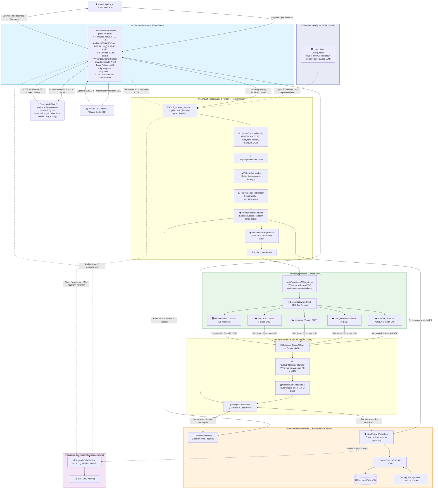
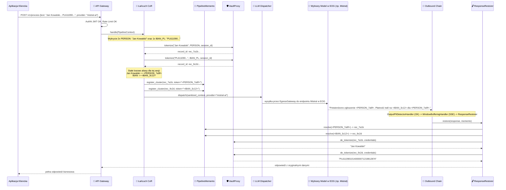
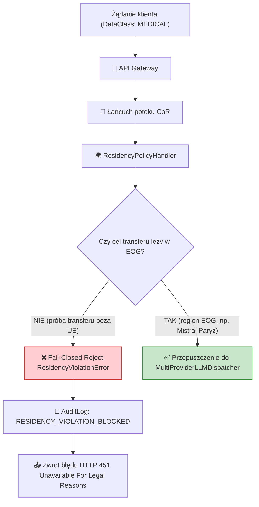
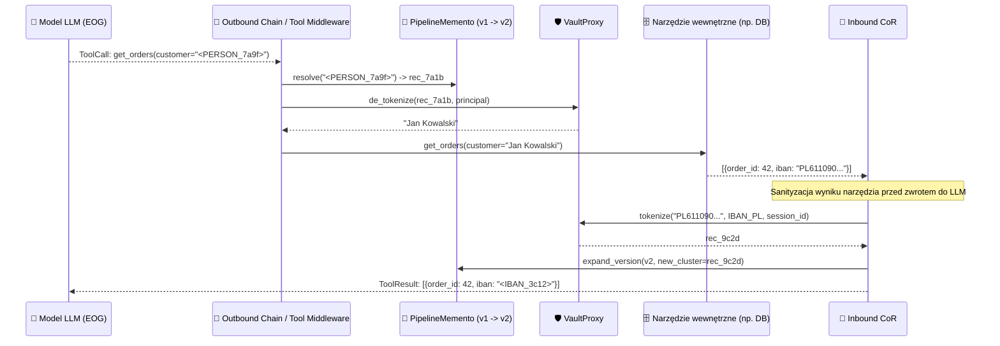

# Privacy-Preserving Context Pipeline for LLMs — Analiza Architektury

> **Wersja:** 2.4 · **Data:** 2026-11-24  
> **Kontekst:** Projekt akademicki / badawczy — dogłębna analiza wzorców projektowych, bezpieczeństwa, integracji wielomodelowej (Multi-Provider Dispatcher) i zgodności regulacyjnej w Unii Europejskiej (GDPR, EU AI Act, eIDAS)

---

## Spis treści

1. [Cel i kontekst projektu](#1-cel-i-kontekst-projektu)
2. [Widok wysokiego poziomu](#2-widok-wysokiego-poziomu)
3. [Wzorce projektowe i ich zastosowanie](#3-wzorce-projektowe-i-ich-zastosowanie)
   - 3.1 [Chain of Responsibility — W pełni konfigurowalny łańcuch przetwarzania](#31-chain-of-responsibility--w-pełni-konfigurowalny-łańcuch-przetwarzania)
   - 3.2 [Strategy (detektory UE, algorytmy anonimizacji, ekstrakcja dokumentów)](#32-strategy)
   - 3.3 [Builder i Dynamic CoR Factory (walidacja niezmienników i polityka Fail-Closed)](#33-builder)
   - 3.4 [API Gateway na brzegu oraz Protection Proxy w Vault (eliminacja zbędnego proxy)](#34-api-gateway-na-brzegu-oraz-protection-proxy-w-vault)
   - 3.5 [Memento i Outbound Chain (losowe aliasy per sesja, SSE streaming)](#35-memento)
   - 3.6 [Wielomodelowa integracja (Multi-Provider Dispatcher) i elastyczny wybór providera LLM](#36-wielomodelowa-integracja-multi-provider-dispatcher-i-elastyczny-wybór-providera-llm)
4. [Komponenty systemu](#4-komponenty-systemu)
5. [Scenariusze użycia — szczegółowa analiza](#5-scenariusze-użycia)
   - 5.1 [Pseudonimizacja sesyjna (happy path)](#51-pseudonimizacja-sesyjna--happy-path)
   - 5.2 [Nieautoryzowana de-tokenizacja — natychmiastowe odrzucenie](#52-nieautoryzowana-de-tokenizacja--natychmiastowe-odrzucenie)
   - 5.3 [Residency danych w EOG — blokada i odrzucenie zapytania](#53-residency-danych-w-eog--blokada-i-odrzucenie-zapytania)
   - 5.4 [Re-identyfikacja — k-anonimowość z danymi publicznymi (GUS, Eurostat)](#54-re-identyfikacja--k-anonimowość-z-danymi-publicznymi-gus-eurostat)
   - 5.5 [Rotacja kluczy kryptograficznych](#55-rotacja-kluczy-kryptograficznych)
   - 5.6 [Anonymized Agentic Tool Calling (Scenariusz odpytania bazy danych)](#56-anonymized-agentic-tool-calling-scenariusz-odpytania-bazy-danych)
   - 5.7 [Tryby integracji: „Połącz LLM” i „Połącz Agenta”](#57-tryby-integracji-połącz-llm-i-połącz-agenta)
6. [Model bezpieczeństwa i przetwarzania danych w Unii Europejskiej](#6-model-bezpieczeństwa-i-przetwarzania-danych-w-unii-europejskiej)
   - 6.1 [Wieloformatowa ekstrakcja dokumentów (Extract-Then-Anonymize)](#61-wieloformatowa-ekstrakcja-dokumentów-extract-then-anonymize)
   - 6.2 [Wykrywanie PII/PHI specyficznych dla Polski i Unii Europejskiej](#62-wykrywanie-piiphi-specyficznych-dla-polski-i-unii-europejskiej)
   - 6.3 [Polityka Fail-Closed — Bezwarunkowe odrzucenie zapytania w razie problemu](#63-polityka-fail-closed--bezwarunkowe-odrzucenie-zapytania-w-razie-problemu)
   - 6.4 [GDPR i EU AI Act](#64-gdpr-i-eu-ai-act)
   - 6.5 [Zarządzanie kluczami i kryptografia](#65-zarządzanie-kluczami-i-kryptografia)
   - 6.6 [Szacowanie k-anonimowości w oparciu o bazy GUS i Eurostat (Offline Baseline)](#66-szacowanie-k-anonimowości-w-oparciu-o-bazy-gus-i-eurostat-offline-baseline)
   - 6.7 [Data residency w EOG — model decyzyjny](#67-data-residency-w-eog--model-decyzyjny)
   - 6.8 [Audyt kryptograficzny i WORM](#68-audyt-kryptograficzny-i-worm)
7. [Architektura fizyczna i wdrożeniowa](#7-architektura-fizyczna-i-wdrożeniowa)
   - 7.1 [Strefy bezpieczeństwa sieciowego (Zero Trust Network Architecture)](#71-strefy-bezpieczeństwa-sieciowego)
   - 7.2 [Diagram architektury fizycznej (Deployment Topology)](#72-diagram-architektury-fizycznej)
   - 7.3 [Izolacja procesowa i sandboxing parserów](#73-izolacja-procesowa-i-sandboxing-parserów)
   - 7.4 [Macierz komunikacji sieciowej (porty i protokoły)](#74-macierz-komunikacji-sieciowej-porty-i-protokoły)
   - 7.5 [Wysoka dostępność (HA) i zachowanie Fail-Closed przy awarii](#75-wysoka-dostępność-ha-i-zachowanie-fail-closed-przy-awarii)
8. [Decyzje architektoniczne (ADR)](#8-decyzje-architektoniczne-adr)
9. [Ryzyka i otwarte pytania](#9-ryzyka-i-otwarte-pytania)

---

## 1. Cel i kontekst projektu

Celem systemu jest stworzenie **bezpiecznej, w pełni konfigurowalnej przez użytkownika warstwy pośredniej (Security & Privacy Middleware)** operującej w reżimie prawnym **Unii Europejskiej (RODO / GDPR, EU AI Act, eIDAS)** między środowiskami klienckimi (aplikacje biznesowe, agenci programistyczni, skrypty, potoki ETL) a zewnętrznymi lub lokalnymi modelami językowymi (LLM), która:

- **przyjmuje ruch na brzegu sieci wyłącznie przez API Gateway**, realizujący uwierzytelnienie (mTLS, JWT), autoryzację (RBAC/ABAC), inspekcję, rate limiting oraz bezpośrednią adaptację protokołów zewnętrznych (eliminując jakiekolwiek zbędne proxy wejściowe),
- **realizuje elastyczny wybór docelowego providera LLM (Multi-Provider Dispatcher)** — system nie narzuca sztywno żadnego pojedynczego dostawcy modelu; klient w prostych trybach **`Połącz LLM`** oraz **`Połącz Agenta`** wskazuje, z jakim providerem w EOG chce się komunikować (np. Google Gemini w Vertex AI EOG, ChatGPT / Azure OpenAI EU, Anthropic Claude EOG, Mistral AI w Paryżu, czy lokalne instancje vLLM/Ollama on-premise),
- **udostępnia uniwersalne interfejsy API (w tym adaptery dla narzędzi deweloperskich)** — transparentnie obsługuje aplikacje webowe, biblioteki OpenAI/Anthropic SDK oraz agentów CLI (takich jak Claude Code) bez modyfikacji ich kodu,
- **bezwzględnie odrzuca zapytanie w razie wykrycia problemu (Polityka Fail-Closed)** — każde naruszenie reguł rezydencji danych, błąd parsowania nieobsługiwanego formatu, przekroczenie progu ryzyka re-identyfikacji czy błąd integralności skutkuje natychmiastowym przerwaniem potoku z kodem błędu HTTP i rejestracją w audycie (zero wycieku, zero zgadywania),
- **umożliwia użytkownikom dynamiczną konfigurację filtrów i detektorów w oparciu o Chain of Responsibility budowany przez Builder** — użytkownik decyduje o zestawie aktywnych filtrów, progach i strategiach, a `PipelineBuilder` waliduje nienaruszalność reguł bezpieczeństwa (Privacy by Design),
- **wykrywa dane osobowe i identyfikatory obowiązujące w Polsce i UE** (PESEL, NIP, REGON, dowody osobiste, paszporty UE, unijne numery IBAN z walidacją Modulo-97, numery VAT-UE/TIN, karty EKUZ/EHIC, polskie i europejskie dane medyczne) z całkowitym pominięciem obcych formatów pozaeuropejskich,
- **bezpiecznie ekstrahuje treść z szerokiego wachlarza formatów plików** (PDF, DOCX, XLSX, CSV, obrazy ze skanami via kontrolowany OCR, archiwa) w trybie *Extract-Then-Anonymize*, uniemożliwiając wyciek surowych binariów do LLM,
- **pseudonimizuje dane za pomocą losowych aliasów per sesja** — w obrębie jednej aktywnej sesji obowiązuje jeden stały, niesekwencyjny zestaw losowych tokenów (np. `<PERSON_7a9f>`), zapewniając spójność kontekstu LLM bez narzutu re-tokenizacji, a po zamknięciu i ponownym otwarciu aplikacji (lub zmianie providera) generowany jest zupełnie nowy zestaw tokenów dzięki wzorcowi Memento,
- **analizuje ryzyko re-identyfikacji (k-anonimowość)** z wykorzystaniem zintegrowanych lokalnie, zindeksowanych rejestrów danych publicznych (GUS, Eurostat) w trybie *Zero-Network-Call Runtime*,
- **gwarantuje separację kryptograficzną i niezmienny audyt (Protection Proxy w Vault)** z wykorzystaniem AES-256-GCM, rotacji kluczy w KMS i logu WORM.

System gwarantuje, że dane podlegające RODO nie opuszczą Europejskiego Obszaru Gospodarczego (EOG).

---

## 2. Widok wysokiego poziomu

Architektura systemu rozdziela wejście brzegowe (API Gateway), konfigurowalny łańcuch CoR, dyspozytora modeli w EOG oraz enklawę kryptograficzną z VaultProxy:



---

## 3. Wzorce projektowe i ich zastosowanie

### 3.1 Chain of Responsibility — W pełni konfigurowalny łańcuch przetwarzania

#### Istota wzorca w systemie
Wzorzec **Chain of Responsibility (CoR)** jest jedynym wzorcem sterującym przepływem przetwarzania żądania. Każdy krok w potoku jest reprezentowany przez autonomiczny obiekt `FilterHandler`. Ogniwa nie komunikują się przez żadne pośrednie "rury" ani kolejki — przetwarzanie zachodzi synchronicznie w pamięci RAM poprzez przekazywanie niemutowalnego obiektu `PipelineContext`.

Każde ogniwo obecne w zbudowanym łańcuchu:
1. **Wykonuje operację domenową:** Wykrywa PII, ekstrahuje dokument, ocenia k-anonimowość lub tokenizuje dane (w łańcuchu znajdują się wyłącznie ogniwa aktywne dla danej konfiguracji).
2. **Realizuje natychmiastowe odrzucenie zapytania (Fail-Closed Short-Circuit):** Jeśli wystąpi jakiekolwiek naruszenie reguły bezpieczeństwa (np. wykrycie skanu bez OCR, próba transferu danych poza EOG, błąd integralności), ogniwo **natychmiast rzuca wyjątek domenowy**, zatrzymując cały łańcuch.
3. **Deleguje do następnika:** W przypadku pomyślnego wykonania krok przekazuje zaktualizowany `PipelineContext` do `self._pass_to_next(updated_context)` (wywołującego `self._next_handler.handle(updated_context)`).

```python
class FilterHandler(Protocol):
    def set_next(self, handler: FilterHandler) -> FilterHandler: ...
    def handle(self, context: PipelineContext) -> PipelineContext: ...

class BaseFilterHandler(ABC):
    def __init__(self) -> None:
        self._next_handler: FilterHandler | None = None

    def set_next(self, handler: FilterHandler) -> FilterHandler:
        self._next_handler = handler
        return handler

    def handle(self, context: PipelineContext) -> PipelineContext:
        # Wykonanie logiki ogniwa z możliwością rzucenia błędu Fail-Closed
        updated_context = self._process(context)
        return self._pass_to_next(updated_context)

    def _pass_to_next(self, context: PipelineContext) -> PipelineContext:
        if self._next_handler is not None:
            return self._next_handler.handle(context)
        return context

    @abstractmethod
    def _process(self, context: PipelineContext) -> PipelineContext:
        """Logika konkretnego filtra. W razie problemu rzuca wyjątek przerywający łańcuch."""
        pass
```

---

### 3.2 Strategy

**Rola:** Wymienne algorytmy dobierane dynamicznie na podstawie konfiguracji użytkownika (zgodność z zasadą Open-Closed — dodanie nowej strategii nie wymaga modyfikacji ogniw CoR):
1. **Detektory PII/PHI dla UE (`PIIDetector`):** `RegexPIIDetector` (dla PESEL, NIP, REGON, dowodów osobistych, paszportów, unijnych IBAN Modulo-97, VAT-UE/TIN, kart EKUZ, kart płatniczych Luhn), `TransformerNERDetector` (HerBERT, RoBERTa/GLiNER), `ContextRuleEnhancer`.
2. **Strategie ochrony (`AnonymizationStrategy`):** `TokenizationStrategy` (odwracalna, powiązana z `VaultProxy`), `MaskingStrategy` (nieodwracalna), `GeneralizationStrategy` (uogólnianie cech w oparciu o `PublicDataDemographicsProvider` — bazy GUS/Eurostat), `SynthesisStrategy` (podstawianie realistycznych danych syntetycznych). Dobór strategii realizuje `StrategySelector`.
3. **Ekstrakcja dokumentów (`DocumentExtractorStrategy`):** Dedykowane silniki parsowania dla PDF, DOCX, XLSX/ODS, wszystkich formatów tekstowych (TXT/MD, CSV/TSV, JSON/JSONL, XML/HTML/SVG, YAML/TOML/INI/ENV, kod źródłowy, logi i dowolne `text/*`), obrazów (OCR) oraz archiwów, wywoływane przez `DocumentExtractorHandler`.
4. **Adaptery modeli LLM (`LLMProviderAdapter`):** Wymienne strategie komunikacji z API wybranego dostawcy (Google Gemini Vertex AI EOG, ChatGPT / Azure OpenAI EU, Mistral AI, Anthropic Claude EOG, vLLM/Ollama), wywoływane przez `MultiProviderLLMDispatcher`.

```python
class PIIDetector(Protocol):
    def detect(self, text: str, language: str) -> Sequence[DetectedEntity]: ...

class AnonymizationStrategy(Protocol):
    def anonymize(self, entity: DetectedEntity, request: AnonymizationRequest) -> AnonymizationResult: ...
    def can_reverse(self) -> bool: ...

class DocumentExtractorStrategy(Protocol):
    def supports(self, mime_type: str) -> bool: ...
    def extract(self, attachment: DocumentAttachment) -> ExtractedDocument: ...

class LLMProviderAdapter(Protocol):
    @property
    def endpoint_metadata(self) -> EndpointMetadata: ...
    def invoke(self, sanitized_prompt: str, params: dict[str, Any]) -> LLMResponse: ...
```

---

### 3.3 Builder

**Rola:** Składanie łańcucha ogniw z konfiguracji użytkownika (`UserPipelineConfig`) za pośrednictwem `DynamicCoRFactory` i `PipelineBuilder` oraz **bezwzględna walidacja niezmienników i polityki Fail-Closed**:
- **Budowa powiązań:** `PipelineBuilder` łączy zarejestrowane instancje `FilterHandler` za pomocą `set_next()`, zwracając głowę łańcucha (`head`).
- **Weryfikacja Privacy by Design:** `PipelineBuilder` zakłada, że w łańcuchu znajdują się wyłącznie wybrane przez użytkownika ogniwa, i weryfikuje ich obecność oraz kolejność. Dla `DataClass.MEDICAL` ogniwa `AnonymizationHandler`, `ResidencyPolicyHandler` oraz `AuditContextHandler` (z zakazem `AuditLevel.NONE`) są obowiązkowe — próba zbudowania łańcucha bez nich kończy się błędem `PipelineConfigurationError`.
- **Wymóg kolejności logicznej:** `PIIDetectorHandler` musi poprzedzać `AnonymizationHandler`, a `ResidencyPolicyHandler` musi znajdować się po anonimizacji (tuż przed `AuditContextHandler` i wyjściem do modelu).
- **Stały zestaw do momentu zmiany ustawień (`DynamicCoRFactory`):** Fabryka odczytuje deklaratywny profil `UserPipelineConfig`, dodaje do `PipelineBuilder` **wyłącznie skonfigurowane ogniwa** (bez wyłączonych „pustych” kroków) i zwraca gotowy, bezstanowy łańcuch. Zbudowany łańcuch pozostaje **stały (cache'owany per profil/tenant)** przez wszystkie kolejne żądania aż do momentu, gdy użytkownik wprowadzi zmianę w ustawieniach aplikacji — dopiero wtedy `DynamicCoRFactory` i `PipelineBuilder` przebudowują oraz ponownie walidują nowy łańcuch.

```python
class UserPipelineConfig(BaseModel):
    model_config = ConfigDict(frozen=True, extra="forbid")
    data_class: DataClass
    enabled_handlers: tuple[str, ...]
    enabled_detectors: tuple[str, ...]
    k_anonymity_min: int = 5
    pdf_extraction_policy: PDFExtractionPolicy = PDFExtractionPolicy.STRICT_NO_OCR
    audit_level: AuditLevel = AuditLevel.FULL
    target_provider: str = "mistral-ai"

class PipelineBuilder:
    def __init__(self) -> None:
        self._handlers: list[FilterHandler] = []
        self._data_class: DataClass = DataClass.GENERAL
        self._audit_level: AuditLevel = AuditLevel.FULL
        self._requires_vault: bool = False
        self._vault_proxy: TokenizationVault | None = None
        self._response_restorer: ResponseRestorer | None = None
        self._has_active_detector: bool = False
        self._has_active_anonymizer: bool = False
        self._has_active_residency: bool = False
        self._has_active_audit: bool = False

    def for_data_class(self, data_class: DataClass) -> Self:
        self._data_class = data_class
        return self

    def with_audit_level(self, audit_level: AuditLevel) -> Self:
        self._audit_level = audit_level
        return self

    def with_reversible_tokenization(
        self,
        vault_proxy: TokenizationVault | None,
        response_restorer: ResponseRestorer | None,
    ) -> Self:
        self._requires_vault = True
        self._vault_proxy = vault_proxy
        self._response_restorer = response_restorer
        return self

    def add_handler(self, handler: FilterHandler) -> Self:
        if isinstance(handler, PIIDetectorHandler):
            self._has_active_detector = True
        elif isinstance(handler, AnonymizationHandler):
            if not self._has_active_detector:
                raise PipelineConfigurationError("PIIDetectorHandler musi poprzedzać AnonymizationHandler.")
            self._has_active_anonymizer = True
        elif isinstance(handler, ResidencyPolicyHandler):
            if not self._has_active_anonymizer:
                raise PipelineConfigurationError("ResidencyPolicyHandler musi występować po AnonymizationHandler.")
            self._has_active_residency = True
        elif isinstance(handler, AuditContextHandler):
            self._has_active_audit = True
        self._handlers.append(handler)
        return self

    def build(self) -> FilterHandler:
        if not self._handlers:
            raise PipelineConfigurationError("Łańcuch musi zawierać co najmniej jedno ogniwo.")
        if self._requires_vault and (self._vault_proxy is None or self._response_restorer is None):
            raise PipelineConfigurationError("Odwracalna tokenizacja wymaga podpięcia VaultProxy oraz ResponseRestorer.")
        if self._data_class == DataClass.MEDICAL:
            if self._audit_level == AuditLevel.NONE:
                raise PipelineConfigurationError("Dla danych medycznych (PHI) AuditLevel.NONE jest zabroniony.")
            if not self._has_active_anonymizer:
                raise PipelineConfigurationError("Dla danych medycznych (PHI) aktywny AnonymizationHandler jest obowiązkowy.")
            if not self._has_active_residency:
                raise PipelineConfigurationError("Dla danych medycznych (PHI) aktywny ResidencyPolicyHandler jest obowiązkowy.")
            if not self._has_active_audit:
                raise PipelineConfigurationError("Dla danych medycznych (PHI) aktywny AuditContextHandler jest obowiązkowy.")

        for i in range(len(self._handlers) - 1):
            self._handlers[i].set_next(self._handlers[i + 1])
        return self._handlers[0]
```

---

### 3.4 API Gateway na brzegu oraz Protection Proxy w Vault

#### Zasada: Na wejściu wyłącznie API Gateway, Proxy wyłącznie w Vault
1. **Brzeg sieci (Zero Proxy on Ingress):**
   - Na brzegu sieci działa wyłącznie **`APIGateway`**.
   - API Gateway jest centralnym punktem styku: przyjmuje żądania klientów, terminując połączenia TLS, weryfikuje tożsamość użytkownika (AuthN) i uprawnienia (AuthZ), egzekwuje limity zapytań (Rate Limiting) oraz udostępnia uniwersalne kontrolery API (w tym adaptery dla formatów Anthropic i OpenAI).
   - Nie występuje żadne osobne proxy wejściowe — ruch od razu z API Gateway trafia do łańcucha CoR w zaufanej strefie.
2. **Warstwa kryptograficzna (Protection Proxy):**
   - Jedynym miejscem występowania wzorca Proxy (GoF) w całym systemie jest **`VaultProxy`**.
   - `VaultProxy` działa jako **Protection Proxy** dla modułu `VaultCore` przechowującego klucze szyfrowania AES-256-GCM.
   - Żaden komponent potoku nie ma bezpośredniego dostępu do bazy `TokenDB` ani `VaultCore`. Dostęp wymaga przejścia przez `VaultProxy`, który weryfikuje tożsamość sesji (`SecurityPrincipal`), sprawdza uprawnienia i wymusza zapis zdarzenia w audycie WORM.

---

### 3.5 Memento

#### Rola wzorca
`PipelineMemento` odpowiada za zachowanie stanu sesji i mapowań tokenów bez ujawniania danych jawnych. 

#### Rotacja zestawu tokenów per sesja (Session-Scoped Token Set)
Aby połączyć pełną wydajność rozmowy z ochroną przed analizą frekwencyjną i korelacją między sesjami:
- **Jeden stały, losowy zestaw na czas trwania sesji:** W obrębie jednej aktywnej sesji (i tego samego wybranego providera) dana encja PII otrzymuje przypisany kryptograficznie losowy, niesekwencyjny alias (np. `<PERSON_7a9f>` zamiast `<PERSON_1>`). Eliminuje to koszt przeliczania całej historii przy każdej kolejnej turze czatu (0 ms narzutu re-tokenizacji w trakcie rozmowy) oraz zapewnia pełną spójność kontekstu dla LLM.
- **Nowy zestaw po zamknięciu aplikacji i ponownym otwarciu:** Zamknięcie aplikacji / wylogowanie / kliknięcie „Nowa rozmowa” kończy bieżącą sesję. Po ponownym uruchomieniu aplikacji otwierana jest nowa sesja (`session_id`), dla której `AnonymizationHandler` i `PipelineMemento` generują **zupełnie nowy, niepowiązany zestaw losowych tokenów** (np. ta sama osoba w nowej sesji otrzymuje `<PERSON_4b1c>`). Uniemożliwia to zewnętrznym dostawcom LLM łączenie logów między sesjami.
- **Zmiana providera w trakcie sesji:** Jeśli użytkownik przełączy docelowego providera w środku rozmowy, nowy provider otrzymuje świeżą permutację tokenów, dzięki czemu różni dostawcy nie mogą skorelować swoich logów.

#### Struktura stanu w `PipelineMemento` i Outbound Chain
1. Każda unikalna wykryta encja w sesji otrzymuje **jeden stały w ramach tej sesji, losowy alias niesekwencyjny** (np. `<PERSON_7a9f>`, `<IBAN_3c12>`), co gwarantuje pełną spójność semantyczną rozmowy bez wstrzykiwania dodatkowych reguł koreferencji do promptu.
2. `PipelineMemento` przechowuje niemutowalny rejestr klastrów `EntityCluster` wraz z metadanymi wystąpień `EntityOccurrence` (bez jakichkolwiek danych jawnych PII):
   ```python
   class EntityOccurrence(BaseModel):
       model_config = ConfigDict(frozen=True, extra="forbid")
       session_token: str       # np. "<PERSON_7a9f>" (stały w sesji, nowy po restarcie)
       start_offset: int
       end_offset: int

   class EntityCluster(BaseModel):
       model_config = ConfigDict(frozen=True, extra="forbid")
       cluster_id: UUID
       entity_type: EntityType
       session_token: str       # np. "<PERSON_7a9f>"
       vault_record_id: UUID    # Identyfikator w VaultCore (brak jawnego PII)
       occurrences: tuple[EntityOccurrence, ...]
   ```
3. **Łańcuch rekonstrukcji (Outbound Chain) i streaming SSE (ADR-006):**
   Odpowiedź modelu (pełna lub strumieniowana przez SSE) przechodzi przez trzy ogniwa `Outbound Chain`:
   - **`OutputPIIDetectorHandler`:** Skanuje odpowiedź LLM przed rekonstrukcją w poszukiwaniu nieoczekiwanych lub halucynowanych surowych danych osobowych (np. wycieku danych treningowych). W zależności od polityki maskuje je lub przerywa odpowiedź z wpisem audytowym.
   - **`WindowBufferingHandler`:** W trybie streamingu SSE buforuje wyłącznie krótkie okno tekstowe od napotkania znaku `<` do zamykającego `>` (z limitem długości okna i timeoutem), dzięki czemu tokeny podzielone między ramkami SSE (np. `"<PERSON_"` + `"7a9f>"`) są rekonstruowane atomowo bez zrywania płynności strumienia.
   - **`ResponseRestorer`:** Odnajduje alias w `PipelineMemento`, wywołuje autoryzowaną de-tokenizację w `VaultProxy` i wstawia oryginalną wartość do odpowiedzi przekazywanej do `APIGateway`. Po zamknięciu sesji lub upływie TTL `RetentionPolicyEngine` i `RetentionWorker` usuwają wygasłe migawki Memento oraz rekordy w `TokenDB`.

---

### 3.6 Wielomodelowa integracja (Multi-Provider Dispatcher) i elastyczny wybór providera LLM

System **nie narzuca na sztywno żadnego pojedynczego modelu ani providera** i udostępnia dwa przejrzyste tryby integracji (**`Połącz LLM`** oraz **`Połącz Agenta`**):

1. **Dwie główne metody połączenia po stronie klienta:**
   - **Metoda 1 — `Połącz LLM` (prosty czat / zapytanie z opcjonalnym plikiem):** dla użytkowników `Web Chat` oraz aplikacji wysyłających pojedyncze prompty i dokumenty (PDF, DOCX, XLSX, CSV, TXT…). Cykl: *1 zapytanie → anonimizacja → LLM → odtworzenie odpowiedzi (lub strumień SSE)*.
   - **Metoda 2 — `Połącz Agenta` (wielokrokowa praca z narzędziami):** dla zewnętrznych agentów (`Claude Code CLI`, `Cursor`, `LangChain`) oraz agentów korzystających z narzędzi wewnętrznych (`ToolExecutionMiddleware`). Oprócz tekstu obsługiwany jest cały cykl **`tools` ↔ `tool_calls` / `tool_use` ↔ `tool_result`** z aktualizacją stanu w `PipelineMemento`.
2. **Kaskada wyboru providera przez API (3 poziomy priorytetu):**
   Klient wysyłający żądanie do `APIGateway` może wskazać docelowego providera w jeden z trzech sposobów (rozwiązywanych w kolejności priorytetów):
   - **Priorytet 1 — Jawny nagłówek lub pole JSON:** nagłówek HTTP `X-Target-Provider: gemini-eu` (lub `azure-openai`, `anthropic-eu`, `mistral-ai`, `vllm-local`) albo pole w JSON: `{"model": "gemini-2.5-pro", "provider": "gemini-eu"}`.
   - **Priorytet 2 — Prefiks w nazwie modelu (`provider/model`):** np. `"model": "gemini-eu/gemini-2.5-pro"`, `"model": "azure-openai/gpt-4o"`, `"model": "mistral-ai/mistral-large-2407"` lub `"model": "vllm-local/bielik-11b"` — `APIGateway` automatycznie rozbija prefiks na docelowego providera i nazwę modelu. Dzięki temu gotowe narzędzia CLI i IDE (Claude Code, Cursor, LangChain, OpenAI/Anthropic SDK) mogą przełączać providera bez wstrzykiwania niestandardowych nagłówków HTTP.
   - **Priorytet 3 — Profil przypisany do klucza API (`UserPipelineConfig`):** domyślny provider zapisany w konfiguracji tenanta/klucza API (z możliwością dynamicznego przełączenia w trakcie sesji przez endpoint konfiguracyjny profilu).
3. **Uniwersalne kontrolery w API Gateway i translacja protokołów (w tym `tool_calls`):**
   - **Natywny endpoint `/v1/process`:** dla aplikacji korporacyjnych przekazujących ustrukturyzowane konteksty biznesowe, załączniki i `ToolCall`.
   - **Endpoint `/v1/chat/completions`:** zgodny ze standardem OpenAI (`messages`, `tools`, `tool_calls`, SSE `choices[].delta`) — umożliwia podpięcie bibliotek `openai-python`, LangChain, LlamaIndex.
   - **Endpoint `/v1/messages`:** zgodny ze standardem Anthropic (`messages`, `tools`, `tool_use`, `tool_result`, SSE `content_block_delta`) — umożliwia bezproblemowe podpięcie narzędzi takich jak **Claude Code CLI** czy wtyczek IDE.
   - **Kanoniczny format wewnętrzny:** `APIGateway` mapuje format wejściowy na ustandaryzowany, niezależny od dostawcy model w `PipelineContext` (obejmujący wiadomości, definicje `tools`, wywołania `tool_calls`/`tool_use` oraz wyniki `tool_result`). Gdy protokół klienta różni się od docelowego providera (np. Claude Code na `/v1/messages` kierowany do `gemini-eu` lub `mistral-ai`), `MultiProviderLLMDispatcher` wykonuje pełną translację dwukierunkową (w tym argumentów `tool_calls` ↔ `tool_use` oraz ramek strumienia SSE).
4. **Multi-Provider Dispatcher (`MultiProviderLLMDispatcher`):**
   Po przejściu łańcucha CoR i weryfikacji rezydencji danych (`ResidencyPolicyHandler`), moduł `MultiProviderLLMDispatcher` dobiera właściwy `LLMProviderAdapter`, dopina firmowy klucz API z `KMS` i kieruje zanonimizowany kontekst przez `EgressGateway` do wybranego docelowego providera działającego w EOG:
   - **Google Gemini (Vertex AI EOG — Warszawa `europe-central2` / Frankfurt `europe-west3`):** Wywołanie modeli Gemini w ramach europejskich regionów Google Cloud.
   - **ChatGPT / Azure OpenAI (Frankfurt / Dublin / EOG):** Wywołanie modeli GPT w ramach dedykowanych europejskich subskrypcji korporacyjnych.
   - **Anthropic Claude (Region EOG):** Wywołanie modeli Claude hostowanych w strefie EOG (np. przez AWS Bedrock w regionie Frankfurt/Paryż lub Vertex AI EU).
   - **Mistral AI (Paryż / EOG):** Bezpośrednie wywołanie API modeli europejskich.
   - **Lokalne instancje vLLM / Ollama:** Wywołanie modeli open-weight (np. Bielik, Llama 3) działających w infrastrukturze własnej (on-premise).
5. **Najprostsze połączenie dla użytkownika nietechnicznego (Zero-Config Web/Desktop Chat UI):**
   Użytkownicy biznesowi (prawnicy, lekarze, księgowi) nie muszą konfigurować zmiennych środowiskowych, własnych kluczy API dostawców ani nagłówków HTTP. Aplikacja kliencka (Web Chat / lekka aplikacja desktopowa) łączy się bezpośrednio z `APIGateway` przez firmowe **SSO** i oferuje:
   - **Wybór modelu z czytelnej listy (Dropdown):** nazwy zrozumiałe biznesowo (np. *„Google Gemini (Warszawa / EOG)”*, *„ChatGPT / GPT-4o (Azure Frankfurt)”*, *„Claude (EOG)”*, *„Mistral AI (Paryż / EOG)”*, *„Model lokalny (On-Premise)”*), mapowane pod spodem na odpowiedniego providera w `APIGateway`.
   - **Drag & Drop dla dokumentów:** przeciągnięcie pliku (PDF, DOCX, XLSX, CSV, TXT) automatycznie kieruje go przez potok *Extract-Then-Anonymize*.
   - **Izolacja sesji („Zamknij i otwórz = nowy zestaw tokenów”):** każda nowa rozmowa oraz ponowne uruchomienie aplikacji tworzy świeżą sesję ze zmienionym zestawem losowych tokenów, bez żadnej ingerencji użytkownika.
   - **Opcjonalny podgląd „Co widzi AI”:** przejrzysty podgląd zanonimizowanego tekstu przed wysyłką, budujący zaufanie do narzędzia.

---

## 4. Komponenty systemu

| Warstwa | Komponent | Odpowiedzialność | Wzorzec |
|---|---|---|---|
| **Edge** | `APIGateway` | Pojedynczy punkt wejścia na brzegu; terminacja TLS, AuthN/AuthZ, rate limiting, uniwersalne kontrolery API (`/v1/process`, `/v1/messages`, `/v1/chat/completions`) | Gateway / Adapter |
| **Config** | `UserPipelineConfig` | Deklaratywny profil konfiguracyjny filtrów, detektorów, progów i wybranego providera LLM | Configuration Model |
| **Config** | `DynamicCoRFactory` | Dynamiczne mapowanie profilu `UserPipelineConfig` na wywołania `PipelineBuilder` w czasie uruchomienia | Factory |
| **Pipeline (In)** | `BaseFilterHandler` | Klasa bazowa ogniw łańcucha z metodą `handle()`, referencją `_next_handler` i polityką Fail-Closed | Chain of Responsibility |
| **Pipeline (In)** | `PipelineBuilder` | Budowanie łańcucha z konfiguracji, spięcie referencji i walidacja niezmienników Privacy by Design | Builder |
| **Pipeline (In)** | `DocumentExtractorHandler` | Ekstrakcja tekstu z PDF, DOCX, XLSX/ODS, wszystkich formatów tekstowych (TXT/MD, CSV/TSV, JSON/JSONL, XML/HTML, YAML/TOML/INI, kod/logi), obrazów (OCR) i archiwów w piaskownicy przez `DocumentExtractorStrategy` | CoR Handler + Strategy |
| **Pipeline (In)** | `LanguageDetectorHandler` | Rozpoznawanie języków europejskich (PL, EN, DE, FR...) | CoR Handler |
| **Pipeline (In)** | `PIIDetectorHandler` | Hybrydowy detektor danych osobowych specyficznych dla Polski i UE (`PIIDetector`) | CoR Handler + Strategy |
| **Pipeline (In)** | `RiskAssessmentHandler` | Szacowanie ryzyka re-identyfikacji i k-anonimowości w oparciu o `PublicDataDemographicsProvider` | CoR Handler |
| **Pipeline (In)** | `AnonymizationHandler` | Dobór strategii anonimizacji (`StrategySelector`), tokenizacja losowymi aliasami per sesja | CoR Handler + Strategy |
| **Pipeline (In)** | `ResidencyPolicyHandler` | Weryfikacja zgodności z wymogiem przetwarzania w EOG za pomocą `ResidencyPolicyEngine` (Fail-Closed Gate) | CoR Handler (Gate) |
| **Pipeline (In)** | `AuditContextHandler` | Skompletowanie metadanych audytowych i zapis zdarzenia zakończenia potoku wejściowego przez `AuditWriter` | CoR Handler |
| **Pipeline (Out)** | `OutputPIIDetectorHandler` | Skanowanie odpowiedzi LLM przed rekonstrukcją w poszukiwaniu nieoczekiwanych wycieków PII | CoR Handler |
| **Pipeline (Out)** | `WindowBufferingHandler` | Buforowanie okien `<...>` w strumieniu SSE w celu atomowej de-tokenizacji placeholderów | Streaming CoR Handler |
| **Pipeline (Out)** | `ResponseRestorer` | Przywracanie oryginalnych wartości w odpowiedzi lub strumieniu SSE (w tym w argumentach `tool_calls` / `tool_use`) z użyciem `PipelineMemento` i `VaultProxy` | CoR Handler / Restorer |
| **Agent / Tools** | `ToolExecutionMiddleware` | Przechwytywanie wewnętrznych wywołań `ToolCall`, autoryzowana de-tokenizacja argumentów w zaufanej strefie, wykonanie narzędzia i natychmiastowa sanityzacja wyniku przez Inbound CoR (*Dynamic Memento Expansion*) | Middleware / Interceptor |
| **Dispatcher** | `MultiProviderLLMDispatcher` | Kierowanie zanonimizowanego promptu do wybranego przez klienta providera w EOG przez `LLMProviderAdapter` | Dispatcher / Strategy |
| **Egress** | `EgressGateway` | Infrastrukturalna brama wyjściowa (*Defense-in-Depth*): twarda allowlista domen i Geo-IP EOG fizycznie blokująca ruch poza EOG nawet w razie błędu konfiguracji aplikacji | Egress Gate |
| **State** | `PipelineMemento` | Niemutowalny stan sesji, rejestr klastrów koreferencyjnych (`EntityCluster`, `EntityOccurrence`) | Memento |
| **State** | `RetentionPolicyEngine` / `RetentionWorker` | Wyznaczanie TTL sesji (RODO art. 17) oraz okresowe usuwanie wygasłych migawek i rekordów `TokenDB` | Policy / Worker |
| **Vault** | `VaultProxy` | Jedyny wzorzec Proxy w systemie: kontrola dostępu (RBAC/ABAC), audyt WORM, rate-limit | Protection Proxy |
| **Vault** | `VaultCore` | Szyfrowanie/deszyfrowanie AES-256-GCM z AAD, zarządzanie rekordami `TokenRecord` | Cryptographic Module |
| **Vault** | `TokenDB` | Zaszyfrowana baza danych PostgreSQL przechowująca wyłącznie szyfrogramy `TokenRecord` | Encrypted Store |
| **KMS** | `InMemoryKMS` / `CloudKMS` | Zarządzanie hierarchią kluczy MK → KEK → DEK, obsługa rotacji i statusów kluczy | Key Management |
| **Policy** | `ResidencyPolicyEngine` | Silnik decyzyjny oceniający zgodność jurysdykcji docelowego endpointu LLM z wymogami EOG i polityką tenanta | Policy Engine (Protocol) |
| **Policy** | `PublicDataDemographicsProvider` | Zindeksowany lokalny magazyn statystyk demograficznych GUS i Eurostat (*Zero-Network-Call Runtime*) | Data Provider |
| **Compliance** | `AuditWriter` | Interfejs zapisu zdarzeń audytowych wstrzykiwany do handlerów CoR, `APIGateway` i `VaultProxy` (implementowany przez `AuditLog`) | Audit Interface (Protocol) |
| **Compliance** | `AuditLog` | Zapis zdarzeń w formacie WORM z kryptograficznym łańcuchem hashy SHA-256 | Append-Only Logger |
| **Compliance** | `SIEM` | Integracja z systemem SOC/SIEM dla alertów bezpieczeństwa w czasie rzeczywistym | Alerting / SIEM |

---

## 5. Scenariusze użycia

### 5.1 Pseudonimizacja sesyjna — happy path

**Wejście:** `"Jan Kowalski zgłosił awarię. Jan Kowalski prosi o kontakt pod numerem konta PL61109010140000071219812874."`



---

### 5.2 Nieautoryzowana de-tokenizacja — natychmiastowe odrzucenie

Próba wywołania de-tokenizacji przez nieuprawniony serwis lub z niepoprawnym tokenem sesji skutkuje natychmiastowym odrzuceniem przez `VaultProxy`:
1. `VaultProxy` sprawdza tożsamość i uprawnienia (`SecurityPrincipal`: uwierzytelnienie, rola RBAC/ABAC, zgodność `tenant_id` i `session_id` oraz ważność tokenu).
2. Przy braku roli lub niezgodności sesji generowany jest wpis `DETOKENIZE_DENIED` do `AuditLog`.
3. Zwracany jest natychmiastowy błąd **HTTP 403 Forbidden** (`UnauthorizedVaultAccessError`), bez ujawnienia jakichkolwiek szczegółów kryptograficznych.

---

### 5.3 Residency danych w EOG — blokada i odrzucenie zapytania

Wszelkie dane wrażliwe (medyczne PHI, finansowe, kod źródłowy) kierowane do modeli poza Europejskim Obszarem Gospodarczym są natychmiast odrzucane:



---

### 5.4 Re-identyfikacja — k-anonimowość z danymi publicznymi (GUS, Eurostat)

Gdy `RiskAssessmentHandler` wykryje kombinację quasi-identyfikatorów (np. wiek, unikalny zawód, mała miejscowość), odpytuje lokalny `PublicDataDemographicsProvider`. Jeśli liczność grupy $N_{pop} < k_{min}$ (np. $k < 5$):
- uruchamiana jest `GeneralizationStrategy` uogólniająca dane (miejscowość $\rightarrow$ powiat $\rightarrow$ województwo),
- jeśli uogólnienie nie pozwala osiągnąć $k \ge k_{min}$, zapytanie zostaje **odrzucone w trybie fail-closed** z błędem `ReIdentificationRiskError` (HTTP 422) i wpisem `RE_IDENTIFICATION_RISK_REJECT`.

---

### 5.5 Rotacja kluczy kryptograficznych

Zarządzanie cyklem życia kluczy KEK/DEK w `InMemoryKMS` / `CloudKMS` opiera się na jawnych statusach (`KeyStatus`) i strategiach rotacji (`RotationStrategy`):

1. **Cykl życia klucza (`KeyStatus`):**
   - `ACTIVE` — jedyny klucz używany do szyfrowania nowych rekordów `TokenRecord` i deszyfrowania istniejących.
   - `DEPRECATED` — klucz po rotacji; nie szyfruje nowych danych, ale pozostaje dostępny do deszyfrowania istniejących tokenów aż do upływu ich TTL.
   - `EXPIRED` — klucz, którego okres ważności minął; próba użycia rzuca `KeyExpiredError` i zapisuje `TOKEN_OR_KEY_EXPIRED` w `AuditLog`.
   - `REVOKED` — klucz natychmiastowo unieważniony (np. incydent bezpieczeństwa lub Crypto-Shredding RODO art. 17); każda próba deszyfrowania jest blokowana (`KeyExpiredError`).
2. **Strategie rotacji (`RotationStrategy`):**
   - `RETAIN_OLD_KEY` (domyślna dla krótkich sesji) — generowany jest nowy `key_id` (`ACTIVE`), stary przechodzi w `DEPRECATED` i wygasa po zakończeniu aktywnych sesji.
   - `RE_ENCRYPT` (dla danych długotrwałych) — worker re-szyfruje aktywne `TokenRecord` nowym kluczem `ACTIVE`, po czym stary klucz przechodzi w `EXPIRED`.
   - `EXPIRE` (Crypto-Shredding) — natychmiastowe przejście starego klucza w `REVOKED`, czyniące zaszyfrowane nim rekordy kryptograficznie nieodwracalnymi.

---

### 5.6 Anonymized Agentic Tool Calling (Scenariusz odpytania bazy danych)

W scenariuszu agentowym LLM decyduje o wywołaniu zewnętrznego narzędzia (np. zapytania SQL/REST) przekazując w argumentach tokeny instancyjne. Proces obsługuje zaufana warstwa wykonawcza z użyciem **Dynamic Memento Expansion**:



1. Argumenty `ToolCall` są walidowane pod kątem schematu JSON i de-tokenizowane w zaufanej strefie przez `VaultProxy`.
2. Narzędzie działa na danych jawnych wyłącznie wewnątrz sieci prywatnej.
3. Wynik narzędzia wraca przez Inbound CoR, gdzie nowe encje PII są natychmiast tokenizowane, a `PipelineMemento` tworzy nową wersję migawki (`version = v + 1`, *Dynamic Memento Expansion*), zachowując niemutowalność poprzedniej wersji.

---

### 5.7 Tryby integracji: „Połącz LLM” i „Połącz Agenta”

**Metoda 1 — `Połącz LLM` (Web Chat Zero-Config lub bezpośrednie API):**
1. Użytkownik nietechniczny otwiera aplikację Web Chat / desktopową i loguje się przez SSO (bez własnych kluczy API do dostawców LLM).
2. Z listy rozwijanej wybiera docelowy model (np. *„Google Gemini — Warszawa (EOG)”*, *„ChatGPT / GPT-4o — Frankfurt”*, *„Claude — EOG”*, *„Mistral AI — Paryż”*), opcjonalnie przeciąga plik (PDF/DOCX/CSV/TXT) i pisze pytanie jak w zwykłym czacie.
3. W ramach otwartej rozmowy używany jest jeden stały zestaw losowych tokenów; po zamknięciu aplikacji i ponownym jej otwarciu tworzona jest nowa sesja z zupełnie nowym zestawem tokenów.

**Metoda 2 — `Połącz Agenta` (Claude Code CLI, Cursor, SDK z obsługą `tool_calls`):**
Programista lub agent zewnętrzny kieruje swój ruch na `APIGateway` (podając nasz adres URL oraz firmowy token naszej aplikacji) i wybiera dowolnego providera w EOG:
```bash
# Użycie Claude Code z wybranym providerem w EOG przez prefiks provider/model (bez własnych nagłówków):
export ANTHROPIC_BASE_URL="http://gateway:8000/v1"
export ANTHROPIC_API_KEY="corp-sandbox-token"
claude --model "gemini-eu/gemini-2.5-pro" "Zrefaktoryzuj moduł fakturowania w pliku src/invoice_service.py"

# Albo bezpośrednie wywołanie API (ChatGPT / Azure OpenAI EU) z jawnym nagłówkiem i obsługą tool_calls:
curl -X POST http://gateway:8000/v1/chat/completions \
  -H "Authorization: Bearer corp-token" \
  -H "X-Target-Provider: azure-openai" \
  -d '{"model": "gpt-4o", "messages": [{"role": "user", "content": "Przeanalizuj umowę..."}], "tools": [...]}'
```

1. **Przejęcie żądania i wybór providera w Gateway:** `APIGateway` rozpoznaje żądanie, weryfikuje uprawnienia, rozwiązuje docelowego providera według kaskady (`X-Target-Provider` → prefiks `provider/model` → profil API Key w `UserPipelineConfig`) i buduje potok przez `DynamicCoRFactory`.
2. **Translacja na format kanoniczny i sanityzacja CoR:** Wiadomości, definicje `tools`, argumenty `tool_calls` / `tool_use` oraz wyniki `tool_result` są mapowane na format kanoniczny, a sekrety, tokeny `.env` i PII (PESEL, NIP, nazwiska) zastępowane są stałymi w ramach sesji losowymi aliasami.
3. **Fail-Closed Gate:** W razie jakiegokolwiek błędu (np. próba użycia niedozwolonego modelu poza EOG lub niezgodny schemat `ToolCall`) zapytanie jest natychmiast odrzucane z kodem HTTP.
4. **Wysłanie do wybranego providera:** `MultiProviderLLMDispatcher` tłumaczy format kanoniczny na natywny protokół wybranego adaptera (`LLMProviderAdapter`) i kieruje treść przez `EgressGateway` do wskazanego API (np. Mistral w Paryżu).
5. **Streaming de-tokenizacji i `tool_calls`:** Strumień SSE odpowiedzi (oraz ewentualne wywołania `tool_calls` / `tool_use` kierowane z powrotem do agenta klienckiego lub do `ToolExecutionMiddleware`) przechodzi przez `Outbound Chain` (`OutputPIIDetectorHandler` → `WindowBufferingHandler` → `ResponseRestorer`) i jest bezpiecznie tłumaczony z powrotem na protokół klienta przez `APIGateway`.

---

## 6. Model bezpieczeństwa i przetwarzania danych w Unii Europejskiej

### 6.1 Wieloformatowa ekstrakcja dokumentów (Extract-Then-Anonymize)

Obowiązuje reguła **Extract-Then-Anonymize, Fail-Closed on Raw Binaries**: surowe pliki binarne nigdy nie trafiają do modelu LLM.

| Format pliku | MIME-Type | Silnik ekstrakcji w piaskownicy | Czyszczenie i sanityzacja | Polityka bezpieczeństwa (Fail-Closed) |
|---|---|---|---|---|
| **PDF** | `application/pdf` | `PyMuPDF` / `pdfplumber` | Usunięcie Info Dict, XMP, ukrytych warstw tekstowych | Domyślnie `STRICT_NO_OCR` — **natychmiastowe odrzucenie zapytania (`HardStopError`)**, jeśli dokument jest skanem. W trybie `LOCAL_OCR_ENABLED` lokalny Tesseract OCR. |
| **DOCX / DOC** | `application/vnd.openxmlformats...` | `python-docx` / lxml parser | Usunięcie `core.xml`, komentarzy, śledzenia zmian | Ekstrakcja czystego tekstu i tabel. Wykrycie makr VBA skutkuje natychmiastowym odrzuceniem dokumentu. |
| **XLSX / ODS** | `application/vnd.openxmlformats...spreadsheetml` | `openpyxl` (data_only=True) | Odcięcie ukrytych arkuszy, formuł zewnętrznych, stripping EXIF | Pobranie wyłącznie wyliczonych wartości komórek (ochrona przed CSV/Formula Injection). |
| **CSV / TSV** | `text/csv`, `text/tab-separated-values` | Parser strumieniowy z walidacją dialektu | Sanityzacja prefiksów formuł (`=`, `+`, `-`, `@`) | Walidacja rozmiaru, kodowania UTF-8 i struktury kolumnowej; odrzucenie bajtów NUL. |
| **JSON / JSONL (NDJSON)** | `application/json`, `application/ld+json`, `application/x-ndjson` | Parser strumieniowy JSON z limitem głębokości | Rekurencyjna ekstrakcja wartości tekstowych (i opcjonalnie kluczy), usunięcie znaków kontrolnych | Błąd składni JSON, przekroczenie limitu zagnieżdżenia lub bajty NUL → odrzucenie Fail-Closed (`UnsupportedMediaWithPotentialPIIError`, HTTP 415). |
| **XML / HTML / XHTML / SVG** | `text/xml`, `application/xml`, `text/html`, `application/xhtml+xml`, `image/svg+xml` | Bezpieczny parser bez zewnętrznych encji (anti-XXE) | Usunięcie tagów `<script>`, `<style>`, komentarzy, deklaracji `DOCTYPE`/encji zewnętrznych oraz atrybutów wykonawczych | Wykrycie próby XXE lub błędnego kodowania skutkuje natychmiastowym odrzuceniem (`HardStopError`). |
| **YAML / TOML / INI / ENV / Properties** | `text/yaml`, `application/x-yaml`, `application/toml`, `text/plain` (`.ini`, `.conf`, `.env`, `.properties`) | Bezpieczne parsery (`safe_load` / stdlib `tomllib` / parser liniowy) | Ekstrakcja wartości i komentarzy (mogących zawierać PII/sekrety), normalizacja UTF-8, usunięcie znaków kontrolnych | Całkowity zakaz deserializacji dowolnych obiektów (tagi YAML); błędna składnia lub dane binarne → odrzucenie Fail-Closed. |
| **TXT / MD / RST / LOG / Kod źródłowy / inne `text/*`** | `text/plain`, `text/markdown`, `text/x-log`, `text/x-python`, `application/javascript`, `text/x-sql`, `text/vcard`, `text/calendar`, wszelkie `text/*` | Bezpośredni odczyt strumieniowy UTF-8 (z obsługą BOM) | Normalizacja kodowania i końców linii (`CRLF`→`LF`), obcięcie niebezpiecznych znaków kontrolnych ASCII | Weryfikacja anty-binarna: wykrycie bajtów `NUL` (`0x00`) lub niepoprawnego UTF-8 (np. plik binarny podszywający się pod `.txt`) kończy się odrzuceniem (`UnsupportedMediaWithPotentialPIIError`, HTTP 415). |
| **Obrazy (PNG/JPEG)** | `image/png`, `image/jpeg` | Lokalny silnik OCR (Tesseract / EasyOCR) | Całkowity brak wysyłki pikseli na zewnątrz; stripping EXIF | Dozwolone wyłącznie w trybie `LOCAL_OCR_ENABLED`. W trybie domyślnym odrzucenie z `HardStopError`. |
| **Archiwa (ZIP/TAR)** | `application/zip`, `application/x-tar` | Izolowany dekompresor | Ochrona przed Zip-Bomb (limit dekompresji, limit zagnieżdżenia) | Wykrycie podejrzanego pliku skutkuje przerwaniem i odrzuceniem całego archiwum. |

---

### 6.2 Wykrywanie PII/PHI specyficznych dla Polski i Unii Europejskiej

System skupia się w 100% na identyfikatorach europejskich:

1. **Identyfikatory krajowe (Polska):**
   - **PESEL:** Pełna weryfikacja poprawności daty, płci oraz cyfry kontrolnej $d_{11}$:  
     $$\text{Suma} = (1\cdot d_1 + 3\cdot d_2 + 7\cdot d_3 + 9\cdot d_4 + 1\cdot d_5 + 3\cdot d_6 + 7\cdot d_7 + 9\cdot d_8 + 1\cdot d_9 + 3\cdot d_{10}) \pmod{10}$$
     $$d_{11} = (10 - \text{Suma}) \pmod{10}$$
   - **NIP:** 10 cyfr z wagami $(6, 5, 7, 2, 3, 4, 5, 6, 7) \pmod{11}$.
   - **REGON:** 9- i 14-cyfrowe numery z sumami kontrolnymi.
   - **Dowód Osobisty RP:** 3 litery i 6 cyfr, gdzie 4. znak (pierwsza cyfra) jest cyfrą kontrolną wyznaczaną dla pozostałych 8 znaków z wagami $(7, 3, 1, 7, 3, 1, 7, 3) \pmod{10}$ (równoważnie: suma wszystkich 9 znaków z wagami $(7, 3, 1, 9, 7, 3, 1, 7, 3) \equiv 0 \pmod{10}$).
   - **Paszport RP:** Seria i numer paszportu polskiego.
2. **Identyfikatory unijne (UE / EOG):**
   - **IBAN UE:** Walidacja długości i sumy kontrolnej **Modulo-97** (zgodnie z ISO 13616) dla wszystkich krajów członkowskich UE (PL, DE, FR, IT, ES, itd.).
   - **VAT-UE / TIN UE:** Europejskie numery identyfikacji podatkowej przedsiębiorstw zgodne z systemem VIES.
   - **Karta EKUZ / EHIC:** Europejska Karta Ubezpieczenia Zdrowotnego.
   - **Dokumenty tożsamości eIDAS:** Numery dokumentów tożsamości państw UE zgodne ze standardem ICAO 9303.
   - **Karty płatnicze:** Numery kart (Visa, Mastercard, Maestro) weryfikowane algorytmem Luhna.
3. **Modele językowe Transformer NER:**
   - Dedykowane modele dla języków UE (fine-tuned HerBERT dla języka polskiego, modele wielojęzyczne GLiNER/RoBERTa) z eliminacją *capitalization bias*.
4. **Context Enhancers:** Słowniki imion i nazwisk polskich, nazewnictwo miejscowości TERYT, słowa kluczowe w oknie kontekstowym (`"zamieszkały"`, `"pacjent"`, `"PESEL"`, `"faktura"`).

---

### 6.3 Polityka Fail-Closed — Bezwarunkowe odrzucenie zapytania w razie problemu

Kluczową zasadą bezpieczeństwa systemu jest **brak domyślnej tolerancji na błędy naruszające prywatność (Zero-Trust Fail-Closed)**:

| Zdarzenie / Problem | Reakcja systemu | Zwracany kod HTTP | Rejestracja w audycie |
|---|---|---|---|
| Naruszenie reguły Data Residency (próba wysyłki poza EOG) | Natychmiastowe przerwanie potoku (`ResidencyViolationError`) | **451 Unavailable For Legal Reasons** | `RESIDENCY_VIOLATION_BLOCKED` |
| Brak uprawnień do de-tokenizacji / zły token sesji | Natychmiastowe odrzucenie zapytania (`UnauthorizedVaultAccessError`) | **403 Forbidden** | `DETOKENIZE_DENIED` |
| Przekroczenie ryzyka re-identyfikacji ($k < k_{min}$ po generalizacji) | Odrzucenie zapytania (`ReIdentificationRiskError`) | **422 Unprocessable Content** | `RE_IDENTIFICATION_RISK_REJECT` |
| Dokument ze skanem / obrazem przy `STRICT_NO_OCR` | Odrzucenie zapytania (`UnsupportedMediaWithPotentialPIIError`) | **415 Unsupported Media Type** | `RAW_BINARY_EXTRACTION_BLOCKED` |
| Uszkodzona suma kontrolna identyfikatora (PESEL / IBAN) | Odrzucenie lub eskalacja do kwarantanny | **400 Bad Request** | `CHECKSUM_VALIDATION_FAILED` |
| Wygasły token TTL lub klucz w statusie `EXPIRED` / `REVOKED` | Odrzucenie de-tokenizacji (`TokenExpiredError` / `KeyExpiredError`) | **410 Gone** | `TOKEN_OR_KEY_EXPIRED` |
| Błąd weryfikacji kryptograficznej AAD w Vault (tampering) | Odrzucenie operacji (`VaultIntegrityError`), alert SIEM | **500 Internal Server Error** | `VAULT_INTEGRITY_TAMPERING` |

W żadnym wypadku system nie podejmuje próby "zgadywania" ani nie przepuszcza niepewnego payloadu do modelu LLM.

---

### 6.4 GDPR i EU AI Act

| Wymóg regulacyjny | Źródło prawa | Implementacja w architekturze |
|---|---|---|
| **Privacy by Design & Default** | GDPR Art. 25 | `PipelineBuilder` uniemożliwia uruchomienie łańcucha bez aktywnych filtrów anonimizacji. |
| **Minimalizacja danych** | GDPR Art. 5(1)(c) | Zastępowanie danych osobowych minimalnymi, losowymi aliasami per sesja. |
| **Prawo do usunięcia (retencja)** | GDPR Art. 17 | `RetentionPolicyEngine` wyznacza TTL sesji, po czym `RetentionWorker` usuwa rekordy z `TokenDB`. |
| **Bezpieczeństwo przetwarzania** | GDPR Art. 32 | Uwierzytelnione szyfrowanie AES-256-GCM, mTLS 1.3, kontrola ról w `VaultProxy`. |
| **Zakaz transferu poza EOG** | GDPR Art. 44–49 | `ResidencyPolicyHandler` blokuje wyjście ruchu poza granice EOG w trybie fail-closed. |
| **Ocena ryzyka AI** | EU AI Act Art. 9 | `RiskAssessmentHandler` bada k-anonimowość w oparciu o statystyki demograficzne UE. |
| **Rejestrowanie zdarzeń** | EU AI Act Art. 12 | Niemodyfikowalny log audytowy WORM z łańcuchem hashy kryptograficznych. |

---

### 6.5 Zarządzanie kluczami i kryptografia

W `VaultCore` zastosowano wyłącznie szyfrowanie uwierzytelnione **AES-256-GCM** w modelu *Envelope Encryption*:
- **96-bitowy losowy Nonce:** Generowany z `os.urandom(12)` niezależnie dla każdej operacji szyfrowania.
- **Associated Authenticated Data (AAD):** Wiązanie szyfrogramu z metadanymi kontekstu: `tenant_id || session_id || entity_type`. Każda modyfikacja szyfrogramu, nonce lub AAD powoduje błąd `InvalidTag` opakowywany w `VaultIntegrityError`.
- **Hierarchia kluczy KMS:** Master Key (MK) w certyfikowanym HSM (FIPS 140-2 Level 3) → Key Encryption Key (KEK) per klasa danych → Data Encryption Key (DEK) per sesja. `VaultCore` przechowuje w `TokenDB` wyłącznie szyfrogramy w strukturze `TokenRecord`:
  ```python
  class TokenRecord(BaseModel):
      model_config = ConfigDict(frozen=True, extra="forbid")
      record_id: UUID
      tenant_id: str
      session_id: str
      entity_type: EntityType
      key_id: str            # Wersja klucza DEK/KEK w KMS
      nonce: bytes           # 12 bajtów (96-bit)
      ciphertext: bytes      # Szyfrogram AES-256-GCM + 16-bajtowy tag uwierzytelniający
      created_at: datetime
      expires_at: datetime   # Wyznaczane przez RetentionPolicyEngine
  ```

---

### 6.6 Szacowanie k-anonimowości w oparciu o bazy GUS i Eurostat (Offline Baseline)

Potok w runtime **nie wykonuje zapytań sieciowych do API zewnętrznych** (zasada *Zero-Network-Call Runtime*). Dane z Banku Danych Lokalnych (GUS BDL), rejestru TERYT, spisu NSP oraz Eurostat Census Hub są ładowane asynchronicznie przez dedykowanego workera ETL do lokalnego magazynu `PublicDataDemographicsProvider`:
- Hierarchia TERYT: SIMC (miejscowość) → TERC (gmina → powiat → województwo).
- Hierarchia Eurostat NUTS: NUTS-3 → NUTS-2 → NUTS-1.
- Hierarchia zawodów: KZiS (Polska) / ISCO-08 (Eurostat).

Gdy liczność komórki populacyjnej $N_{pop} < k_{min}$ (np. $k < 5$), `RiskAssessmentHandler` nakazuje uogólnienie cech przez `GeneralizationStrategy`.

---

### 6.7 Data residency w EOG — model decyzyjny

$$\text{Decision} = f(\text{DataClass}, \text{TargetEndpoint.region}, \text{TenantPolicy})$$

Wszelkie dane wrażliwe i chronione RODO podlegają twardej regule: **dozwolony jest wyłącznie transfer do regionów należących do Europejskiego Obszaru Gospodarczego (EOG)**. Każdy docelowy endpoint poza EOG skutkuje natychmiastowym przerwaniem z błędem `ResidencyViolationError` i kodem HTTP 451.

---

### 6.8 Audyt kryptograficzny i WORM

Każda operacja tokenizacji, de-tokenizacji, rotacji kluczy oraz każde odrzucenie Fail-Closed generuje niezmienny wpis `AuditEvent` zapisywany w `AuditLog` (WORM):
- **Algorytm i kanonikalizacja:** `event_hash = SHA-256(previous_hash || canonical_json(payload))`, gdzie `canonical_json` serializuje pola w deterministycznej kolejności kluczy (RFC 8785 / JCS) bez białych znaków.
- **Rekord początkowy (Genesis):** Pierwszy wpis w łańcuchu dziennym używa ustalonego `previous_hash = "0" * 64` (lub zakotwiczonego hasha zamknięcia poprzedniego dnia).
- **Weryfikacja integralności:** Audytor lub worker okresowy przelicza łańcuch sekwencyjnie; niezgodność dowolnego `event_hash` wyzwala krytyczny alert w `SIEM`.
- **Zakaz logowania surowych PII:** Pola `AuditEvent` zawierają wyłącznie `token_id`, `entity_type`, `session_id` i metadane `SecurityPrincipal` — nigdy wartości jawnych PII ani kluczy kryptograficznych.

```json
{
  "event_id": "c71a3f2b-8a4d-4e91-b93e-2b1928374650",
  "event_type": "DETOKENIZE_SUCCESS",
  "timestamp": "2026-11-12T14:30:00Z",
  "token_id": "<PERSON_7a9f>",
  "entity_type": "PERSON",
  "session_id": "sess-9912",
  "principal": {
    "user_id": "developer_eu_01",
    "role": "CODE_REVIEWER",
    "auth_method": "mTLS_JWT"
  },
  "previous_hash": "e3b0c44298fc1c149afbf4c8996fb92427ae41e4649b934ca495991b7852b855",
  "event_hash": "5d41402abc4b2a76b9719d911017c592..."
}
```

---

## 7. Architektura fizyczna i wdrożeniowa

### 7.1 Strefy bezpieczeństwa sieciowego

Architektura opiera się na 5 odizolowanych strefach sieciowych:
1. **DMZ / Edge Zone:** Publiczny Load Balancer oraz klaster kontenerów **`APIGateway`** (obsługujący routing i adaptery protokołów Anthropic/OpenAI).
2. **Trusted App Zone:** Kontenery silnika łańcucha Chain of Responsibility, piaskownice ekstrakcji dokumentów (gVisor/nsjail), klaster pamięci podręcznej Redis (dla Memento) oraz wolumen NVMe z lokalną bazą GUS/Eurostat.
3. **Cryptographic Enclave:** Dedykowana podsieć izolowana z `VaultProxy`, `VaultCore`, bazą PostgreSQL `TokenDB` oraz połączeniem z modułem HSM / Cloud KMS.
4. **Compliance Zone:** Niezmienne repozytorium WORM (S3 Object Lock w trybie Compliance) i integracja z SIEM.
5. **Egress Zone:** `EgressGateway` działający jako sieciowa zapora *Defense-in-Depth* (twarda allowlista domen i Geo-IP EOG, fizycznie blokująca wyjście ruchu poza EOG nawet w przypadku błędnej konfiguracji w warstwie aplikacji).

---

### 7.2 Diagram architektury fizycznej

```mermaid
graph TD
    subgraph Internet["Sieć Publiczna / Środowiska Klienckie"]
        WebUser["Aplikacje Biznesowe / SDK"]
        WebChat["💬 Web Chat / Aplikacja Desktopowa (SSO, Zero-Config)"]
        DevCli["Developer CLI / Agenci (Claude Code, IDE)"]
        CorpIdP["🔑 Firmowy IdP / SSO (OIDC / SAML)"]
    end

    subgraph DMZ["DMZ / Edge Zone (VPC Public Subnet)"]
        LoadBalancer["🛡️ Cloud Load Balancer / WAF\n(DDoS Protection, TLS Termination)"]
        APIGW_Pod["🚪 API Gateway Cluster\n• Native REST (/v1/process)\n• OpenAI (/v1/chat/completions) & Anthropic (/v1/messages)\n• Kaskada wyboru providera (Header / provider/model / API Key)\n• Translacja kanoniczna (messages, tools, tool_calls/tool_use, SSE)\n• AuthN / AuthZ / Rate Limiting"]
    end

    subgraph AppVPC["Trusted App Zone (VPC Private Subnet 1)"]
        CoR_Pods["⚙️ Processing Engine Pods\n(Inbound CoR + Outbound Chain: OutputPII, WindowBuffering, ResponseRestorer)"]
        Tool_Middleware["🔧 ToolExecutionMiddleware\n(De-tokenizacja argumentów ToolCall, wykonanie narzędzi, sanitacja wyników)"]
        Internal_Tools[("🗄️ Wewnętrzne Narzędzia / DB\n(Tylko strefa zaufana)")]
        Sandbox_Pods["📄 Sandboxed Extractor Pods\n(gVisor / nsjail, --net=none)"]
        Redis_State["🧠 Redis Cluster (TLS 1.3)\n(PipelineMemento Session Cache + RetentionWorker)"]
        Gus_DB[("🏛️ PublicDataDemographicsProvider\n(Local GUS/Eurostat Read-Only NVMe)")]
    end

    subgraph VaultVPC["Cryptographic Enclave (VPC Isolated Subnet 2)"]
        Vault_Pods["🛡️ VaultProxy & VaultCore Pods\n(mTLS Only, Zero Public Route - JEDYNE PROXY W SYSTEMIE)"]
        Token_DB[("🗄️ PostgreSQL TokenDB\n(AES-256 Storage, Encrypted Tables)")]
        KMS_Service["🗝️ Dedicated HSM / Cloud KMS\n(FIPS 140-2 Level 3)"]
    end

    subgraph ComplianceVPC["Audit & SIEM Zone (VPC Private Subnet 3)"]
        WORM_Storage[("📜 WORM Audit Storage\n(S3 Object Lock / Compliance Mode)")]
        SIEM_System["🚨 Enterprise SIEM / SOC"]
    end

    subgraph EgressNet["Egress Control Zone"]
        Dispatcher_Pod["🔀 MultiProviderLLMDispatcher Pods"]
        Egress_GW["🚪 EgressGateway\n(Strict EEA Domain & Geo-IP Filtering)"]
    end

    subgraph ExternalLLM["Dozwolone Modele LLM w EOG"]
        LLM_Gemini["☁️ Google Gemini (Vertex AI EOG)"]
        LLM_Azure["☁️ ChatGPT / Azure OpenAI (Frankfurt / EOG)"]
        LLM_Claude["☁️ Anthropic Claude (Region EOG)"]
        LLM_Mistral["☁️ Mistral AI (Paryż / EOG)"]
        LLM_Local["🖥️ Lokalne vLLM / Ollama (On-Premise)"]
    end

    WebUser -->|"HTTPS (Port 443)"| LoadBalancer
    WebChat -->|"HTTPS + SSO (Port 443)"| LoadBalancer
    DevCli -->|"HTTPS (Port 443)"| LoadBalancer

    LoadBalancer -->|"Ruch do Gateway"| APIGW_Pod
    APIGW_Pod <-->|"Weryfikacja tokenów OIDC / SAML"| CorpIdP
    APIGW_Pod <-->|"Internal mTLS (Request / Restored Response)"| CoR_Pods
    APIGW_Pod -.->|"AuthN/AuthZ Audit Events"| WORM_Storage
    CoR_Pods <-->|"Extract Tasks (Brak sieci)"| Sandbox_Pods
    CoR_Pods <-->|"Session State (Memento)"| Redis_State
    CoR_Pods -.->|"Offline Reads"| Gus_DB
    CoR_Pods <-->|"Agentic ToolCall / Sanitized ToolResult"| Tool_Middleware
    Tool_Middleware <-->|"Dynamic Memento Expansion"| Redis_State
    Tool_Middleware <-->|"mTLS De-tokenize / Tokenize"| Vault_Pods
    Tool_Middleware <-->|"Zapytania na jawnych danych"| Internal_Tools

    CoR_Pods <-->|"mTLS Client Cert Auth (Tokenize / De-tokenize)"| Vault_Pods
    Vault_Pods --> Token_DB
    Vault_Pods <--> KMS_Service

    Vault_Pods -.->|"Append-Only Audit Stream"| WORM_Storage
    CoR_Pods -.->|"Pipeline Audit Events / Rejections"| WORM_Storage
    WORM_Storage --> SIEM_System

    CoR_Pods <-->|"Sanitized Prompts / LLM Response & SSE"| Dispatcher_Pod
    Dispatcher_Pod <--> Egress_GW
    Egress_GW <-->|"Zgodne z RODO połączenie EOG"| LLM_Gemini & LLM_Mistral & LLM_Azure & LLM_Claude & LLM_Local

    style DMZ fill:#e1f5fe,stroke:#0288d1
    style AppVPC fill:#e8f5e9,stroke:#388e3c
    style VaultVPC fill:#fff3e0,stroke:#f57c00
    style ComplianceVPC fill:#f3e5f5,stroke:#7b1fa2
    style EgressNet fill:#ffebee,stroke:#d32f2f
```



---

### 7.3 Izolacja procesowa i sandboxing parserów

Ekstrakcja dokumentów odbywa się w piaskownicach z wykorzystaniem technologii **gVisor / nsjail**:
- Parametr `--net=none` (całkowity brak interfejsu sieciowego),
- Tymczasowy system plików w pamięci `tmpfs`,
- Limity zasobów pamięci i czasu procesora (ochrona przed Zip-Bomb i atakami na parsery binarne).

---

### 7.4 Macierz komunikacji sieciowej (porty i protokoły)

Wszystkie połączenia międzystrefowe podlegają zasadzie **Default-Deny** (Kubernetes NetworkPolicies / Security Groups):

| Źródło | Cel | Protokół / Port | Uwierzytelnienie |
|---|---|---|---|
| Klienci zewnętrzni / `Web Chat` | `LoadBalancer` / `APIGateway` | HTTPS (TLS 1.3) / `443` | mTLS, OIDC/SSO lub JWT / API Key |
| `APIGateway` | `Firmowy IdP / SSO` | HTTPS (TLS 1.3) / `443` | OIDC / SAML (JWKS) |
| `APIGateway` | `Processing Engine Pods` (CoR) | HTTP/2 / gRPC (mTLS) / `8443` | Certyfikat mTLS (SPIFFE/SPIRE) |
| `Processing Engine Pods` | `Sandboxed Extractor Pods` | Unix Domain Socket / lokalny IPC | Izolacja pod-to-pod (`--net=none`) |
| `Processing Engine Pods` | `Redis Cluster` (Memento) | RESP3 over TLS 1.3 / `6379` | ACL + mTLS |
| `Processing Engine Pods` | `VaultProxy` | gRPC (mTLS) / `9443` | mTLS Client Cert + `SecurityPrincipal` |
| `ToolExecutionMiddleware` | `Redis Cluster` (Memento) | RESP3 over TLS 1.3 / `6379` | ACL + mTLS (*Dynamic Memento Expansion*) |
| `ToolExecutionMiddleware` | `VaultProxy` | gRPC (mTLS) / `9443` | mTLS Client Cert + `SecurityPrincipal` |
| `ToolExecutionMiddleware` | `Wewnętrzne Narzędzia / DB` | TLS 1.3 / mTLS (wewnętrzny) | Certyfikat mTLS + izolacja `Trusted App Zone` |
| `VaultCore` | `PostgreSQL TokenDB` | PostgreSQL over TLS 1.3 / `5432` | mTLS + krótkotrwałe poświadczenia |
| `VaultCore` | `HSM / Cloud KMS` | PKCS#11 / HTTPS (mTLS) / `443` | Certyfikat enklawy + IAM |
| `APIGateway` / `CoR` / `VaultProxy` | `WORM Audit Storage` | HTTPS (TLS 1.3) / `443` | Uprawnienia wyłącznie `PutObject` (Append-Only) |
| `Processing Engine Pods` | `MultiProviderLLMDispatcher` | HTTP/2 (mTLS) / `8444` (dwukierunkowo: prompt, `tool_calls`, SSE) | Certyfikat mTLS |
| `MultiProviderLLMDispatcher` | `EgressGateway` | HTTP/2 (mTLS) / `8445` | Certyfikat mTLS |
| `EgressGateway` | Zewnętrzne API LLM w EOG | HTTPS (TLS 1.3) / `443` | Allowlista domen i zakresów IP EOG |

---

### 7.5 Wysoka dostępność (HA) i zachowanie Fail-Closed przy awarii

Wszystkie warstwy bezstanowe (`APIGateway`, `Processing Engine Pods`, `MultiProviderLLMDispatcher`, `VaultProxy`) są wdrażane w topologii **Multi-AZ** (min. 2 strefy dostępności w obrębie regionu EOG). W przypadku awarii komponentów krytycznych obowiązuje bezwarunkowo polityka **Fail-Closed**:
- **Niedostępność `VaultProxy` / `KMS` / `TokenDB`:** Potok przerywa przetwarzanie (HTTP 503 Service Unavailable); żaden prompt wymagający tokenizacji nie opuszcza strefy bez anonimizacji.
- **Niedostępność `WORM Audit Storage`:** Dla klas danych wymagających `AuditLevel.FULL` (w tym `DataClass.MEDICAL`) operacje wrażliwe są wstrzymywane (fail-closed) zamiast kontynuowane bez śladu audytowego.
- **Niedostępność `Redis Cluster` (Memento):** Sesje z odwracalną tokenizacją zwracają błąd 503 (brak możliwości bezpiecznej rekonstrukcji odpowiedzi); dane jawne nie są buforowane na dysku lokalnym podów.

---

## 8. Decyzje architektoniczne (ADR)

| ID | Tytuł decyzji | Główny wzorzec | Kluczowe uzasadnienie i kompromisy |
|:---|:---|:---|:---|
| **ADR-001** | Configurable Request Sanitization via Pure Chain of Responsibility Pattern | **Chain of Responsibility** | Rezygnacja z Pipes & Filters na rzecz Chain of Responsibility w celu zapewnienia użytkownikowi pełnej konfigurowalności zestawu i kolejności filtrów oraz bezpośredniej obsługi *fail-closed short-circuit*. |
| **ADR-002** | Pluggable EU-Specific PII Detectors and Anonymization Algorithms | **Strategy** | Zgodność z OCP: dodawanie nowych detektorów dla krajów UE lub strategii maskowania/tokenizacji bez modyfikacji logiki sterującej potoku. |
| **ADR-003** | Composing Multi-Stage Compliance Chains via Builder with Fail-Closed Invariants | **Builder** |Walidacja spójności łańcucha na etapie kompilacji/konfiguracji (wymuszenie obecności detektorów przed anonimizacją, blokada wyłączenia zabezpieczeń dla PHI, twarde odrzucenie zapytania w razie błędu). |
| **ADR-004** | Access-Controlled Cryptographic Vault via Protection Proxy | **Protection Proxy** | Jedyny wzorzec Proxy w systemie: enkapsulacja `VaultCore` za pośrednictwem `VaultProxy`; rygorystyczna autoryzacja RBAC i niezmienny audyt każdej próby de-tokenizacji. |
| **ADR-005** | State Restoration via Memento with Session-Scoped Random Aliases | **Memento** | Jeden stały, losowy alias niesekwencyjny na czas sesji zapewnia spójność wnioskowania LLM bez narzutu re-tokenizacji, a nowy zestaw po restarcie aplikacji lub zmianie providera chroni przed korelacją międzysesyjną. |
| **ADR-006** | Streaming Response Detokenization via Window Buffering Handler in CoR | **Streaming Handler** | Buforowanie wyłącznie okna nawiasowego `<...>` w strumieniu SSE umożliwia atomową de-tokenizację placeholderów bez naruszania płynności generowania odpowiedzi. |
| **ADR-007** | Anonymized Agentic Tool Calling & Dynamic Memento Expansion | **Memento + VaultProxy** | Przechwytywanie wywołań narzędzi, de-tokenizacja argumentów w zaufanej strefie, natychmiastowa tokenizacja wyników narzędzia i wersjonowane rozszerzanie Memento. |
| **ADR-008** | Hybrid Unstructured PII Detection (Ensemble NER & Enhancers) | **Strategy** | Połączenie regexów ze sprawdzaniem sum kontrolnych dla identyfikatorów PL/UE, modeli Transformer NER oraz reguł kontekstowych niwelujących *capitalization bias*. |
| **ADR-009** | Extract-Then-Anonymize Multi-Format Document Processing (Fail-Closed) | **Fail-Closed Gate** |Całkowity zakaz wysyłania surowych binariów do LLM; ekstrakcja czystego tekstu w piaskownicy bez dostępu do sieci; blokada i odrzucenie skanów bez lokalnego OCR. |
| **ADR-010** | Unified Edge API Gateway with Multi-Provider Dispatcher | **Gateway + Dispatcher** | API Gateway jako jedyny punkt wejścia na brzegu z trybami `Połącz LLM` i `Połącz Agenta`; eliminacja zbędnego proxy na wejściu; obsługa wyboru dowolnego providera LLM w EOG (Google Gemini Vertex AI EOG, ChatGPT/Azure OpenAI, Anthropic Claude, Mistral, vLLM). |
| **ADR-011** | User-Configurable Chain Execution via Dynamic CoR Factory | **Chain of Responsibility** | Dynamiczne składanie łańcucha ogniw w czasie uruchomienia z profilu konfiguracyjnego użytkownika (włączanie/wyłączanie filtrów, parametry, progi). |
| **ADR-012** | Offline Public Demographic Baselines (GUS & Eurostat) for k-Anonymity | **Offline Data Provider** | Obliczanie ryzyka k-anonimowości z wykorzystaniem lokalnie zindeksowanych rejestrów GUS/Eurostat; eliminacja zapytań sieciowych w trakcie przetwarzania promptu. |
| **ADR-013** | Session-Scoped Random Alias Tokenization with Restart Rotation | **Memento + Strategy** | Losowe, niesekwencyjne aliasy (`<PERSON_7a9f>`) są stałe w ramach jednej sesji (brak narzutu CPU i pełna spójność kontekstu) oraz generowane od nowa przy każdej nowej sesji po zamknięciu aplikacji lub przy zmianie providera. |
| **ADR-014** | Multi-Format Document Ingestion in Sandboxed Environment | **Sandboxing + Strategy** | Wsparcie dla PDF, DOCX, XLSX, CSV, obrazów (OCR) i archiwów; uruchomienie parserów w kontenerach gVisor/nsjail bez uprawnień sieciowych. |

---

## 9. Ryzyka i otwarte pytania

### 9.1 Zidentyfikowane ryzyka techniczne i operacyjne

1. **Wpływ placeholderów na odmianę przez przypadki w języku polskim (Inflection & Reasoning Penalty):**
   - *Ryzyko:* Niektóre modele LLM mogą zniekształcać tokeny typu `<PERSON_7a9f>` przy próbie odmiany przez przypadki w języku polskim (np. *„spotkałem się z `<PERSON_7a9f>`em”*).
   - *Mitigacja:* Dla zadań wymagających naturalnej fleksji języka polskiego dostępny jest opcjonalny fallback do semantycznej syntezy danych (`SynthesisStrategy`), w której na czas sesji wstawiany jest spójny, losowy alias syntetyczny (np. „Michał Nowak” w sesji #1, „Piotr Wiśniewski” po ponownym otwarciu aplikacji).
2. **Narost opóźnień (Latency Overhead) przy wieloformatowej ekstrakcji dokumentów:**
   - *Ryzyko:* Parsowanie dużych arkuszy kalkulacyjnych XLSX lub uruchomienie lokalnego OCR dla wielostronicowych dokumentów PDF wprowadza opóźnienia rzędu sekund.
   - *Mitigacja:* Asynchroniczne przetwarzanie dokumentów wielostronicowych, optymalizacja silnika Tesseract (wątki CPU, ograniczenie DPI do 300), ścisłe limity rozmiaru załączników na bramie API Gateway (np. max 25 MB).
3. **Pojemność i świeżość lokalnych baz demograficznych (GUS / Eurostat):**
   - *Ryzyko:* Dezaktualizacja danych spisowych lub zbyt duży rozmiar wielowymiarowych tabel w pamięci RAM.
   - *Mitigacja:* Kompresja struktur statystycznych do formatów kolumnowych (DuckDB/Parquet); periodyczna automatyczna aktualizacja wydań rocznych (ETL Worker).
4. **Złożoność przechwytywania narzędzi agentowych (Tool Calling Drift):**
   - *Ryzyko:* Zewnętrzne modele mogą generować wywołania narzędzi ze zmienioną strukturą argumentów lub pomijać placeholdery.
   - *Mitigacja:* Rygorystyczna walidacja schematów JSON w adapterze `APIGateway` przed wykonaniem narzędzia; fail-closed reject w przypadku wykrycia niezgodności tokenów.

---

### 9.2 Podsumowanie kluczowych odpowiedzi architektonicznych

1. **Dlaczego Chain of Responsibility z Builderem całkowicie zastępuje Pipes & Filters?**
   - Z Pipes & Filters zrezygnowano na rzecz czystego Chain of Responsibility, ponieważ kluczowym wymaganiem jest **dynamiczna konfiguracja zestawu filtrów, detektorów i parametrów przez użytkownika końcowego**.
   - `PipelineBuilder` waliduje konfigurację użytkownika i buduje łańcuch ogniw CoR.
   - Każde ogniwo w razie wykrycia problemu (brak sumy kontrolnej, skan bez OCR, naruszenie residency) natychmiast odrzuca zapytanie w trybie **Fail-Closed**.
2. **API Gateway a Proxy — eliminacja redundancji na wejściu:**
   - Na brzegu sieci działa **wyłącznie API Gateway** jako centralny punkt wejścia (terminacja TLS, AuthN/AuthZ, rate limiting, adaptery protokołów).
   - Wzorzec **Proxy** (GoF) ma swoje jedyne miejsce w warstwie kryptograficznej jako **Protection Proxy (`VaultProxy`)**, zabezpieczając dostęp do `VaultCore`.
3. **Elastyczny wybór providera LLM (Brak vendor lock-in):**
   - System nie jest sztywno związany z żadnym dostawcą. Poprzez API Gateway (tryby `Połącz LLM` i `Połącz Agenta`) oraz `MultiProviderLLMDispatcher` klient może kierować zanonimizowany ruch do dowolnego modelu działającego w EOG (Google Gemini Vertex AI EOG, ChatGPT / Azure OpenAI EU, Anthropic Claude EOG, Mistral AI, lokalne vLLM).
