# Privacy-Preserving Context Pipeline for LLMs — Analiza Architektury

> **Wersja:** 1.0 · **Data:** 2026-10-25  
> **Kontekst:** Projekt akademicki / badawczy — dogłębna analiza wzorców projektowych, bezpieczeństwa i zgodności regulacyjnej

---

## Spis treści

1. [Cel i kontekst projektu](#1-cel-i-kontekst-projektu)
2. [Widok wysokiego poziomu](#2-widok-wysokiego-poziomu)
3. [Wzorce projektowe i ich zastosowanie](#3-wzorce-projektowe-i-ich-zastosowanie)
   - 3.1 [Pipes & Filters](#31-pipes--filters)
   - 3.2 [Strategy (maskowanie, tokenizacja, generalizacja)](#32-strategy)
   - 3.3 [Builder](#33-builder)
   - 3.4 [Proxy (Tokenization Vault)](#34-proxy--tokenization-vault)
   - 3.5 [Memento](#35-memento)
4. [Komponenty systemu](#4-komponenty-systemu)
5. [Scenariusze użycia — szczegółowa analiza](#5-scenariusze-użycia)
   - 5.1 [Pseudonimizacja (happy path)](#51-pseudonimizacja--happy-path)
   - 5.2 [Nieautoryzowana de-tokenizacja](#52-nieautoryzowana-de-tokenizacja)
   - 5.3 [Residency danych — blokada](#53-data-residency--blokada)
   - 5.4 [Re-identyfikacja — k-anonimowość](#54-re-identyfikacja--k-anonimowość)
   - 5.5 [Rotacja kluczy](#55-rotacja-kluczy)
   - 5.6 [Rozszerzenie — nowy detektor / strategia](#56-rozszerzenie)
   - 5.7 [Anonymized Agentic Tool Calling (Scenariusz odpytania bazy danych)](#57-anonymized-agentic-tool-calling-scenariusz-odpytania-bazy-danych)
6. [Model bezpieczeństwa](#6-model-bezpieczeństwa)
   - 6.1 [Wykrywanie PII/PHI](#61-wykrywanie-piiphi)
   - 6.2 [GDPR i EU AI Act](#62-gdpr-i-eu-ai-act)
   - 6.3 [Zarządzanie kluczami](#63-zarządzanie-kluczami)
   - 6.4 [Ryzyko re-identyfikacji](#64-ryzyko-re-identyfikacji)
   - 6.5 [Data residency](#65-data-residency)
   - 6.6 [Audyt de-tokenizacji](#66-audyt-de-tokenizacji)
7. [Decyzje architektoniczne (ADR)](#7-decyzje-architektoniczne-adr)
8. [Ryzyka i otwarte pytania](#8-ryzyka-i-otwarte-pytania)

---

## 1. Cel i kontekst projektu

Celem systemu jest stworzenie **warstwy pośredniej** (middleware) między aplikacją kliencką a zewnętrznymi modelami językowymi (LLM), która:

- **wykrywa** dane osobowe (PII) i wrażliwe (PHI) w tekście wejściowym,
- **anonimizuje lub pseudonimizuje** je przed wysłaniem do LLM,
- **przywraca** oryginalne wartości w odpowiedzi — tylko dla uprawnionych podmiotów,
- **rejestruje** każdą operację de-tokenizacji w niezmiennym logu audytowym,
- **blokuje** przepływ danych niezgodny z politykami residency lub uprawnieniami.

System musi spełniać wymagania **RODO (GDPR)** oraz **EU AI Act** (szczególnie art. 9 dotyczące systemów wysokiego ryzyka przetwarzających dane wrażliwe).

---

## 2. Widok wysokiego poziomu

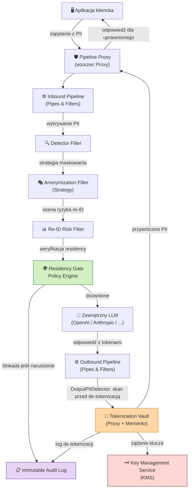

### Kluczowe zasady projektu

| Zasada | Realizacja |
|--------|-----------|
| **Minimalizacja danych** | Tylko niezbędne atrybuty PII trafiają do Vault; reszta jest usuwana |
| **Privacy by Design** | Anonimizacja jest pierwszym krokiem pipeline'u, nie ostatnim |
| **Separation of Concerns** | Każdy filtr ma jedną odpowiedzialność |
| **Zero Trust** | Każde żądanie de-tokenizacji wymaga jawnego uwierzytelnienia i autoryzacji |
| **Audit Everything** | Wszystkie operacje na tokenach są logowane niezależnie od powodzenia |

---

## 3. Wzorce projektowe i ich zastosowanie

### 3.1 Pipes & Filters

**Rola:** Główna struktura pipeline'u przetwarzania tekstu.

Każdy filtr jest niezależną jednostką przetwarzającą, która konsumuje `PipelineContext` i zwraca zmodyfikowany `PipelineContext`. Filtry mogą:
- **przepuszczać** dane bez zmian (pass-through),
- **transformować** dane (anonimizacja),
- **wzbogacać** dane (metadane, ryzyko),
- **blokować** przepływ (hard-stop z audytem).

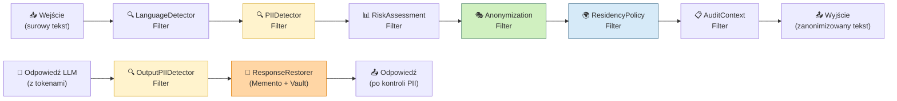

Outbound Pipeline zawiera `OutputPIIDetector`, uruchamiany przed `ResponseRestorer`, de-tokenizacją oraz odwróceniem Memento. Filtr analizuje także odpowiedzi częściowe i może wykonać hard-stop, redakcję lub przekazać wynik do audytu, zanim jakakolwiek wartość zostanie przywrócona z Vault.

**Kluczowe właściwości:**

- **Kolejność filtrów jest deterministyczna** — `LanguageDetector` musi działać przed `PIIDetector`, bo reguły wykrywania PESEL różnią się od SSN.
- **Short-circuit semantics** — filtr `ResidencyPolicy` może przerwać łańcuch i zwrócić błąd bez dalszego przetwarzania.
- **Konfigurowalne łańcuchy** — `PipelineBuilder` (patrz §3.3) pozwala składać różne łańcuchy dla różnych kontekstów (np. pipeline dla danych medycznych vs. finansowych).

```
interface Filter {
    process(context: PipelineContext): PipelineContext | HardStop
}

interface Pipe {
    addFilter(filter: Filter): Pipe
    execute(input: RawInput): PipelineResult
}
```

---

### 3.2 Strategy

**Rola:** Wymienne algorytmy anonimizacji / pseudonimizacji dla każdego typu PII.

Wzorzec Strategy pozwala dodawać nowe metody ochrony **bez modyfikacji** `AnonymizationFilter`. Filtr deleguje decyzję do `AnonymizationStrategy`, wybieranej przez `StrategySelector` na podstawie:
- **typu encji** (PERSON, PESEL, IBAN, EMAIL, ...),
- **kontekstu** (dane medyczne → silniejsza ochrona),
- **polityki organizacyjnej**.

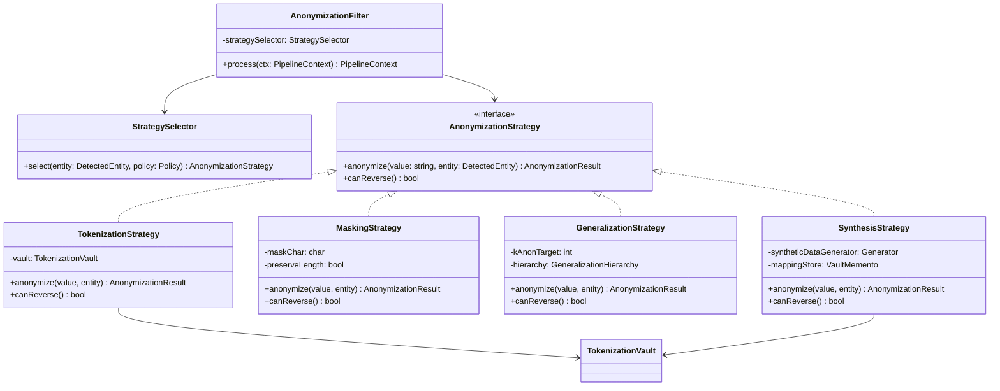

| Strategia | Odwracalna | Zastosowanie | Przykład |
|-----------|-----------|--------------|---------|
| **Tokenizacja** | ✅ Tak | Pseudonimizacja wymagająca przywrócenia | `Jan Kowalski` → `<PERSON_1>` |
| **Maskowanie** | ❌ Nie | Dane nieistotne dla kontekstu LLM | `90010112345` → `***********` |
| **Generalizacja** | ❌ Nie | Quasi-identyfikatory, k-anonimowość | `wiek: 34, Sępólno Krajeńskie` → `wiek: 30–40, Polska` |
| **Synteza** | ✅ Tak* | Opcjonalny fallback, gdy LLM odmawia placeholderów | `Jan Kowalski` → `Piotr Wiśniewski` (syntetyczna) |

`SynthesisStrategy` jest opcjonalnym rozwiązaniem dla modeli, które odmawiają odpowiedzi po napotkaniu surowych tokenów typu `<PERSON_1>`. Zastępuje realne PII realistycznymi danymi syntetycznymi, zachowując strukturę i kontekst wypowiedzi. `Vault`/`Memento` utrzymuje dwukierunkowe mapowanie **syntetyk ↔ oryginał**, dzięki czemu odpowiedź może zostać bezpiecznie odtworzona dla uprawnionego odbiorcy; strategia nie przechowuje oryginału poza zaszyfrowanym Vaultem.

---

### 3.3 Builder

**Rola:** Budowanie skonfigurowanego pipeline'u krok po kroku, z walidacją spójności.

`PipelineBuilder` enkapsuluje złożoną logikę tworzenia pipeline'u:
- sprawdza, że wymagane filtry (np. `PIIDetector` przed `AnonymizationFilter`) są obecne w odpowiedniej kolejności,
- weryfikuje zgodność polityk (np. jeśli dane to PHI, wymaga silniejszej strategii),
- tworzy niemutowalny obiekt `Pipeline` gotowy do użycia.

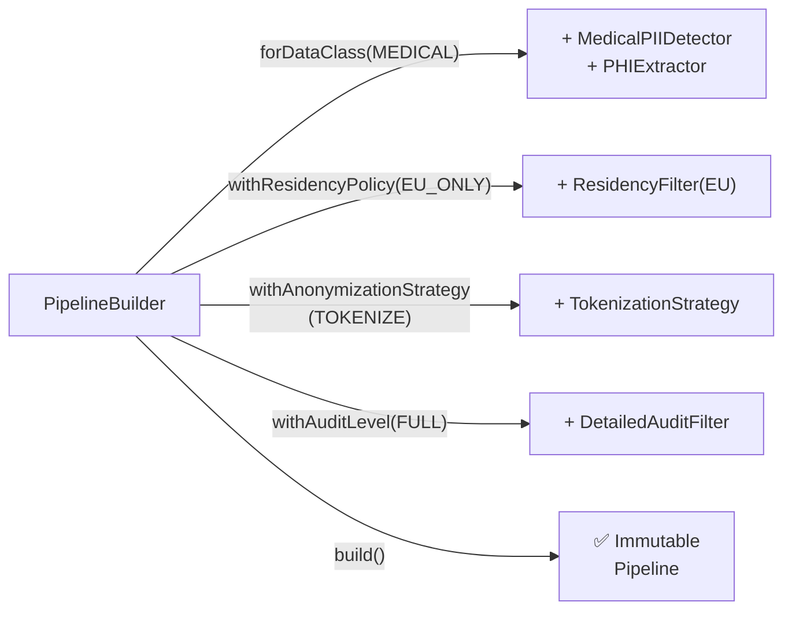

```
PipelineBuilder
    .forDataClass(DataClass.MEDICAL)
    .withResidencyPolicy(ResidencyPolicy.EU_ONLY)
    .withAnonymizationStrategy(StrategyType.TOKENIZE, config)
    .withReIdRiskThreshold(0.05)
    .withAuditLevel(AuditLevel.FULL)
    .build()
```

**Dlaczego Builder, nie Factory?**  
Factory tworzy jeden dobrze znany obiekt. Builder jest niezbędny, gdy produkt wymaga **wielu kroków konfiguracji z walidacją między nimi** — np. nie można ustawić `withAuditLevel(NONE)` przy `DataClass.MEDICAL` (naruszenie GDPR).

---

### 3.4 Proxy — Tokenization Vault

**Rola:** Kontrolowany punkt dostępu do operacji tokenizacji i de-tokenizacji.

`VaultProxy` implementuje ten sam interfejs co `VaultCore`, dodając:
1. **Uwierzytelnienie** żądającego podmiotu (JWT / mTLS),
2. **Autoryzację** (RBAC/ABAC — czy ten podmiot może de-tokenizować ten typ encji?),
3. **Audit log** każdej próby dostępu (udanej i odrzuconej),
4. **Rate limiting** jako ochronę przed masową de-tokenizacją.

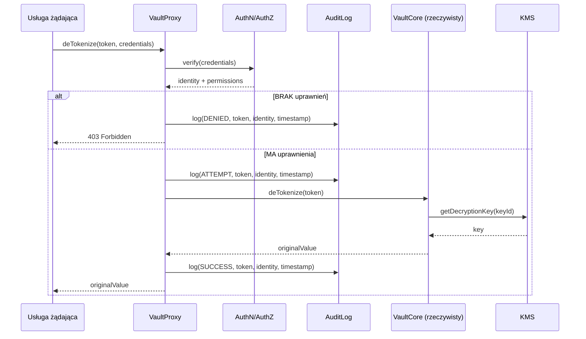

**Struktura TokenRecord w VaultCore:**

```
TokenRecord {
    tokenId:        UUID          // publiczny identyfikator tokenu, np. <PERSON_1>
    encryptedValue: bytes         // AES-256-GCM(originalValue, dataEncryptionKey)
    keyId:          UUID          // wskazuje na klucz w KMS
    entityType:     EntityType    // PERSON, PESEL, IBAN, ...
    createdAt:      timestamp
    expiresAt:      timestamp?    // zgodnie z retention policy
    sessionId:      UUID          // powiązanie z kontekstem żądania
}
```

---

### 3.5 Memento

**Rola:** Zachowanie i przywracanie stanu pipeline'u w celu bezpiecznej rekonstrukcji kontekstu.

Memento służy dwóm celom:

#### A. Przywracanie tokenów w odpowiedzi LLM

`PipelineContext` (Originator) tworzy `PipelineMemento` po fazie anonimizacji. Ten snapshot zawiera mapowanie `token → metadane`, które pozwala `ResponseRestorer` (Caretaker) przywrócić oryginalne wartości w odpowiedzi LLM **bez ponownego dostępu do Vault** dla każdego tokenu z osobna — jeden call, atomowe przywrócenie.

#### B. Odtwarzanie stanu po awarii

Przy przerwaniu sesji (np. timeout LLM) system może odtworzyć stan z Memento i wznowić od momentu wysłania do LLM, bez ponownej anonimizacji (która byłaby niedeterministyczna przy tokenach sekwencyjnych).

#### C. Dynamic Memento Expansion w sesji agentowej

W sesji agentowej `PipelineMemento` jest rozszerzalny i może atomowo dopisywać nowe tokeny powstałe podczas wykonywania narzędzi. Gdy `ToolExecutionMiddleware` pobierze z Vault wartość potrzebną do zapytania (np. `Jan Kowalski`), wynik z bazy danych jest natychmiast tokenizowany w Vault/Memento (np. `1990-01-01` → `<DATE_1>`), a wpis `<DATE_1>` zostaje dodany do istniejącego `tokenMap` tej samej sesji. Memento nie ujawnia wartości jawnej ani LLM, ani komponentom przechowującym snapshot.

Rozszerzenie jest wersjonowane i wykonywane przed zwróceniem wyniku narzędzia do LLM, dzięki czemu `ResponseRestorer` korzystający z końcowego snapshotu przywraca zarówno tokeny pierwotnego promptu (`<PERSON_1>`), jak i tokeny wygenerowane dynamicznie przez narzędzie (`<DATE_1>`). Operacja wymaga kontroli integralności, zgodności `sessionId` oraz audytu tak jak początkowa anonimizacja.

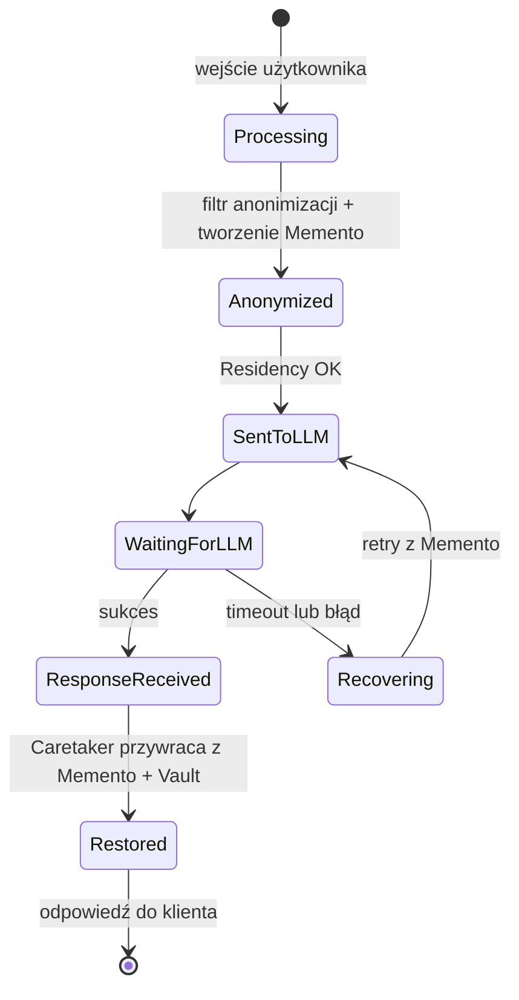

```
PipelineMemento {
    sessionId:      UUID
    tokenMap:       Map<Token, EntityMetadata>   // NIE zawiera oryginalnych wartości
    version:        int                           // wersja po każdym rozszerzeniu
    appliedFilters: List<FilterRecord>
    timestamp:      Instant
    checksum:       bytes   // integralność snapshotu
}
```

> **Ważne:** Memento **nigdy nie przechowuje oryginalnych wartości PII** — tylko tokeny i metadane. Oryginalne wartości żyją wyłącznie w Vault (zaszyfrowane), również dla tokenów dodanych dynamicznie podczas wywołania narzędzia.

---

## 4. Komponenty systemu

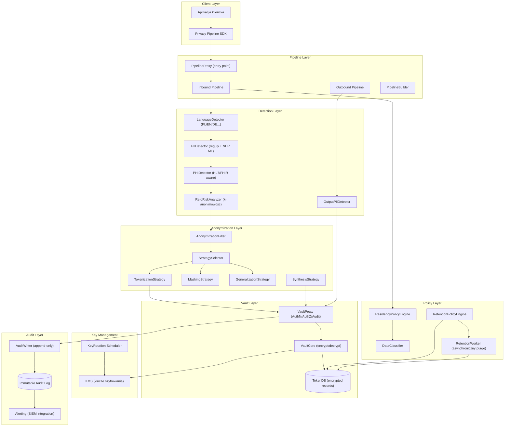

### Opis kluczowych komponentów

| Komponent | Odpowiedzialność | Wzorzec |
|-----------|-----------------|---------|
| `PipelineProxy` | Pojedynczy punkt wejścia; zarządza sesjami, Memento oraz normalizuje tekst i obiekty `ToolCall` / `FunctionCall` JSON | Proxy, Facade |
| `Inbound Pipeline` | Przetwarza `RawInput` oraz ustrukturyzowane wywołania narzędzi; tokenizuje argumenty `name`/`arguments` przed przekazaniem do LLM | Pipes & Filters |
| `PIIDetector` | Wykrywa encje PII kombinując reguły regex (PESEL, NIP) + model NER | Filter |
| `OutputPIIDetector` | Skanuje odpowiedź LLM pod kątem PII wygenerowanego lub ujawnionego przez model, przed de-tokenizacją | Filter |
| `AnonymizationFilter` | Deleguje do strategii wybranej przez `StrategySelector` | Filter + Strategy |
| `VaultProxy` | Enforce AuthN/AuthZ/RateLimit przed każdą operacją na Vault | Proxy |
| `VaultCore` | Szyfruje/deszyfruje wartości PII, zarządza cyklem życia tokenów | — |
| `RetentionWorker` | Asynchronicznie usuwa wygasłe rekordy tokenów po TTL sesji i audytuje wykonanie purge | Worker |
| `ResidencyPolicyEngine` | Sprawdza, czy docelowy LLM jest w dozwolonej strefie geograficznej | Policy |
| `ReIdRiskAnalyzer` | Oblicza ryzyko re-identyfikacji metodą k-anonimowości | Filter |
| `PipelineBuilder` | Tworzy i waliduje konfigurację pipeline'u | Builder |
| `AuditWriter` | Append-only zapis do niezmiennego logu (WORM storage / blockchain hash) | — |

`PipelineProxy` i `Inbound Pipeline` nie zakładają, że wejście jest wyłącznie typu `str`. Dla obiektu `ToolCall` / `FunctionCall` zachowują strukturę JSON, identyfikator wywołania, nazwę funkcji oraz schemat argumentów, a anonimizacji podlegają wartości w `arguments` (rekurencyjnie, zgodnie z typem encji). Dzięki temu LLM otrzymuje wyłącznie zanonimizowaną definicję i parametry narzędzia, natomiast middleware może przechwycić ustrukturyzowany call przed wykonaniem.

```
ToolCall {
    id:        UUID
    name:      string
    arguments: JSON          // wartości PII zastąpione tokenami
    sessionId: UUID
}
```

---

## 5. Scenariusze użycia

### 5.1 Pseudonimizacja — happy path

**Wejście:** `"Jan Kowalski, PESEL 90010112345, skarży się na fakturę 7/2026"`

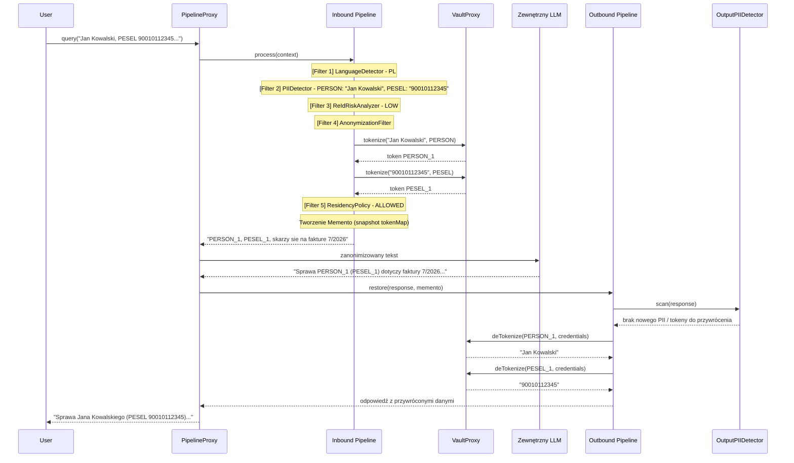

**Wynik wysłany do LLM:** `"<PERSON_1>, <PESEL_1>, skarży się na fakturę 7/2026"`  
**Wynik zwrócony użytkownikowi:** oryginalna treść z przywróconymi danymi.

`OutputPIIDetector` działa przed de-tokenizacją i odwróceniem Memento. Wykrywa zarówno PII podchwycone z kontekstu, jak i nowe, zmyślone lub pochodzące z danych treningowych modelu (hallucination / training data leak). W przypadku wykrycia nieoczekiwanego PII odpowiedź jest blokowana albo kierowana do polityki redakcji i audytu; nie może zostać automatycznie wzbogacona o dane z Vault.

---

### 5.2 Nieautoryzowana de-tokenizacja

**Scenariusz:** Serwis B (bez uprawnień) próbuje de-tokenizować `<PERSON_1>` należący do sesji serwisu A.

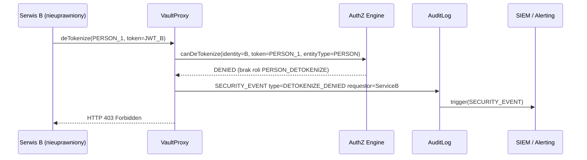

**Mechanizmy ochrony:**
- Token jest powiązany z `sessionId` — nawet znajomość tokenu nie pozwala na de-tokenizację poza oryginalną sesją (strict mode).
- `AuditLog` jest append-only — zdarzenie odmowy nie może zostać usunięte.
- Wielokrotne odmowy z tego samego źródła triggerują alert w SIEM.

---

### 5.3 Data Residency — blokada

**Scenariusz:** Dane medyczne (PHI) mają być wysłane do providera LLM zlokalizowanego poza EU (np. us-east-1).

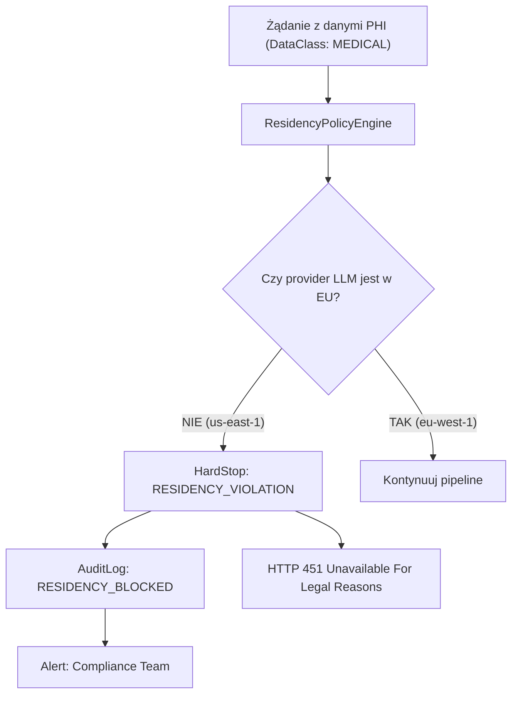

**Polityki residency (przykłady):**

```yaml
residency_policies:
  - data_class: MEDICAL
    allowed_regions: [eu-west-1, eu-central-1, eu-north-1]
    deny_action: HARD_BLOCK

  - data_class: FINANCIAL
    allowed_regions: [eu-*]
    deny_action: HARD_BLOCK

  - data_class: GENERAL
    allowed_regions: ["*"]
    deny_action: NONE
```

**Zgodność z EU AI Act:** Systemy przetwarzające dane zdrowotne są klasyfikowane jako **high-risk** (Annex III). Polityka residency jest wymagana przez art. 9(1) oraz GDPR art. 44–49 (transfer danych poza EOG).

---

### 5.4 Re-identyfikacja — k-anonimowość

**Scenariusz:** Kontekst zawiera kombinację quasi-identyfikatorów: `zawód: neurochirurg`, `miasto: Sępólno Krajeńskie`, `wiek: 47`.

`ReIdRiskAnalyzer` szacuje, ile osób w Polsce pasuje do tego profilu. Jeśli `k < k_threshold` (np. k=2 < k_min=5), uruchamia `GeneralizationStrategy`.

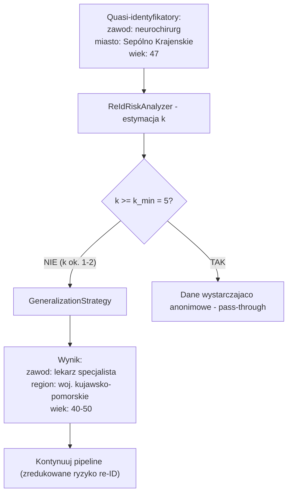

**Hierarchie generalizacji — lokalizacja:**

```
Sępólno Krajeńskie
    → powiat sępoleński
        → woj. kujawsko-pomorskie
            → Polska Północna
                → Polska
```

**Hierarchie generalizacji — zawód:**

```
neurochirurg
    → chirurg
        → lekarz specjalista
            → lekarz
                → pracownik służby zdrowia
```

> **Uwaga:** k-anonimowość jest **konieczna, ale niewystarczająca**. Należy rozważyć ℓ-różnorodność (l-diversity) dla atrybutów wrażliwych (np. diagnoza) i t-bliskość (t-closeness) w systemach przetwarzających dane medyczne.

---

### 5.5 Rotacja kluczy

**Zasada:** Rotacja kluczy szyfrowania nie unieważnia istniejących tokenów — dane są re-szyfrowane lub zachowywana jest zdolność odczytu starymi kluczami zgodnie z polityką retencji.

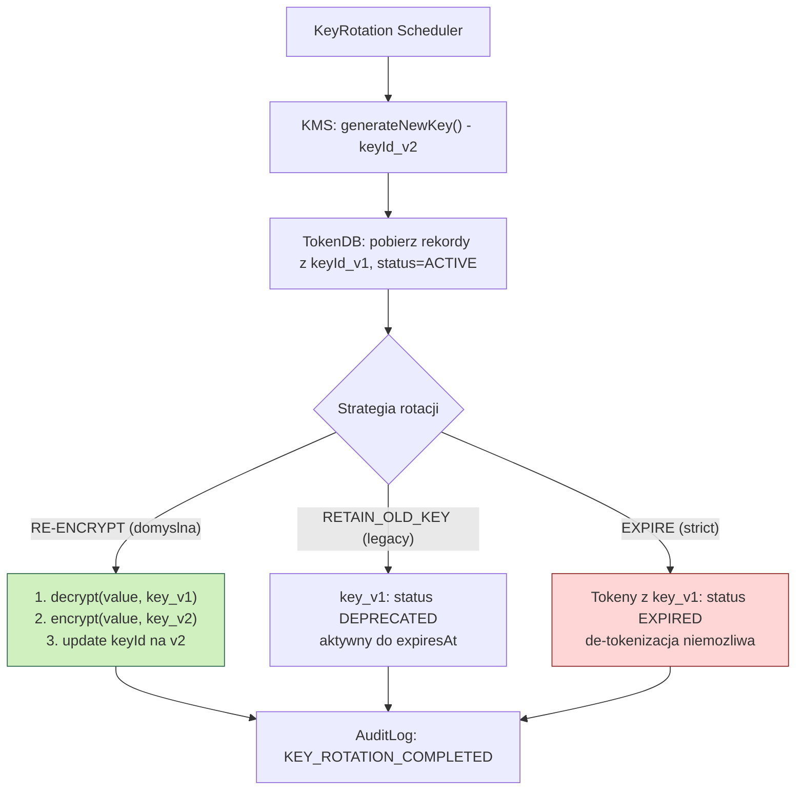

**Polityki retencji vs. rotacja:**

| Scenariusz | Polityka kluczy | Skutek |
|-----------|----------------|--------|
| Standardowa rotacja | RE-ENCRYPT (atomic) | Stare tokeny działają, dane re-szyfrowane |
| Koniec okresu retencji | EXPIRE | Token staje się nierozwiązywalny — prawo do zapomnienia |
| Kompromitacja klucza | REVOKE + RE-ENCRYPT priorytetowo | Natychmiastowe re-szyfrowanie |

> **Uwaga:** Strategia EXPIRE powoduje **nieodwracalną utratę** możliwości de-tokenizacji. Należy upewnić się, że dane nie są już potrzebne lub zostały wcześniej zapisane przez klienta.

---

### 5.6 Rozszerzenie

**Przykład:** Dodanie detektora polskiego numeru IBAN.

**Zmiana wymagana:** tylko nowe implementacje, **żadna modyfikacja istniejącego kodu** (zasada Open/Closed Principle — spełniona przez Pipes & Filters + Strategy).

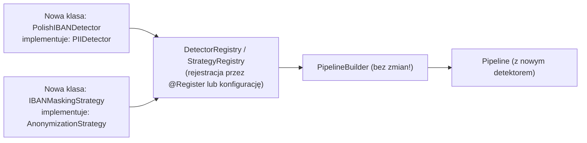

**Kontrakt dla nowego detektora:**

```python
interface PIIDetector:
    entityType()         -> EntityType     # np. EntityType.IBAN
    supportedLanguages() -> List[Lang]
    detect(text, lang)   -> List[DetectedEntity]
    confidence()         -> float          # próg pewności
```

**Przykład implementacji:**

```python
@register_detector(entity_type=EntityType.IBAN, priority=100)
class PolishIBANDetector(PIIDetector):
    IBAN_PATTERN = re.compile(
        r'PL\d{2}\s?\d{4}\s?\d{4}\s?\d{4}\s?\d{4}\s?\d{4}\s?\d{4}'
    )

    def detect(self, text: str, lang: Lang) -> list[DetectedEntity]:
        return [
            DetectedEntity(
                value=m.group(), type=EntityType.IBAN,
                start=m.start(), end=m.end()
            )
            for m in self.IBAN_PATTERN.finditer(text)
        ]
```

### 5.7 Anonymized Agentic Tool Calling (Scenariusz odpytania bazy danych)

**Scenariusz:** Użytkownik pyta: `"Kiedy urodził się Jan Kowalski?"`. Agent LLM nie ma bezpośredniego dostępu do bazy danych ani danych jawnych. `Inbound Pipeline` tokenizuje PII, a middleware przechwytuje każde wywołanie narzędzia przed jego wykonaniem.

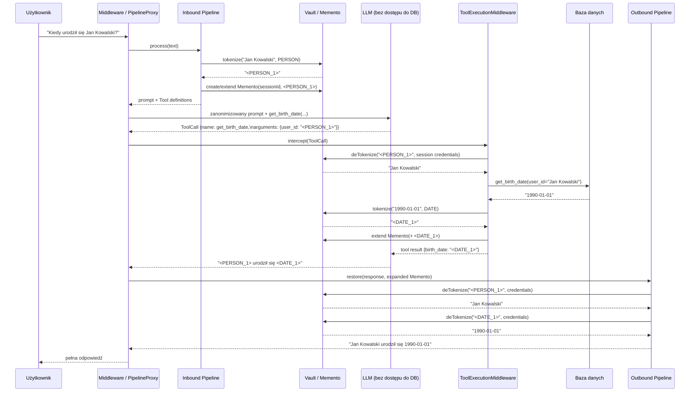

W żadnym momencie LLM nie otrzymuje jawnego identyfikatora osoby, daty urodzenia ani bezpośredniego połączenia z bazą. Wynik narzędzia jest anonimizowany natychmiast po odczycie, a dynamicznie rozszerzone Memento umożliwia atomową de-tokenizację obu tokenów dopiero w `Outbound Pipeline`, po kontroli uprawnień i audycie.

---

## 6. Model bezpieczeństwa

### 6.1 Wykrywanie PII/PHI

System stosuje **podejście wielowarstwowe**:

| Warstwa | Metoda | Przykłady encji |
|---------|--------|----------------|
| **Reguły deterministyczne** | Regex + checksum (Luhn, PESEL modulo) | PESEL, NIP, REGON, IBAN, numer dowodu |
| **NER (Named Entity Recognition)** | Transformer-based (np. fine-tuned HerBERT dla PL) | Imię, nazwisko, adres, organizacja |
| **Kontekstowe reguły** | Słowa kluczowe + proximity | "diagnoza:", "PESEL:", "ur." |
| **PHI (dane medyczne)** | HL7/FHIR-aware parser | Kody ICD-10, nazwy leków, procedury |
| **Cross-entity correlation** | Graf quasi-identyfikatorów | Kombinacje cech demograficznych |

**Priorytety błędów detekcji:**
- **False Negative** (niewykrycie PII) = **krytyczne** — dane trafiają do LLM bez ochrony.
- **False Positive** (nadmierna anonimizacja) = **akceptowalne** — pogarsza jakość odpowiedzi, ale nie narusza prywatności.

Dlatego progi detekcji są celowo **konserwatywne** (wysoka czułość, niższa precyzja).

---

### 6.2 GDPR i EU AI Act

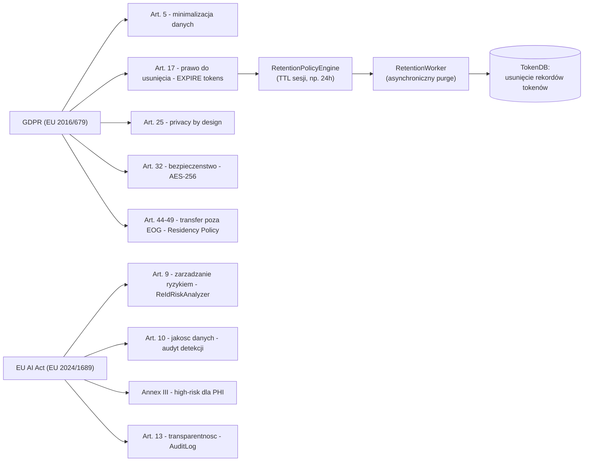

**Mapa wymagań regulacyjnych na komponenty:**

| Wymóg | Komponent realizujący |
|-------|----------------------|
| Minimalizacja danych | `PIIDetector` + `AnonymizationFilter` |
| Prawo do usunięcia | `RetentionPolicyEngine` + `VaultCore.expire()` |
| Privacy by Design | `PipelineBuilder` (anonimizacja obowiązkowa) |
| Szyfrowanie w transit | TLS 1.3 na wszystkich połączeniach |
| Szyfrowanie at rest | AES-256-GCM w `VaultCore` |
| Transfer poza EOG | `ResidencyPolicyEngine` |
| Ocena ryzyka AI | `ReIdRiskAnalyzer` + dokumentacja modelu |
| Transparentność | `AuditLog` (niemodyfikowalny) |

**Cykl życia sesji i purge Vaulta:** przy utworzeniu sesji `RetentionPolicyEngine` wyznacza `expiresAt` dla każdego `TokenRecord` (domyślnie TTL 24h, konfigurowalny zgodnie z polityką organizacji). Asynchroniczny `RetentionWorker` cyklicznie pobiera rekordy, dla których `expiresAt < now()`, i wykonuje atomowe, nieodwracalne usunięcie zaszyfrowanych wartości oraz ich mapowań z `TokenDB` (`Purge`). Operacja jest idempotentna, monitorowana i audytowana bez zapisywania wartości PII. Mechanizm realizuje operacyjne usuwanie danych zgodnie z RODO art. 17; ewentualne wyjątki retencyjne (np. obowiązek prawny) muszą być jawnie oznaczone polityką i nie mogą rozszerzać domyślnego TTL.

---

### 6.3 Zarządzanie kluczami

**Architektura kluczy (hierarchiczna):**

```
Master Key (MK)
    ↓ szyfruje
Key Encryption Keys (KEK) — jeden per klasa danych
    ↓ szyfruje
Data Encryption Keys (DEK) — jeden per sesja/batch
    ↓ szyfruje
Wartości PII w TokenDB
```

- **MK** przechowywany w HSM (Hardware Security Module) lub Cloud KMS z FIPS 140-2 Level 3.
- **KEK** rotowany co 90 dni (lub natychmiastowo przy kompromitacji).
- **DEK** rotowany per sesja lub co 24h (dla długich sesji).
- Dostęp do MK wymaga **M-of-N** (np. 3 z 5) autoryzowanych administratorów (Shamir Secret Sharing).

---

### 6.4 Ryzyko re-identyfikacji

**Miary używane w systemie:**

| Miara | Opis | Próg alertu |
|-------|------|-------------|
| **k-anonimowość** | Minimalna liczba rekordów nieodróżnialnych | k < 5 → generalizacja |
| **ℓ-różnorodność** | Różnorodność atrybutów wrażliwych w grupie k | ℓ < 3 → dodatkowa ochrona |
| **t-bliskość** | Rozkład atrybutów wrażliwych ≈ globalny | t > 0.3 → alert |
| **Uniqueness score** | % unikalnych kombinacji quasi-ID | > 10% → odmowa |

**Źródła danych pomocniczych dla szacowania k:**
- GUS (Główny Urząd Statystyczny) — dane demograficzne PL
- OpenStreetMap — gęstość zaludnienia
- Lokalne modele statystyczne (bez external API w runtime)

---

### 6.5 Data Residency

**Model decyzyjny:**

```
ResidencyDecision = f(DataClass, LLMProvider.Region, OrganizationPolicy)
```

**Macierz decyzji:**

| Klasa danych | Region EU | Region US | Region APAC |
|-------------|-----------|-----------|-------------|
| MEDICAL (PHI) | ✅ ALLOW | ❌ BLOCK | ❌ BLOCK |
| FINANCIAL | ✅ ALLOW | ⚠️ WARN* | ❌ BLOCK |
| LEGAL | ✅ ALLOW | ⚠️ WARN* | ❌ BLOCK |
| GENERAL PII | ✅ ALLOW | ✅ ALLOW** | ⚠️ WARN* |
| ANONYMOUS | ✅ ALLOW | ✅ ALLOW | ✅ ALLOW |

`*` Wymaga dodatkowego uzasadnienia biznesowego i SCCs (Standard Contractual Clauses)  
`**` Wymaga weryfikacji DPA (Data Processing Agreement) z providerem

**Metadane LLM Provider (przykład konfiguracji):**

```yaml
providers:
  - id: openai-eu
    endpoint: "https://api.openai.azure.com/"
    region: eu-west-1
    data_processing_agreement: true
    certifications: [ISO27001, SOC2]

  - id: openai-us
    endpoint: "https://api.openai.com/"
    region: us-east-1
    data_processing_agreement: false
```

---

### 6.6 Audyt de-tokenizacji

**Każde zdarzenie de-tokenizacji zapisuje:**

```json
{
  "event_id": "uuid-v4",
  "event_type": "DETOKENIZE_SUCCESS | DETOKENIZE_DENIED | DETOKENIZE_ERROR",
  "timestamp": "2026-10-25T11:13:28Z",
  "token_id": "<PERSON_1>",
  "entity_type": "PERSON",
  "requestor": {
    "service_id": "crm-service-v2",
    "user_id": "u-12345",
    "role": "CASE_WORKER",
    "ip": "10.0.1.42"
  },
  "session_id": "sess-abc-123",
  "authorization_basis": "GDPR_ART6_1B | LEGITIMATE_INTEREST",
  "previous_hash": "sha256:...",
  "event_hash": "sha256:..."
}
```

**Właściwości logu:**
- **Append-only** — zapis do WORM storage (Write Once Read Many) lub Blockchain-anchored.
- **Łańcuch hashy** — każdy wpis zawiera hash poprzedniego (`previous_hash`), co uniemożliwia niewidoczne usunięcie wpisów.
- **Dostęp do logu** — oddzielna rola `AUDIT_READER`, niedostępna dla operatorów pipeline'u.
- **Retencja logu** — minimum 5 lat (GDPR + EU AI Act).

---

## 7. Decyzje architektoniczne (ADR)

### ADR-001: Tokenizacja jako domyślna strategia dla PII odwracalnego

- **Kontekst:** Musimy móc przywrócić oryginalne dane dla uprawnionych użytkowników.
- **Decyzja:** Domyślna strategia dla danych wymagających przywrócenia to tokenizacja z Vault.
- **Alternatywy:** Szyfrowanie deterministyczne (ryzyko: podatne na frequency analysis); maskowanie (nieodwracalne).
- **Konsekwencje:** Vault staje się single point of failure — wymaga replikacji HA.

### ADR-002: Vault jako Proxy, nie wbudowany w Pipeline

- **Kontekst:** Pipeline i Vault mają różne cykle życia, wymagania bezpieczeństwa i skalowalności.
- **Decyzja:** Vault to oddzielna usługa z VaultProxy jako fasadą dla pipeline'u.
- **Alternatywy:** Vault jako część pipeline'u (monolit) — prostszy deployment, ale gorsze separation of concerns.
- **Konsekwencje:** Latencja sieciowa przy tokenizacji/de-tokenizacji. Mitygacja: batching i lokalne cache tokenów (TTL 60s, tylko w pamięci).

### ADR-003: Memento nie przechowuje oryginalnych wartości PII

- **Kontekst:** Memento musi być bezpiecznie przesyłalne między komponentami.
- **Decyzja:** Memento zawiera tylko tokeny i metadane, nigdy oryginalne wartości.
- **Konsekwencje:** De-tokenizacja zawsze wymaga wywołania Vault (brak skrótu). Akceptowalne ze względów bezpieczeństwa.

### ADR-004: Hard-stop dla naruszeń residency

- **Kontekst:** Dane medyczne wysyłane poza EU to naruszenie GDPR art. 44.
- **Decyzja:** Naruszenie residency powoduje twardy błąd (HTTP 451) i audyt, nie ostrzeżenie.
- **Alternatywy:** Soft-warning z możliwością override — zbyt ryzykowne dla PHI.
- **Konsekwencje:** Degradacja dostępności gdy jedyny dostępny LLM jest poza EU. Mitygacja: fallback do EU LLM.

### ADR-005: k-anonimowość jako próg, nie gwarancja

- **Kontekst:** k-anonimowość może być niewystarczająca (atak jednorodności).
- **Decyzja:** k-anonimowość jest minimalnym progiem; dla danych medycznych wymagana ℓ-różnorodność.
- **Konsekwencje:** Większa złożoność analizy ryzyka; konieczność utrzymania hierarchii generalizacji dla typowych atrybutów PL.

### ADR-006: Streaming Proxy z buforowaniem placeholderów

- **Kontekst:** LLM może zwracać odpowiedź strumieniowo przez Server-Sent Events (SSE), token po tokenie. Pełny placeholder, np. `<PERSON_1>`, może być podzielony między kilka zdarzeń SSE, a pełna odpowiedź nie powinna być buforowana ze względu na latencję i zużycie pamięci.
- **Decyzja:** `Outbound Pipeline` implementuje `StreamingProxy`, który przekazuje zdarzenia SSE bez zmian, ale utrzymuje małe okno słowne/nawiasowe od znaku `<` do `>`. Po wykryciu kompletnego placeholdera przekazuje go do `OutputPIIDetector`, następnie bezpiecznie de-tokenizuje przez `Vault/Memento` i natychmiast emituje pełny ciąg do klienta. Tekst poza oknem jest emitowany od razu; brak zamknięcia `>` powoduje dalsze buforowanie wyłącznie tego fragmentu.
- **Konsekwencje:** Zachowana zostaje płynność streamu i ograniczone zużycie pamięci, przy czym de-tokenizacja i kontrola PII odbywają się przed emisją wrażliwego fragmentu. Wykrycie nowego PII lub niepoprawnego placeholdera uruchamia hard-stop albo politykę redakcji, zamiast częściowego ujawnienia odpowiedzi.

### ADR-007: Anonymized Tool Calling Execution

- **Kontekst:** Agent LLM powinien odpowiadać na pytania wymagające danych z bazy, ale nie może otrzymać bezpośredniego dostępu do bazy ani jawnych danych osobowych. Wywołania funkcji LLM są ustrukturyzowanymi obiektami i muszą podlegać tej samej izolacji co tekstowy prompt.
- **Decyzja:** Middleware przechwytuje każde `ToolCall` / `FunctionCall` przed egzekucją, de-tokenizuje wyłącznie wymagane argumenty w Vault, wykonuje zapytanie przez kontrolowany adapter DB, a wynik tokenizuje natychmiast przed zwróceniem go do LLM. Nowe tokeny są dopisywane do Memento bieżącej sesji, a `Outbound Pipeline` wykonuje dwukierunkową kontrolę i de-tokenizację dopiero dla uprawnionego odbiorcy.
- **Uzasadnienie:** Dwukierunkowa tokenizacja izoluje agenta od danych jawnych i ogranicza zakres ujawnienia do minimalnego, audytowanego wywołania. Rozwiązanie wspiera privacy by design, zasadę minimalizacji danych RODO oraz kontrolę ryzyka systemu agentowego zgodnie z EU AI Act.
- **Konsekwencje:** Wzrasta latencja i złożoność orkiestracji (przechwycenie call, Vault, DB, tokenizacja wyniku), a każda operacja wymaga spójności `sessionId`, autoryzacji i audytu. W zamian LLM nie może samodzielnie odpytywać bazy, a jawne dane opuszczają zaufaną granicę wyłącznie w kontrolowanym middleware.
