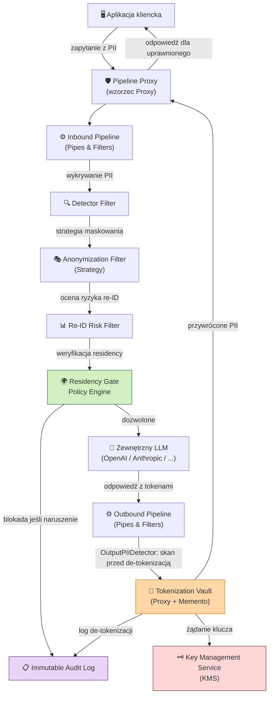
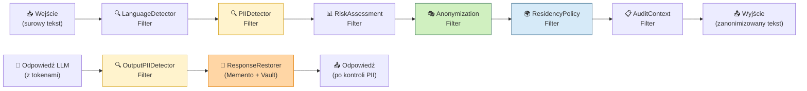
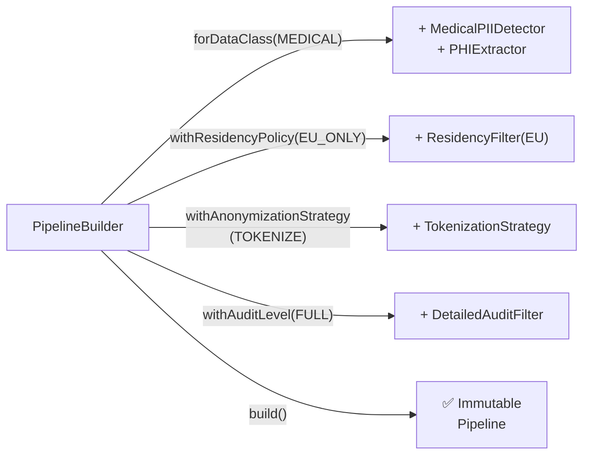
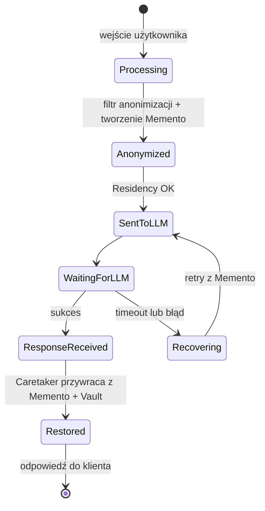
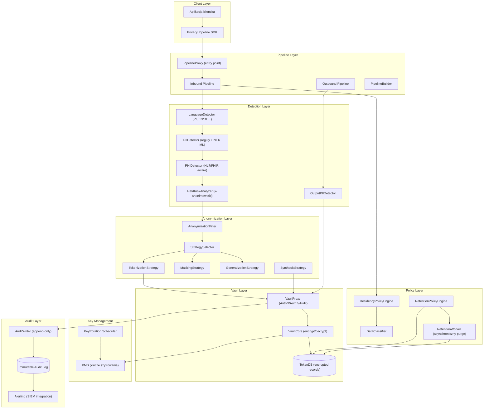
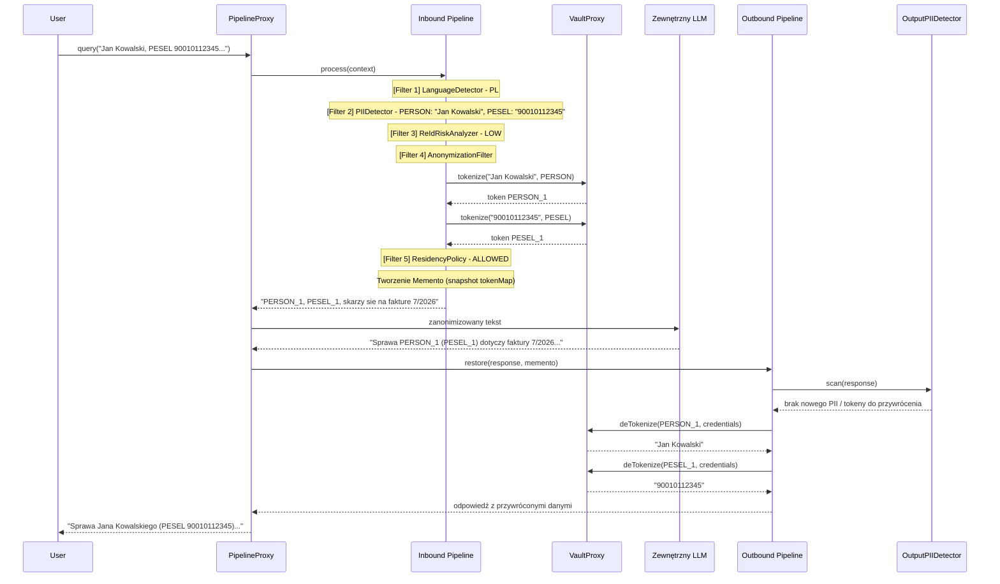
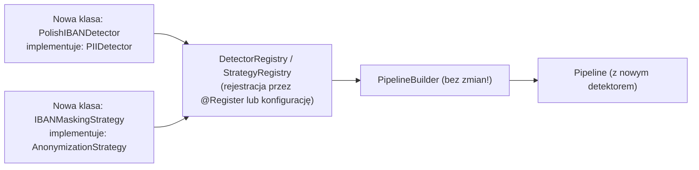

# Moje zagadnienia — Osoba A

Wybrane z `ARCHITECTURE.md` zgodnie z zakresem Osoby A w `TEAM_TASKS_DIVISION.md`.

## 2. Widok wysokiego poziomu



### Kluczowe zasady projektu

| Zasada | Realizacja |
|--------|-----------|
| **Minimalizacja danych** | Tylko niezbędne atrybuty PII trafiają do Vault; reszta jest usuwana |
| **Privacy by Design** | Anonimizacja jest pierwszym krokiem pipeline'u, nie ostatnim |
| **Separation of Concerns** | Każdy filtr ma jedną odpowiedzialność |
| **Zero Trust** | Każde żądanie de-tokenizacji wymaga jawnego uwierzytelnienia i autoryzacji |
| **Audit Everything** | Wszystkie operacje na tokenach są logowane niezależnie od powodzenia |

---

### 3.1 Pipes & Filters

**Rola:** Główna struktura pipeline'u przetwarzania tekstu.

Każdy filtr jest niezależną jednostką przetwarzającą, która konsumuje `PipelineContext` i zwraca zmodyfikowany `PipelineContext`. Filtry mogą:
- **przepuszczać** dane bez zmian (pass-through),
- **transformować** dane (anonimizacja),
- **wzbogacać** dane (metadane, ryzyko),
- **blokować** przepływ (hard-stop z audytem).



Outbound Pipeline zawiera `OutputPIIDetector`, uruchamiany przed `ResponseRestorer`, de-tokenizacją oraz odwróceniem Memento. Filtr analizuje także odpowiedzi częściowe i może wykonać hard-stop, redakcję lub przekazać wynik do audytu, zanim jakakolwiek wartość zostanie przywrócona z Vault.

**Kluczowe właściwości:**

- **Kolejność filtrów jest deterministyczna** — `LanguageDetector` musi działać przed `PIIDetector`, bo reguły wykrywania PESEL różnią się od SSN.
- **Short-circuit semantics** — filtr `ResidencyPolicy` może przerwać łańcuch i zwrócić błąd bez dalszego przetwarzania.
- **Konfigurowalne łańcuchy** — `PipelineBuilder` (patrz §3.3) pozwala składać różne łańcuchy dla różnych kontekstów (np. pipeline dla danych medycznych vs. finansowych).

```
interface Filter {
    process(context: PipelineContext): PipelineContext | HardStop
}

interface Pipe {
    addFilter(filter: Filter): Pipe
    execute(input: RawInput): PipelineResult
}
```

---

### 3.3 Builder

**Rola:** Budowanie skonfigurowanego pipeline'u krok po kroku, z walidacją spójności.

`PipelineBuilder` enkapsuluje złożoną logikę tworzenia pipeline'u:
- sprawdza, że wymagane filtry (np. `PIIDetector` przed `AnonymizationFilter`) są obecne w odpowiedniej kolejności,
- weryfikuje zgodność polityk (np. jeśli dane to PHI, wymaga silniejszej strategii),
- tworzy niemutowalny obiekt `Pipeline` gotowy do użycia.



```
PipelineBuilder
    .forDataClass(DataClass.MEDICAL)
    .withResidencyPolicy(ResidencyPolicy.EU_ONLY)
    .withAnonymizationStrategy(StrategyType.TOKENIZE, config)
    .withReIdRiskThreshold(0.05)
    .withAuditLevel(AuditLevel.FULL)
    .build()
```

**Dlaczego Builder, nie Factory?**  
Factory tworzy jeden dobrze znany obiekt. Builder jest niezbędny, gdy produkt wymaga **wielu kroków konfiguracji z walidacją między nimi** — np. nie można ustawić `withAuditLevel(NONE)` przy `DataClass.MEDICAL` (naruszenie GDPR).

---

### 3.5 Memento

**Rola:** Zachowanie i przywracanie stanu pipeline'u w celu bezpiecznej rekonstrukcji kontekstu.

Memento służy dwóm celom:

#### A. Przywracanie tokenów w odpowiedzi LLM

`PipelineContext` (Originator) tworzy `PipelineMemento` po fazie anonimizacji. Ten snapshot zawiera mapowanie `token → metadane`, które pozwala `ResponseRestorer` (Caretaker) przywrócić oryginalne wartości w odpowiedzi LLM **bez ponownego dostępu do Vault** dla każdego tokenu z osobna — jeden call, atomowe przywrócenie.

#### B. Odtwarzanie stanu po awarii

Przy przerwaniu sesji (np. timeout LLM) system może odtworzyć stan z Memento i wznowić od momentu wysłania do LLM, bez ponownej anonimizacji (która byłaby niedeterministyczna przy tokenach sekwencyjnych).

#### C. Dynamic Memento Expansion w sesji agentowej

W sesji agentowej `PipelineMemento` jest rozszerzalny i może atomowo dopisywać nowe tokeny powstałe podczas wykonywania narzędzi. Gdy `ToolExecutionMiddleware` pobierze z Vault wartość potrzebną do zapytania (np. `Jan Kowalski`), wynik z bazy danych jest natychmiast tokenizowany w Vault/Memento (np. `1990-01-01` → `<DATE_1>`), a wpis `<DATE_1>` zostaje dodany do istniejącego `tokenMap` tej samej sesji. Memento nie ujawnia wartości jawnej ani LLM, ani komponentom przechowującym snapshot.

Rozszerzenie jest wersjonowane i wykonywane przed zwróceniem wyniku narzędzia do LLM, dzięki czemu `ResponseRestorer` korzystający z końcowego snapshotu przywraca zarówno tokeny pierwotnego promptu (`<PERSON_1>`), jak i tokeny wygenerowane dynamicznie przez narzędzie (`<DATE_1>`). Operacja wymaga kontroli integralności, zgodności `sessionId` oraz audytu tak jak początkowa anonimizacja.



```
PipelineMemento {
    sessionId:      UUID
    tokenMap:       Map<Token, EntityMetadata>   // NIE zawiera oryginalnych wartości
    version:        int                           // wersja po każdym rozszerzeniu
    appliedFilters: List<FilterRecord>
    timestamp:      Instant
    checksum:       bytes   // integralność snapshotu
}
```

> **Ważne:** Memento **nigdy nie przechowuje oryginalnych wartości PII** — tylko tokeny i metadane. Oryginalne wartości żyją wyłącznie w Vault (zaszyfrowane), również dla tokenów dodanych dynamicznie podczas wywołania narzędzia.

---

## 4. Komponenty systemu



### Opis kluczowych komponentów

| Komponent | Odpowiedzialność | Wzorzec |
|-----------|-----------------|---------|
| `PipelineProxy` | Pojedynczy punkt wejścia; zarządza sesjami, Memento oraz normalizuje tekst i obiekty `ToolCall` / `FunctionCall` JSON | Proxy, Facade |
| `Inbound Pipeline` | Przetwarza `RawInput` oraz ustrukturyzowane wywołania narzędzi; tokenizuje argumenty `name`/`arguments` przed przekazaniem do LLM | Pipes & Filters |
| `PIIDetector` | Wykrywa encje PII kombinując reguły regex (PESEL, NIP) + model NER | Filter |
| `OutputPIIDetector` | Skanuje odpowiedź LLM pod kątem PII wygenerowanego lub ujawnionego przez model, przed de-tokenizacją | Filter |
| `AnonymizationFilter` | Deleguje do strategii wybranej przez `StrategySelector` | Filter + Strategy |
| `VaultProxy` | Enforce AuthN/AuthZ/RateLimit przed każdą operacją na Vault | Proxy |
| `VaultCore` | Szyfruje/deszyfruje wartości PII, zarządza cyklem życia tokenów | — |
| `RetentionWorker` | Asynchronicznie usuwa wygasłe rekordy tokenów po TTL sesji i audytuje wykonanie purge | Worker |
| `ResidencyPolicyEngine` | Sprawdza, czy docelowy LLM jest w dozwolonej strefie geograficznej | Policy |
| `ReIdRiskAnalyzer` | Oblicza ryzyko re-identyfikacji metodą k-anonimowości | Filter |
| `PipelineBuilder` | Tworzy i waliduje konfigurację pipeline'u | Builder |
| `AuditWriter` | Append-only zapis do niezmiennego logu (WORM storage / blockchain hash) | — |

`PipelineProxy` i `Inbound Pipeline` nie zakładają, że wejście jest wyłącznie typu `str`. Dla obiektu `ToolCall` / `FunctionCall` zachowują strukturę JSON, identyfikator wywołania, nazwę funkcji oraz schemat argumentów, a anonimizacji podlegają wartości w `arguments` (rekurencyjnie, zgodnie z typem encji). Dzięki temu LLM otrzymuje wyłącznie zanonimizowaną definicję i parametry narzędzia, natomiast middleware może przechwycić ustrukturyzowany call przed wykonaniem.

```
ToolCall {
    id:        UUID
    name:      string
    arguments: JSON          // wartości PII zastąpione tokenami
    sessionId: UUID
}
```

---

## 5. Scenariusze użycia

### 5.1 Pseudonimizacja — happy path

**Wejście:** `"Jan Kowalski, PESEL 90010112345, skarży się na fakturę 7/2026"`



**Wynik wysłany do LLM:** `"<PERSON_1>, <PESEL_1>, skarży się na fakturę 7/2026"`  
**Wynik zwrócony użytkownikowi:** oryginalna treść z przywróconymi danymi.

`OutputPIIDetector` działa przed de-tokenizacją i odwróceniem Memento. Wykrywa zarówno PII podchwycone z kontekstu, jak i nowe, zmyślone lub pochodzące z danych treningowych modelu (hallucination / training data leak). W przypadku wykrycia nieoczekiwanego PII odpowiedź jest blokowana albo kierowana do polityki redakcji i audytu; nie może zostać automatycznie wzbogacona o dane z Vault.

---

### 5.6 Rozszerzenie

**Przykład:** Dodanie detektora polskiego numeru IBAN.

**Zmiana wymagana:** tylko nowe implementacje, **żadna modyfikacja istniejącego kodu** (zasada Open/Closed Principle — spełniona przez Pipes & Filters + Strategy).



**Kontrakt dla nowego detektora:**

```python
interface PIIDetector:
    entityType()         -> EntityType     # np. EntityType.IBAN
    supportedLanguages() -> List[Lang]
    detect(text, lang)   -> List[DetectedEntity]
    confidence()         -> float          # próg pewności
```

**Przykład implementacji:**

```python
@register_detector(entity_type=EntityType.IBAN, priority=100)
class PolishIBANDetector(PIIDetector):
    IBAN_PATTERN = re.compile(
        r'PL\d{2}\s?\d{4}\s?\d{4}\s?\d{4}\s?\d{4}\s?\d{4}\s?\d{4}'
    )

    def detect(self, text: str, lang: Lang) -> list[DetectedEntity]:
        return [
            DetectedEntity(
                value=m.group(), type=EntityType.IBAN,
                start=m.start(), end=m.end()
            )
            for m in self.IBAN_PATTERN.finditer(text)
        ]
```

## 6. Model bezpieczeństwa

### 6.1 Wykrywanie PII/PHI

System stosuje **podejście wielowarstwowe**:

| Warstwa | Metoda | Przykłady encji |
|---------|--------|----------------|
| **Reguły deterministyczne** | Regex + checksum (Luhn, PESEL modulo) | PESEL, NIP, REGON, IBAN, numer dowodu |
| **NER (Named Entity Recognition)** | Transformer-based (np. fine-tuned HerBERT dla PL) | Imię, nazwisko, adres, organizacja |
| **Kontekstowe reguły** | Słowa kluczowe + proximity | "diagnoza:", "PESEL:", "ur." |
| **PHI (dane medyczne)** | HL7/FHIR-aware parser | Kody ICD-10, nazwy leków, procedury |
| **Cross-entity correlation** | Graf quasi-identyfikatorów | Kombinacje cech demograficznych |

**Priorytety błędów detekcji:**
- **False Negative** (niewykrycie PII) = **krytyczne** — dane trafiają do LLM bez ochrony.
- **False Positive** (nadmierna anonimizacja) = **akceptowalne** — pogarsza jakość odpowiedzi, ale nie narusza prywatności.

Dlatego progi detekcji są celowo **konserwatywne** (wysoka czułość, niższa precyzja).

---

### ADR-001: Tokenizacja jako domyślna strategia dla PII odwracalnego

- **Kontekst:** Musimy móc przywrócić oryginalne dane dla uprawnionych użytkowników.
- **Decyzja:** Domyślna strategia dla danych wymagających przywrócenia to tokenizacja z Vault.
- **Alternatywy:** Szyfrowanie deterministyczne (ryzyko: podatne na frequency analysis); maskowanie (nieodwracalne).
- **Konsekwencje:** Vault staje się single point of failure — wymaga replikacji HA.

### ADR-003: Memento nie przechowuje oryginalnych wartości PII

- **Kontekst:** Memento musi być bezpiecznie przesyłalne między komponentami.
- **Decyzja:** Memento zawiera tylko tokeny i metadane, nigdy oryginalne wartości.
- **Konsekwencje:** De-tokenizacja zawsze wymaga wywołania Vault (brak skrótu). Akceptowalne ze względów bezpieczeństwa.

