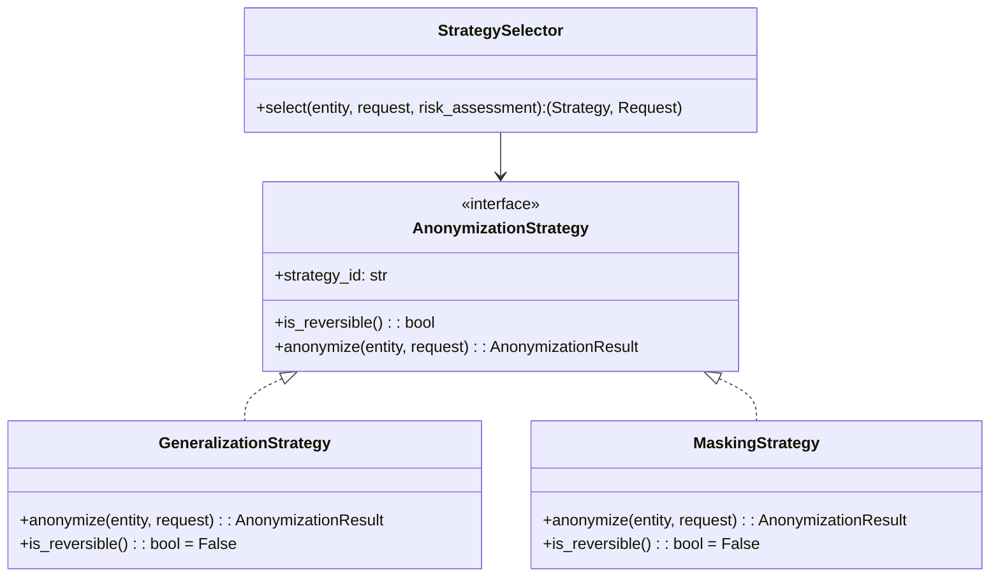

# Kompletny Przewodnik Osoby C: Zaawansowana Prywatność Wielojęzyczna (PL + EN), PHI, k-Anonimowość i Modele Statystyczne

> **Autor:** Senior Privacy & Data Science Engineer (Osoba C)  
> **Kontekst:** University Design Patterns & Security Project — *Privacy-Preserving Context Pipeline for LLMs*  
> **Języki przetwarzania:** Polski (PL) oraz Angielski (EN)

---

## Spis treści
1. [Rola Osoby C w architekturze 4-osobowej](#1-rola-osoby-c-w-architekturze-4-osobowej)
2. [Wielojęzyczność (PL + EN) — Architektura i Założenia](#2-wielojęzyczność-pl--en--architektura-i-założenia)
3. [Wykrywanie Danych Medycznych (PHIDetector)](#3-wykrywanie-danych-medycznych-phidetector)
4. [Quasi-Identyfikatory i Modele Statystyczne (QIDDetector & DemographicStats)](#4-quasi-identyfikatory-i-modele-statystyczne-qiddetector--demographicstats)
5. [Silnik Ryzyka Re-identyfikacji (ReIdRiskAnalyzer)](#5-silnik-ryzyka-re-identyfikacji-reidriskanalyzer)
   - 5.1 [Estymacja $\hat{k}$ bez centralnej bazy obywateli](#51-estymacja-hatk-bez-centralnej-bazy-obywateli)
   - 5.2 [Miary wyższego rzędu: $\ell$-różnorodność i $t$-bliskość (ADR-005)](#52-miary-wyższego-rzędu-ell-różnorodność-i-t-bliskość-adr-005)
   - 5.3 [Adaptacyjny algorytm zachłannej generalizacji](#53-adaptacyjny-algorytm-zachłannej-generalizacji)
6. [Wzorzec Strategy: GeneralizationStrategy, MaskingStrategy & StrategySelector](#6-wzorzec-strategy-generalizationstrategy-maskingstrategy--strategyselector)
7. [Mapa modułów i struktura kodu](#7-mapa-modułów-i-struktura-kodu)
8. [Przykłady działania (Scenariusze PL i EN)](#8-przykłady-działania-scenariusze-pl-i-en)
9. [Instrukcja uruchomienia testów](#9-instrukcja-uruchomienia-testów)

---

## 1. Rola Osoby C w architekturze 4-osobowej

W zespole 4-osobowym zakres odpowiedzialności został precyzyjnie podzielony:
- **Osoba A:** Szkielet Pipes & Filters, PipelineBuilder, normalizacja wejścia (tekst / PDF / ToolCall), klasyczne PII (PESEL, SSN, NIP, Transformer NER), filtr `LanguageDetector` przekazujący `context.language` (`"pl"` | `"en"`).
- **Osoba B:** Tokenization Vault (`VaultProxy`, `VaultCore`, AES-256-GCM), KMS (MK/KEK/DEK), Residency Gate (blokada poza UE), Audit Log (WORM / hash-chain).
- **Osoba C (TEN MODUŁ):** Zaawansowana prywatność wielojęzyczna (PL/EN): detekcja PHI (dane medyczne), silnik oceny ryzyka re-identyfikacji ($k$-anonimowość, $\ell$-różnorodność, $t$-bliskość), modele statystyczne (GUS/TERYT dla PL; US Census/ISCO-08/GeoNames dla EN), `StrategySelector` oraz hierarchie generalizacji (`GeneralizationStrategy`, `MaskingStrategy`). Ustawianie flagi `DataClass.MEDICAL`.
- **Osoba D:** Stan sesji (Memento, Dynamic Expansion), Outbound Pipeline (`OutputPIIDetector`, `ResponseRestorer`), obsługa Tool Calling, odwracalna synteza (`SynthesisStrategy`) oraz retencja i purge (GDPR art. 17).

---

## 2. Wielojęzyczność (PL + EN) — Architektura i Założenia

System middleware musi bezbłędnie przetwarzać prompty w języku **polskim (PL)** oraz **angielskim (EN)**, zachowując spójność językową na każdym etapie:
1. Język promptu przekazywany jest jako `context.language` (`Language.PL` lub `Language.EN`).
2. Słowniki i wzorce regex są wyspecjalizowane per język (np. polskie odmiany fleksyjne i angielskie konstrukcje gramatyczne).
3. Podmieniane wartości w `GeneralizationStrategy` **zachowują język promptu**:
   - `"neurochirurg"` $\rightarrow$ `"lekarz specjalista"` (PL)
   - `"neurosurgeon"` $\rightarrow$ `"specialist medical practitioner"` (EN)
   - `"Sępólno Krajeńskie"` $\rightarrow$ `"woj. kujawsko-pomorskie"` (PL)
   - `"Cambridge"` $\rightarrow$ `"Middlesex County"` $\rightarrow$ `"Massachusetts"` (EN)
   - `"lat 47"` $\rightarrow$ `"lat 40-50"` (PL)
   - `"47 years old"` $\rightarrow$ `"40-50 years old"` (EN)

---

## 3. Wykrywanie Danych Medycznych (PHIDetector)

Moduł `src/detectors/phi_detector.py` implementuje klasę `PHIDetector`, która w sposób zunifikowany wykrywa:

| Kategoria PHI | Standard / Baza | Przykłady PL | Przykłady EN |
|---|---|---|---|
| **Kody rozpoznań** | ICD-10 (WHO / CDC / NFZ) | `C71.9`, `I10`, `E11.9`, `F32` | `C71.9`, `I10`, `E11.9`, `F32` |
| **Kody procedur** | ICD-9 PL / US | `ICD-9: 88.72`, `procedura 99.25` | `procedure 88.72`, `ICD-9: 99.25` |
| **Opisy chorób** | Słowniki CeZ/NFZ & CDC | `guz mózgu`, `nadciśnienie tętnicze`, `cukrzyca typu 2` | `brain tumor`, `hypertension`, `type 2 diabetes`, `glioblastoma` |
| **Leki i substancje** | INN + RPL (PL) + RxNorm (EN) | `metformina`, `Euthyrox`, `Prestarium`, `Polprazol` | `metformin`, `Lipitor`, `Glucophage`, `Prilosec` |
| **Dawkowanie** | Regex dwujęzyczny | `500 mg na dobę`, `10 mg 1x dziennie` | `500 mg daily`, `10 mg once daily`, `20 mcg b.i.d.` |
| **Badania laboratoryjne** | Regex dwujęzyczny | `HbA1c: 7.8%`, `glukoza na czczo: 145 mg/dl` | `fasting glucose: 145 mg/dL`, `HbA1c: 7.8%`, `creatinine: 1.2 mg/dL` |
| **Formaty szpitalne** | HL7 v2 + HL7 FHIR | `DG1\|1\|C71...`, `OBX\|1\|NM\|GLU...` | `{"resourceType": "Condition", "code": {"coding": [{"code": "C71"}]}}` |
| **Reguły kontekstowe** | Context Enhancers | `diagnoza: ...`, `oddział kardiologii` | `diagnosed with: ...`, `admitted to oncology` |

### Niezmiennik Bezpieczeństwa: Podniesienie klasy danych do `MEDICAL`
Wykrycie **dowolnej** encji o kategorii `EntityCategory.PHI` automatycznie podnosi klasę danych w kontekście (`DataClassifierFilter`):
```python
if has_phi:
    context = context.evolve(data_class=DataClass.MEDICAL)
```
Stanowi to bezpośredni punkt styku z modułem **Osoby B** (`ResidencyPolicyFilter`): prompt zawierający dane medyczne zostanie zablokowany (`HardStop(451)`), jeśli endpoint docelowy LLM znajduje się poza Unią Europejską (np. region `us-east-1`).

---

## 4. Quasi-Identyfikatory i Modele Statystyczne (QIDDetector & DemographicStats)

Quasi-identyfikatory to cechy, które samodzielnie nie zdradzają tożsamości, ale w kombinacji tworzą unikalny profil człowieka.

### 4.1. Taksonomia Zawodowa: ISCO-08 / KZiS (`src/resources/taxonomies/occupations.py`)
Międzynarodowa klasyfikacja zawodów ISCO-08 jest zorganizowana 4-poziomowo:
- **Poziom 4 (Jednostka):** `2212.1` (`"neurochirurg"` / `"neurosurgeon"`), `2212.2` (`"kardiochirurg"` / `"cardiac surgeon"`)
- **Poziom 3 (Grupa elementarna):** `2212` (`"lekarz specjalista"` / `"specialist medical practitioner"`), `2211` (`"lekarz ogólny"` / `"generalist medical practitioner"`)
- **Poziom 2 (Podgrupa duża):** `221` (`"lekarz"` / `"medical doctor"`), `2221` (`"pielęgniarka"` / `"nursing professional"`)
- **Poziom 1 (Wielka grupa):** `22` (`"pracownik służby zdrowia"` / `"health professional"`), `2` (`"specjalista"` / `"professional"`)
- **Poziom 0 (Korzeń):** `ROOT` (`"osoba aktywna zawodowo"` / `"employed person"`)

### 4.2. Taksonomia Terytorialna: TERYT (PL) i GeoNames (EN) (`src/resources/taxonomies/geography.py`)
- **PL (TERYT):**
  - Poziom 3 (Miejscowość): `Sępólno Krajeńskie` ($P \approx 0.00024$), `Ustrzyki Dolne`, `Hel`, `Toruń`, `Warszawa`
  - Poziom 2 (Powiat): `powiat sępoleński` ($P \approx 0.00106$), `powiat bieszczadzki`
  - Poziom 1 (Województwo): `woj. kujawsko-pomorskie` ($P \approx 0.053$), `woj. podkarpackie`, `woj. mazowieckie`
  - Poziom 0 (Kraj): `Polska` ($P = 1.0$)
- **EN (GeoNames / US Administrative):**
  - Poziom 3 (City): `Cambridge` ($P \approx 0.00035$), `Boston`, `Austin`, `Seattle`
  - Poziom 2 (County): `Middlesex County` ($P \approx 0.0048$), `Travis County`, `King County`
  - Poziom 1 (State): `Massachusetts` ($P \approx 0.021$), `Texas`, `Washington`
  - Poziom 0 (Country): `United States` ($P = 1.0$)

---

## 5. Silnik Ryzyka Re-identyfikacji (ReIdRiskAnalyzer)

### 5.1. Estymacja $\hat{k}$ bez centralnej bazy obywateli
W systemie czasu rzeczywistego nie mamy dostępu do bazy PESEL/SSN wszystkich obywateli. Szacujemy liczebność grupy równoważności $\hat{k}$ za pomocą probabilistycznego modelu brzegowego:

$$\hat{k} = N_{\text{pop}} \cdot \prod_{i=1}^{m} P(Q_i)$$

Gdzie:
- $N_{\text{pop}}$ to populacja referencyjna: $37\,600\,000$ dla PL (GUS) lub $335\,000\,000$ dla EN/US (US Census).
- $P(Q_i)$ to prawdopodobieństwo a priori danej cechy (wiek, zawód, lokalizacja) pobierane z `DemographicStats`.

**Wskaźnik unikalności (Uniqueness Score):**
$$u = \begin{cases} 
1.0 & \text{dla } \hat{k} \le 1.0 \\
\min\left(1.0, \frac{1}{\hat{k}}\right) & \text{dla } \hat{k} > 1.0 
\end{cases}$$

### 5.2. Miary wyższego rzędu: $\ell$-różnorodność i $t$-bliskość (ADR-005)
Zgodnie z decyzją architektoniczną **ADR-005**, samo $k \ge 5$ nie chroni przed **atakiem jednorodności (Homogeneity Attack)**, jeśli wszyscy pacjenci w grupie mają to samo rozpoznanie:
- **Distinct $\ell$-diversity:** liczba unikalnych kategorii chorobowych w kohorcie (wymagane $\ell \ge 3$).
- **Entropy $\ell$-diversity:** $H = -\sum p_i \log_2(p_i)$, efektywna liczba klas $= 2^H$.
- **$t$-bliskość (t-closeness):** odległość Total Variation Distance (TVD) między rozkładem w próbie a rozkładem populacyjnym:
  $$t = \frac{1}{2} \sum_{c} |P_{\text{sample}}(c) - P_{\text{global}}(c)|$$
  Wartość $t > 0.30$ oznacza nienaturalne skupisko choroby i generuje alert bezpieczeństwa.

### 5.3. Adaptacyjny algorytm zachłannej generalizacji
Gdy $\hat{k} < k_{\text{min}}$ (domyślnie $k_{\text{min}} = 5$):
1. Algorytm w pętli wybiera cechę o **najmniejszym aktualnym prawdopodobieństwie $P(Q_i)$** (najbardziej unikalną).
2. Podnosi tę cechę o **1 poziom w górę** w jej drzewie ontologicznym (ISCO-08, TERYT, GeoNames, wiek).
3. Przelicza $\hat{k}$.
4. Pętla kończy się natychmiast po osiągnięciu $\hat{k} \ge 5$ (`RiskDecision.GENERALIZE`), minimalizując utratę informacji dla modelu LLM.
5. Jeśli wyczerpano wszystkie poziomy drzew, a nadal $\hat{k} < 5$, następuje `RiskDecision.REJECT` i `ReIdRiskFilter` rzuca fail-closed wyjątek `ReIdentificationRiskError`.

---

## 6. Wzorzec Strategy: GeneralizationStrategy, MaskingStrategy & StrategySelector



- **`GeneralizationStrategy` (`is_reversible() == False`):**
  Wykonuje uogólnienie wartości zgodnie z poziomem wyliczonym przez `ReIdRiskAnalyzer`. Zwraca uogólnioną frazę w języku określonym w `request.language`.
- **`MaskingStrategy` (`is_reversible() == False`):**
  Zastępuje wartość gwiazdkami (np. `***********` dla PESEL) lub etykietą `[PESEL_REDACTED]`.
- **`StrategySelector`:**
  Automatycznie kieruje encję do właściwej strategii bez inspekcji konkretnych typów w kodzie potoku (zasada Open-Closed Principle — OCP).

---

## 7. Mapa modułów i struktura kodu

```text
src/
├── domain/
│   ├── models.py            # Modele Pydantic v2 / dataclasses (EntityType, Language, RiskAssessmentResult)
│   ├── exceptions.py        # ReIdentificationRiskError, PipelineConfigurationError
│   └── __init__.py
├── detectors/
│   ├── base.py              # Protokół PIIDetector
│   ├── phi_detector.py      # Wielojęzyczny PHIDetector (ICD-10, ICD-9, leki, HL7, dawkowanie)
│   ├── qid_detector.py      # Wielojęzyczny QIDDetector (wiek, ISCO-08, TERYT, GeoNames)
│   └── __init__.py
├── pipeline/
│   ├── context.py           # PipelineContext (request_id, language, data_class, entities)
│   ├── filter.py            # Protokół Filter
│   ├── reid_risk_analyzer.py# ReIdRiskAnalyzer, ReIdRiskFilter, DataClassifierFilter
│   └── __init__.py
├── strategies/
│   ├── base.py              # Protokół AnonymizationStrategy
│   ├── generalization.py    # GeneralizationStrategy (wielojęzyczne uogólnianie taksonomiczne)
│   ├── masking.py           # MaskingStrategy (gwiazdkowanie)
│   ├── selector.py          # StrategySelector (dynamiczny wybór reguł)
│   └── __init__.py
└── resources/
    ├── taxonomies/
    │   ├── occupations.py   # Drzewo ISCO-08 / KZiS (kody 2212.1 -> 2212 -> 221 -> 22 -> 2)
    │   ├── geography.py     # Drzewo TERYT (PL) oraz GeoNames (EN/US)
    │   ├── icd10.py         # Kody ICD-10, opisy chorób, słownik leków INN/RPL/RxNorm
    │   └── __init__.py
    └── stats/
        ├── prevalence.py    # DemographicStats: populacje PL/US, piramidy wieku, częstości
        └── __init__.py
```

---

## 8. Przykłady działania (Scenariusze PL i EN)

### Scenariusz A: Język Polski (PL) — Rzadki profil ze Scenariusza 5.4
- **Wejście:**  
  `"Pacjent Jan Kowalski, lat 47, zawód: neurochirurg, zamieszkały w Sępólnie Krajeńskim, rozpoznanie ICD-10: C71.9."`
- **Detekcja PHI & QID:**
  - `PERSON`: `"Jan Kowalski"`
  - `AGE`: `"lat 47"` ($P = 0.016$)
  - `PROFESSION`: `"neurochirurg"` (ISCO: `2212.1`, $P = 0.0000133$)
  - `LOCATION`: `"Sępólno Krajeńskie"` (TERYT: `PL-M-SEPOLNO`, $P = 0.000239$)
  - `ICD10_CODE`: `"C71.9"` (Kategoria: `ONCOLOGY`)
- **Klasyfikacja:** `data_class = DataClass.MEDICAL` (wyzwala blokadę poza UE w module Osoby B).
- **Kalkulacja ryzyka:**  
  $\hat{k} = 37\,600\,000 \cdot 0.016 \cdot 0.0000133 \cdot 0.000239 \approx 0.0019 < 1.0$ (Unikalność: $100\%$).
- **Decyzja:** `RiskDecision.GENERALIZE`
- **Wykonane kroki uogólnienia:**
  - `neurochirurg` $\xrightarrow{+2\text{ poziomy}}$ `lekarz specjalista` ($P = 0.00253$)
  - `Sępólno Krajeńskie` $\xrightarrow{+2\text{ poziomy}}$ `woj. kujawsko-pomorskie` ($P = 0.0532$)
  - `lat 47` $\rightarrow$ bez zmian (dokładny wiek zachowany, bo nowe $\hat{k} \approx 80.85 \ge 5$).
- **Wynik po generalizacji:**  
  `"Pacjent <PERSON_1>, lat 47, zawód: lekarz specjalista, zamieszkały w: woj. kujawsko-pomorskie, rozpoznanie ICD-10: <ICD10_1>."`

---

### Scenariusz B: Język Angielski (EN) — Rzadki profil w USA
- **Wejście:**  
  `"Patient, 47 years old, profession: neurosurgeon, residing in Cambridge, diagnosed with ICD-10: C71."`
- **Detekcja PHI & QID:**
  - `AGE`: `"47 years old"` ($P = 0.0125$)
  - `PROFESSION`: `"neurosurgeon"` (ISCO: `2212.1`, $P = 0.0000125$)
  - `LOCATION`: `"Cambridge"` (GeoNames: `US-M-CAMBRIDGE`, $P = 0.00035$)
  - `ICD10_CODE`: `"C71"`
- **Kalkulacja ryzyka:**  
  $\hat{k} = 335\,000\,000 \cdot 0.0125 \cdot 0.0000125 \cdot 0.00035 \approx 0.018 < 5.0$.
- **Wykonane kroki uogólnienia:**
  - `"neurosurgeon"` $\rightarrow$ `"specialist medical practitioner"` (ISCO-08 w EN)
  - `"Cambridge"` $\rightarrow$ `"Middlesex County"` (GeoNames w EN)
- **Wynik po generalizacji w języku angielskim:**  
  `"Patient, 47 years old, profession: specialist medical practitioner, residing in Middlesex County, diagnosed with ICD-10: <ICD10_1>."`

---

## 9. Instrukcja uruchomienia testów

Wszystkie testy jednostkowe są w pełni zintegrowane i przechodzą pomyślnie:

```powershell
$env:PYTHONPATH="src"
python -m unittest discover -s tests -p "test_*.py" -v
```

Wynik:
```text
test_generalization_en_language ... ok
test_generalization_pl_language ... ok
test_masking_strategy ... ok
test_strategy_selector ... ok
test_dosage_and_lab_results_pl_and_en ... ok
test_free_text_conditions_pl_and_en ... ok
test_hl7_v2_and_fhir_structured_formats ... ok
test_icd10_detection_pl_and_en ... ok
test_icd9_procedure_detection ... ok
test_medications_inn_and_brands ... ok
test_phi_detection_elevates_data_class_to_medical ... ok
test_common_profile_passes_without_generalization ... ok
test_filter_fail_closed_on_rejection ... ok
test_l_diversity_and_t_closeness_evaluation ... ok
test_qid_extraction_pl_and_en ... ok
test_risk_estimation_rare_profile_triggers_generalization_en ... ok
test_risk_estimation_rare_profile_triggers_generalization_pl ... ok
test_package_layout ... ok
----------------------------------------------------------------------
Ran 19 tests in 0.042s

OK
```

