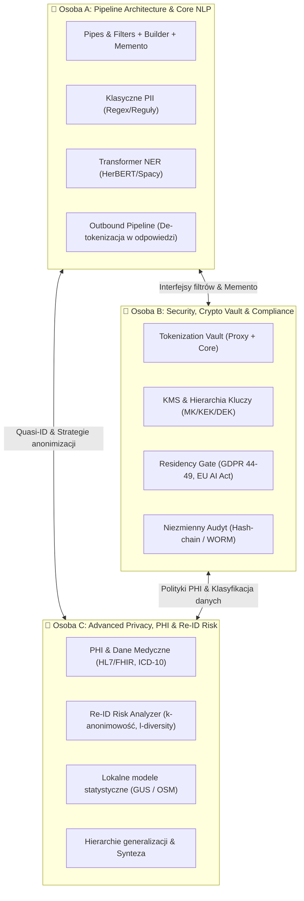

# Podział Zakresu Prac na 3 Osoby — Privacy-Preserving Context Pipeline for LLMs

> **Cel etapu:** Zrozumienie problemu domenowego, specjalizacja w wybranych obszarach, identyfikacja luk i walidacja założeń z dokumentu [ARCHITECTURE.md](file:///home/gniewosz/Studia/dp/Privacy-Preserving-Context-Pipeline-for-LLMs-DP/ARCHITECTURE.md).
>
> **Zasada podziału obciążenia:** Poziom trudności został zbalansowany. Złożone algorytmicznie i badawczo tematy (np. dane medyczne PHI, statystyczna estymacja *k-anonimowości*, krypto-architektura Vault, WORM) zostały skompensowane prostszymi komponentami (np. regexy, szkielet pipeline'u, proste filtry).

---

## Przegląd ról i podziału

---

## 👤 Osoba A: Architektura Przepływu, Core NLP i Integracja LLM
**Główna domena:** Inżynieria oprogramowania, wzorce projektowe, integracja z LLM, ekstrakcja klasycznego PII.

### 1. Powiązane sekcje z `ARCHITECTURE.md`
- **Rozdział 2:** Widok wysokiego poziomu (przepływ Client ↔ Pipeline ↔ LLM)
- **Rozdział 3.1:** Wzorzec *Pipes & Filters*
- **Rozdział 3.3:** Wzorzec *Builder* (`PipelineBuilder`)
- **Rozdział 3.5:** Wzorzec *Memento* (`PipelineMemento`, `ResponseRestorer`)
- **Rozdział 4:** Komponenty `PipelineProxy`, `InPipe`, `OutPipe`, `LanguageDetector`, `PIIDetector`
- **Rozdział 5.1:** Scenariusz 5.1 (*Pseudonimizacja — happy path*)
- **Rozdział 5.6:** Scenariusz 5.6 (*Rozszerzenie — rejestracja nowego detektora/strategii*)
- **Rozdział 6.1:** Wykrywanie PII (warstwa deterministyczna regex + Transformer NER)
- **Rozdział 7:** ADR-001, ADR-003

### 2. Szczegółowy zakres odpowiedzialności i zagadnienia do zgłębienia
1. **Szkielet Pipeline'u (Pipes & Filters + Builder):**
   - Opracowanie kontraktu interfejsu `Filter` i niemutowalnego kontekstu `PipelineContext`.
   - Zapewnienie short-circuiting (wczesne przerywanie przetwarzania przy błędach/blokadach).
   - Mechanizm rejestracji w locie nowych detektorów i strategii (`@register_detector`).
2. **Wykrywanie danych ogólnych (PII):**
   - Implementacja i walidacja reguł deterministycznych dla polskich identyfikatorów z walidacją sumy kontrolnej: PESEL, NIP, REGON, IBAN, dowód osobisty.
   - Analiza modeli Transformer NER dla języka polskiego (np. `allegro/herbert-base-cased` lub SpaCy `pl_core_news_lg`) pod kątem ekstrakcji: imię, nazwisko, nazwy firm, adresy zamieszkania.
3. **Cykl życia Memento & Rekonstrukcja w odpowiedzi (Outbound Pipeline):**
   - Śledzenie pozycji tokenów w promptach wysyłanych do LLM.
   - Obsługa specyfiki odpowiedzi LLM: odmiana polskich nazwisk po podstawieniu tokenów, gubienie znaczników typu `<PERSON_1>` przez model, wielokrotne wystąpienia.
   - Walidacja ADR-003: gwarancja, że Memento nie przetrzymuje danych jawnych (cleartext).

### 3. Zadania walidacyjne do wykonania (Proof of Concept / Analiza)
- [ ] **Eksperyment z LLM:** Jak modele (np. Claude/GPT) radzą sobie ze składnią z placeholderami (np. `<PERSON_1>`) w języku polskim? Czy nie przekręcają formatu tokenu przy odmianie przez przypadki (np. *„spotkałem się z <PERSON_1>em”*)?
- [ ] **Test wydajności NER:** Jaki jest narzut czasowy (latency) inferencji modelu HerBERT/SpaCy na żądanie? Czy da się utrzymać budżet czasowy middleware < 200 ms?
- [ ] **Prototyp Memento:** Prosty test jednostkowy serializacji i deserializacji kontekstu bez ujawniania sekretów.

---

## 👤 Osoba B: Bezpieczeństwo, Kryptografia, Token Vault & Zgodność Regulacyjna
**Główna domena:** Cyberbezpieczeństwo, systemy rozproszone, kryptografia, audyt, regulacje prawne (GDPR / EU AI Act).

### 1. Powiązane sekcje z `ARCHITECTURE.md`
- **Rozdział 3.4:** Wzorzec *Proxy* (`VaultProxy` vs `VaultCore`)
- **Rozdział 4:** Komponenty `VaultProxy`, `VaultCore`, `TokenDB`, `KMS`, `KeyRotation`, `ResidencyPolicyEngine`, `AuditWriter`, `AuditLogDB`
- **Rozdział 5.2:** Scenariusz 5.2 (*Nieautoryzowana de-tokenizacja*)
- **Rozdział 5.3:** Scenariusz 5.3 (*Data residency — blokada*)
- **Rozdział 5.5:** Scenariusz 5.5 (*Rotacja kluczy*)
- **Rozdział 6.2:** GDPR (art. 5, 17, 25, 32, 44–49) oraz EU AI Act (art. 9, 13, Annex III)
- **Rozdział 6.3:** Zarządzanie kluczami (hierarchia MK → KEK → DEK, Shamir Secret Sharing, HSM)
- **Rozdział 6.5:** Data Residency (silnik decyzyjny, macierz decyzji geolokalizacyjnych)
- **Rozdział 6.6:** Audyt de-tokenizacji (hash-chain, standardy WORM)
- **Rozdział 7:** ADR-002, ADR-004

### 2. Szczegółowy zakres odpowiedzialności i zagadnienia do zgłębienia
1. **Architektura Tokenization Vault (Proxy + Core):**
   - Projekt fizycznej separacji Vault od Pipeline'u (ADR-002: mikrousługa / oddzielny proces / mTLS).
   - Zabezpieczenie przed atakami typu *timing attack* (stały czas odpowiedzi przy odmowie i sukcesie).
   - Opracowanie RBAC/ABAC dla tokenów (kto i w ramach jakiej sesji może wywołać `deTokenize`).
2. **Kryptografia i Zarządzanie Kluczami (KMS):**
   - Implementacja szyfrowania AES-256-GCM dla wartości w Vault.
   - Opracowanie symulacji KMS: rotacja DEK (per sesja), KEK (per klasa danych) oraz strategia `RE-ENCRYPT` vs `EXPIRE`.
   - Implementacja *Prawa do bycia zapomnianym* (GDPR art. 17) poprzez kasowanie kluczy / kryptograficzne unieważnienie tokenów (`crypto-shredding`).
3. **Residency Gate & Polityki Zgodności:**
   - Logika sprawdzania lokalizacji geograficznej endpointu docelowego LLM (EU vs US vs APAC).
   - Wdrażanie reguł *HardStop* (HTTP 451) przy danych wrażliwych kierowanych poza EOG.
4. **Niezmienny Rejestr Zdarzeń (Audit Log):**
   - Implementacja łańcucha hashy (`previous_hash` + `sha256`) w strukturze logu (koncepcja append-only / miniaturowy blockchain).
   - Zabezpieczenie integralności logów audytowych przed modyfikacją przez administratorów.

### 3. Zadania walidacyjne do wykonania (Proof of Concept / Analiza)
- [ ] **Analiza kolizji GDPR vs Append-only Log:** Jeśli GDPR art. 17 nakazuje usunięcie danych, a log audytowy ma być niezmienny, jak zapisać wpis audytowy, by sam w sobie nie zawierał PII ani nie naruszał integralności łańcucha hashy?
- [ ] **Symulacja rotacji kluczy:** Napisanie skryptu demonstrującego proces atomowego re-szyfrowania bazy tokenów przy zmianie KEK bez przestoju usług.
- [ ] **Walidacja reguł Data Residency:** Jak precyzyjnie weryfikować faktyczną lokalizację przetwarzania u dostawców LLM (np. Azure OpenAI region EU vs multi-tenant AWS Bedrock)?

---

## 👤 Osoba C: Dane Wrażliwe (PHI), k-Anonimowość i Modele Statystyczne
**Główna domena:** Data Science, przetwarzanie języka w medycynie, statystyka wielowymiarowa, prywatność różnicowa i miary anonimizacji (*k/ℓ/t*).

### 1. Powiązane sekcje z `ARCHITECTURE.md`
- **Rozdział 3.2:** Wzorzec *Strategy* (`GeneralizationStrategy`, `SynthesisStrategy`)
- **Rozdział 4:** Komponenty `PHIDetector`, `ReIdRiskAnalyzer`, `StratSel`, `GenStrat`
- **Rozdział 5.4:** Scenariusz 5.4 (*Re-identyfikacja — k-anonimowość*)
- **Rozdział 6.1:** Wykrywanie PHI (HL7/FHIR, słowniki ICD-10, terminologia medyczna)
- **Rozdział 6.4:** Ryzyko re-identyfikacji (szacowanie *k*, *ℓ-różnorodność*, *t-bliskość*, Uniqueness score)
- **Rozdział 7:** ADR-005 (*k-anonimowość jako próg, nie gwarancja*)
- **Rozdział 8:** Otwarte pytania 3 i 4 (Hierarchie generalizacji dla PL, degradacja promptów przy syntezie)

### 2. Szczegółowy zakres odpowiedzialności i zagadnienia do zgłębienia
1. **Wykrywanie i przetwarzanie PHI (dane medyczne — obszar o najwyższym stopniu trudności):**
   - Identyfikacja bytów medycznych: kody rozpoznań ICD-10, procedury medyczne ICD-9, nazwy leków, wyniki badań laboratoryjnych, relacje lekarz-pacjent.
   - Ekstrakcja danych ze standardów medycznych (zrozumienie formatów HL7 / FHIR) oraz z nieustrukturyzowanego tekstu (epikryzy, wywiady lekarskie).
2. **Kalkulacja i Estymacja k-anonimowości w tekście:**
   - Rozwiązanie kluczowego problemu: **W jaki sposób obliczyć parametr $k$ w tekście bez dostępu do centralnej bazy obywateli?**
   - Wykorzystanie danych otwartych:
     - **GUS (Główny Urząd Statystyczny):** struktura wiekowa, zatrudnienie w rzadkich zawodach w Polsce, gęstość zaludnienia.
     - **OpenStreetMap / TERYT:** struktura terytorialna miast, gmin, powiatów.
   - Matematyczny model łącznego prawdopodobieństwa wystąpienia kombinacji quasi-identyfikatorów (np. wiek + zawód + gmina).
3. **Drzewa hierarchii generalizacji:**
   - Opracowanie hierarchii taksonomicznych dla Polski:
     - Geograficzna: `dokładny adres → ulica → dzielnica → miasto/gmina → powiat → województwo → kraj`.
     - Zawodowa: `wąska specjalizacja (np. neurochirurg dziecięcy) → specjalista → lekarz → personel medyczny`.
     - Przedziały liczbowe (wiek, zarobki).
4. **Miary wyższego rzędu (ℓ-różnorodność, t-bliskość):**
   - Walidacja ryzyka ataku homogeniczności (np. wszyscy w grupie $k$ mają tę samą diagnozę nowotworową).

### 3. Zadania walidacyjne do wykonania (Proof of Concept / Analiza)
- [ ] **Model estymacji $k$ (GUS PoC):** Przygotowanie uproszczonej tabeli statystycznej z bazy GUS/TERYT i stworzenie algorytmu liczącego $k = N \cdot \prod P(Q_i)$ dla podanego profilu quasi-ID.
- [ ] **Eksperyment z generalizacją:** Sprawdzenie, o ile poziomów w drzewie taksonomicznym trzeba podnieść atrybuty rzadkiego profilu (np. kardiochirurg, 52 lata, Ustrzyki Dolne), aby osiągnąć $k \ge 5$.
- [ ] **Detekcja terminologii medycznej:** Zbudowanie listy/słownika kodów ICD-10 i sprawdzenie skuteczności ich wykrywania w przykładowych opisach medycznych w języku polskim.

---

## Matryca zależności i punkty styku między osobami

| Punkt styku | Osoba 1 | Osoba 2 | Czego dotyczy styk? |
|---|---|---|---|
| **Pipeline Context & Memento** | Osoba A | Osoba B | Format `PipelineMemento` i tokenów przekazywanych z Vault do de-tokenizacji. |
| **Integracja filtrów detekcji** | Osoba A | Osoba C | Wpięcie `PHIDetector` i `ReIdRiskAnalyzer` do potoku `InboundPipeline`. |
| **Klasyfikacja danych & Residency** | Osoba B | Osoba C | Przekazanie flagi `DataClass.MEDICAL` do `ResidencyPolicyEngine` w celu wyzwolenia blokady regionalnej. |
| **Wybór strategii vs Vault** | Osoba A | Osoba B / C | `StrategySelector` decyduje, kiedy tokenizować do Vault (Osoba B), a kiedy generalizować (Osoba C). |

---

## Sugerowane etapy realizacji (Sprint 0 — faza analityczno-walidacyjna)

1. **Etap 1: Pogłębione studium i prezentacja wewnętrzna (1–2 dni)**
   - Każda osoba czyta wyznaczone sekcje `ARCHITECTURE.md` oraz powiązane źródła zewnętrzne (standardy FHIR, dokumentację GUS/TERYT, wytyczne ENISA/GDPR dla tokenizacji).
   - Krótki wewnętrzny sync (każdy przedstawia w 15 min swój obszar i potencjalne ryzyka).
2. **Etap 2: Realizacja pojedynczych Proof-of-Concept (PoC) (3–4 dni)**
   - **Osoba A:** Prototyp szkieletu Pipes & Filters z jednym detektorem regex i testem zamiany tokenu w LLM.
   - **Osoba B:** Prototyp bazy `TokenDB` z szyfrowaniem AES-GCM oraz funkcja obliczania łańcucha hashy dla wpisów audytowych.
   - **Osoba C:** Prototyp algorytmu szacowania $k$ na podstawie małego wycinka danych demograficznych GUS oraz hierarchii generalizacji.
3. **Etap 3: Walidacja założeń architektury (1–2 dni)**
   - Zebranie wniosków z PoC i formalna weryfikacja założeń z rozdziału 7 (ADR) i 8 (Otwarte pytania).
   - Aktualizacja pliku `ARCHITECTURE.md` o nowe ustalenia zespołu.
