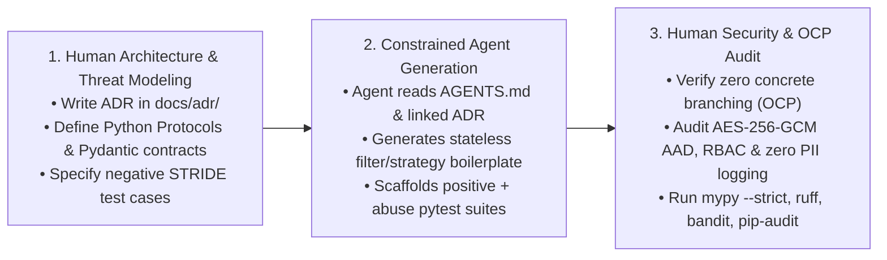

# AI Agent Usage & Human-in-the-Loop Governance Log (`docs/AI_USAGE.md`)

> **Project:** LLM Anonymization & Pseudonymization Pipeline  
> **Team Size:** 4 Engineers  
> **Governance Policy:** AI coding agents act strictly as constrained pair-programmers under [`AGENTS.md`](../AGENTS.md). Architectural decisions, security boundaries, and cryptographic invariants remain under 100% human ownership.

---

## 1. Human-in-the-Loop (HITL) Engineering Workflow

Our team enforces a 3-stage Human-in-the-Loop workflow for every feature and milestone:

### Stage 1: Human Interface Design & ADR Authorship
- Before prompting any AI agent to write production code, the responsible team member writes or updates the relevant **Architecture Decision Record (`docs/adr/00X-*.md`)** and defines exact Python 3.12 `Protocol` / `ABC` signatures and frozen Pydantic v2 models.
- Humans explicitly identify which STRIDE threats apply (from [`docs/security/STRIDE.md`](security/STRIDE.md)) and list the required negative/abuse test cases.

### Stage 2: Constrained Agent Code & Test Generation
- The developer invokes the AI agent with explicit context: `@AGENTS.md`, the target `ADR`, and the interface contract.
- The agent is tasked with implementing concrete strategies, builders, or unit/abuse test fixtures while obeying all constraints in `AGENTS.md` (no `if/elif` type switching in filters, no direct `TokenVault` access bypassing `VaultProtectionProxy`, zero hardcoded keys or jurisdictions).

### Stage 3: Human Security, Cryptography & OCP Review
- Every line of agent-generated code undergoes manual review by the author and at least one peer reviewer using the checklists in [`.github/pull_request_template.md`](../.github/pull_request_template.md):
  1. **Open-Closed Principle (OCP) Audit:** Confirm that adding a new `PIIDetector` or `AnonymizationStrategy` requires zero edits to `src/pipeline/`.
  2. **Encapsulation Audit:** Confirm `TokenVault` and `AnonymizationMemento` internals are never exposed or mutated outside their authorized boundaries.
  3. **Zero PII Leakage Audit:** Verify that `repr()`, `str()`, `AuditEvent` payloads, and exception messages never include raw PII/PHI substrings.

---
