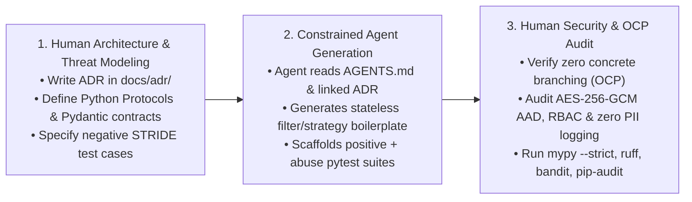

# AI Agent Usage & Human-in-the-Loop Governance Log (`docs/AI_USAGE.md`)

> **Project:** LLM Anonymization & Pseudonymization Pipeline  
> **Team Size:** 4 Engineers  
> **Governance Policy:** AI coding agents act strictly as constrained pair-programmers under [`AGENTS.md`](../AGENTS.md). Architectural decisions, security boundaries, and cryptographic invariants remain under 100% human ownership.

---

## 1. Human-in-the-Loop (HITL) Engineering Workflow

Our team enforces a 3-stage Human-in-the-Loop workflow for every feature and milestone:

### Stage 1: Human Interface Design & ADR Authorship
- Before prompting any AI agent to write production code, the responsible team member writes or updates the relevant **Architecture Decision Record (`docs/adr/00X-*.md`)** and defines exact Python 3.12 `Protocol` / `ABC` signatures and frozen Pydantic v2 models.
- Humans explicitly identify which STRIDE threats apply (from [`docs/security/STRIDE.md`](security/STRIDE.md)) and list the required negative/abuse test cases.

### Stage 2: Constrained Agent Code & Test Generation
- The developer invokes the AI agent with explicit context: `@AGENTS.md`, the target `ADR`, and the interface contract.
- The agent is tasked with implementing concrete strategies, builders, or unit/abuse test fixtures while obeying all constraints in `AGENTS.md` (no `if/elif` type switching in filters, no direct `TokenVault` access bypassing `VaultProtectionProxy`, zero hardcoded keys or jurisdictions).

### Stage 3: Human Security, Cryptography & OCP Review
- Every line of agent-generated code undergoes manual review by the author and at least one peer reviewer using the checklists in [`.github/pull_request_template.md`](../.github/pull_request_template.md):
  1. **Open-Closed Principle (OCP) Audit:** Confirm that adding a new `PIIDetector` or `AnonymizationStrategy` requires zero edits to `src/pipeline/`.
  2. **Encapsulation Audit:** Confirm `TokenVault` and `AnonymizationMemento` internals are never exposed or mutated outside their authorized boundaries.
  3. **Zero PII Leakage Audit:** Verify that `repr()`, `str()`, `AuditEvent` payloads, and exception messages never include raw PII/PHI substrings.

---

## 2. Milestone 1 — Week 2: Governance, Core Contracts & Pipes/Filters Foundation

**Focus:** Repository initialization, ADRs 001–005, STRIDE threat model, immutable `PipelineContext`, `Filter` / `Pipe` abstractions, `PIIDetector` & `AnonymizationStrategy` interfaces, and `PipelineBuilder`.

| Date / PR | Component / ADR | Prompt Summary / Task Delegated | What Agent Did Well | Human Corrections & Architectural Interventions |
| :--- | :--- | :--- | :--- | :--- |
| `2026-11-10` / `PR #1` | Repo Governance, ADRs 001–005, `STRIDE.md`, `AGENTS.md` | Initialize project governance, ADR suite, STRIDE threat matrix across Scenarios 1–6, and CI security workflow (`ruff`, `mypy --strict`, `pytest`, `bandit`, `pip-audit`). | Generated cohesive ADR documentation aligned with our 5 GoF/POSA patterns and mapped concrete abuse cases to each STRIDE category and project scenario. | Reviewed and tightened `AGENTS.md` rules to explicitly forbid direct `TokenVault` instantiation outside `VaultProtectionProxy` and mandated AES-256-GCM AAD tenant binding. |
| `2026-11-12` / `PR #2` *(Example)* | `AnonymizationFilter` & `RegexPIIDetector` (`ADR-001`, `ADR-002`) | Generate `AnonymizationFilter.process()` and initial regex detectors for PESEL and Email using `PipelineContext`. | Produced clean Pydantic v2 `frozen=True` models and accurate Modulo-10 checksum validation for Polish PESEL numbers. | **OCP & Security Intervention:** The agent initially generated an `if entity.type == "PESEL": MaskingStrategy().anonymize(...) elif entity.type == "PERSON": TokenizationStrategy()...` block inside `AnonymizationFilter` and included `f"Invalid PESEL: {raw_value}"` in `ValueError`. We rejected both: refactored `AnonymizationFilter` to delegate exclusively to an injected `StrategySelector` (restoring strict OCP compliance for Week 6) and scrubbed `raw_value` from the exception message to prevent PII leakage in error logs. |

---

## 3. Milestone 2 — Week 4: Cryptographic Vault, Protection Proxy, Memento & Residency Gate

**Focus:** `TokenVault` (AES-256-GCM + AAD), `KeyManager` with key versioning/rotation, `VaultProtectionProxy` (RBAC + immutable audit trail), `AnonymizationMemento` & `Caretaker`, and `ResidencyGate` (EU Data Residency enforcement for PHI).

| Date / PR | Component / ADR | Prompt Summary / Task Delegated | What Agent Did Well | Human Corrections & Architectural Interventions |
| :--- | :--- | :--- | :--- | :--- |
| *TBD (Week 4)* | `VaultProtectionProxy` & `TokenVault` (`ADR-004`) | *Document prompt used to scaffold AES-256-GCM encryption, RBAC checks, and audit event emission.* | *Document agent strengths (e.g., nonce generation, test parameterization).* | *Document human fixes (e.g., enforcing AAD verification, ensuring denied attempts log before raising exception, sealing direct vault access).* |
| *TBD (Week 4)* | `AnonymizationMemento` & `Caretaker` (`ADR-005`) | *Document prompt used for Memento state capture and response re-identification.* | *Document agent strengths.* | *Document human fixes (e.g., sealing Memento attributes against external mutation or inspection).* |
| *TBD (Week 4)* | `ResidencyGate` (`ADR-001`, `STRIDE.md`) | *Document prompt used for EU data residency policy evaluation on PHI payloads.* | *Document agent strengths.* | *Document human fixes (e.g., removing hardcoded region strings in favor of declarative `ResidencyPolicy`).* |

---

## 4. Milestone 3 — Week 6: Hidden Change Request & Extensibility Verification

**Focus:** Implementing the instructors' unannounced Week 6 Change Request + Scenario 6 (Polish IBAN detector & strategy extension) with **zero modifications** to core pipeline classes, demonstrating strict Open-Closed Principle (OCP) compliance.

| Date / PR | Component / ADR | Prompt Summary / Task Delegated | What Agent Did Well | Human Corrections & Architectural Interventions |
| :--- | :--- | :--- | :--- | :--- |
| *TBD (Week 6)* | Week 6 Hidden Change Request (`ADR-002`, `ADR-003`) | *Document the exact Week 6 requirement announced by instructors and the prompt delegated to the agent.* | *Document how existing abstractions (`Filter`, `PIIDetector`, `AnonymizationStrategy`, `PipelineBuilder`) accommodated the change.* | *Document human verification that `git diff src/pipeline/filter.py` and core filters remained untouched.* |
| *TBD (Week 6)* | Polish IBAN Extension — Scenario 6 (`ADR-002`) | *Document prompt for adding `PolishIBANDetector` (ISO 13616 Mod-97) and registering via `PipelineBuilder`.* | *Document agent strengths.* | *Document human verification of edge cases (whitespace normalization, false-positive prevention).* |

---

## 5. Milestone 4 — Week 8: k-Anonymity, End-to-End Hardening & Final Security Audit

**Focus:** Scenario 4 ($k$-anonymity generalization and re-identification risk filter), Scenario 5 (live key rotation and expired token rejection), FastAPI middleware integration, full SAST/dependency audit, and final presentation benchmarks.

| Date / PR | Component / ADR | Prompt Summary / Task Delegated | What Agent Did Well | Human Corrections & Architectural Interventions |
| :--- | :--- | :--- | :--- | :--- |
| *TBD (Week 8)* | `KAnonymityGeneralizationStrategy` & Risk Filter (`ADR-002`) | *Document prompt for quasi-identifier generalization hierarchies (age bands, geographic regions) and $k$-threshold enforcement.* | *Document agent strengths.* | *Document human verification of fail-closed behavior when $k$-anonymity cannot be satisfied.* |
| *TBD (Week 8)* | End-to-End Security & Abuse Suite (`STRIDE.md`) | *Document prompt for comprehensive adversarial test cases (tampered ciphertexts, cross-tenant replay, expired keys).* | *Document agent strengths.* | *Document final human security review and audit log completeness verification.* |
