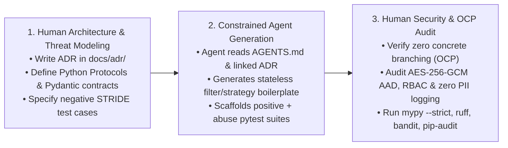

# AI Agent Usage & Human-in-the-Loop Governance Log (`docs/AI_USAGE.md`)

> **Project:** LLM Anonymization & Pseudonymization Pipeline  
> **Team Size:** 4 Engineers  
> **Governance Policy:** AI coding agents act strictly as constrained pair-programmers under [`AGENTS.md`](../AGENTS.md). Architectural decisions, security boundaries, and cryptographic invariants remain under 100% human ownership.

---

## 1. Human-in-the-Loop (HITL) Engineering Workflow

Our team enforces a 3-stage Human-in-the-Loop workflow for every feature and pull request:

### Stage 1: Human Interface Design & ADR Authorship
- Before prompting any AI agent to write production code, the responsible team member writes or updates the relevant **Architecture Decision Record (`docs/adr/00X-*.md`)** and defines exact Python 3.12 `Protocol` / `ABC` signatures and frozen Pydantic v2 models.
- Humans explicitly identify which STRIDE threats apply (from [`docs/security/STRIDE.md`](security/STRIDE.md)) and list the required negative/abuse test cases.

### Stage 2: Constrained Agent Code & Test Generation
- The developer invokes the AI agent with explicit context: `@AGENTS.md`, the target `ADR`, and the interface contract.
- The agent is tasked with implementing concrete strategies, builders, or unit/abuse test fixtures while obeying all constraints in `AGENTS.md` (no `if/elif` type switching in filters, no direct `VaultCore` access bypassing `VaultProxy`, zero hardcoded keys or jurisdictions).

### Stage 3: Human Security, Cryptography & OCP Review
- Every line of agent-generated code undergoes manual review by the author and at least one peer reviewer using the checklists in [`.github/pull_request_template.md`](../.github/pull_request_template.md):
  1. **Open-Closed Principle (OCP) Audit:** Confirm that adding a new `PIIDetector` or `AnonymizationStrategy` requires zero edits to `src/pipeline/`.
  2. **Encapsulation Audit:** Confirm `VaultCore` and `PipelineMemento` internals are never exposed or mutated outside their authorized boundaries.
  3. **Zero PII Leakage Audit:** Verify that `repr()`, `str()`, `AuditEvent` payloads, and exception messages never include raw PII/PHI substrings.

---

## 2. Pull Request AI Usage Log

### PR #2 — Pipes & Filters Core, PipelineBuilder, and Multi-Strategy PII/PHI Detectors (PL/US)
- **Branch:** `olaf` → `main`
- **Linked ADRs:** `ADR-001`, `ADR-002`, `ADR-003`, `ADR-007`, `ADR-008`, `ADR-009`
- **AI Agent / Model Used:** Gemini (Antigravity)
- **What Was Generated by the Agent:**
  - Boilerplate for immutable Pydantic v2 domain models (`src/domain/models.py`), domain exceptions (`src/domain/exceptions.py`), and dependency injection protocols (`src/domain/protocols.py`).
  - Stateless pipeline filters (`src/pipeline/filters.py`), `PipelineContext` (`src/pipeline/context.py`), `PipelineProxy` (`src/pipeline/proxy.py`), and fluent `PipelineBuilder` (`src/pipeline/builder.py`).
  - PL/US regex & mathematical checksum validators (`src/detectors/regex.py`), Transformer NER adapters (`src/detectors/ner.py`), context rule enhancers (`src/detectors/heuristic.py`), and strategy registries (`src/detectors/base.py`, `src/strategies/base.py`).
  - Unit, integration, and security abuse test suites (`tests/test_person_a_pipeline_and_detectors.py`).
- **What Required Manual Refactoring / Fixing by the Student:**
  - Simplified detector orchestration in `PIIDetectorFilter` and updated architecture documentation (`ARCHITECTURE.md`, `docs/adr/README.md`) to rely purely on the Strategy pattern and span conflict resolution (`resolve_overlapping_spans`) without redundant Composite wrappers.
  - Audited and verified strict Open-Closed Principle (OCP) compliance (zero concrete detector/entity branching inside pipeline filters), `mypy --strict` static typing across all modules, and zero raw PII leakage in `DetectedEntity` representations, exceptions, and audit events.

### [2026-11-12] PR #5: state,outbound: add Memento, Outbound Pipeline, synthesis, and retention
- **Author:** `@pTrenzi2005` | **PR:** [#5](https://github.com/gniewekk/Privacy-Preserving-Context-Pipeline-for-LLMs-DP/pull/5)
- **AI Agent / Model Used:** Antigravity (Gemini 4 Argon)
- **Prompt / Context Summary:**
  - Provided `@AGENTS.md`, `@ARCHITECTURE.md`, `@TEAM_TASKS_DIVISION.md`, and `ADR-005`/`006`/`007` to design and implement Osoba D's modules (Memento state restoration, Outbound Pipeline, SSE placeholder buffering, `SynthesisStrategy`, `ToolExecutionMiddleware`, and GDPR Art. 17 retention lifecycle) along with unit, PoC, and abuse tests.
- **What Was Generated by the Agent:**
  - `EntityMetadata`, `PipelineMemento`, `ResponseRestorer`, `RetentionPolicyEngine`, and `RetentionWorker` in `src/state/memento.py`
  - `OutputPIIDetector` and `StreamingResponseRestorer` in `src/pipeline/filters.py`
  - `SynthesisStrategy` and vault-backed `TokenizationStrategy` integration in `src/strategies/base.py`
  - `LLMDispatcher` protocol and `ToolExecutionMiddleware` in `src/dispatchers/__init__.py`
  - Test suite in `tests/test_person_d_state_outbound_lifecycle.py`
- **What Required Manual Refactoring / Fixing by the Student:**
  - Resolved circular type-import dependencies between `src/pipeline/`, `src/state/`, and `src/dispatchers/` using `TYPE_CHECKING` guards.
  - Removed concrete `EntityType` branching inside `ResponseRestorer` to strictly satisfy the zero-concrete-branching rule in `AGENTS.md` §3.1.
  - Renamed the retention audit enum member to `AuditAction.RETENTION_PURGE` to avoid Bandit `B105` false-positive heuristics on `TOKEN_*` strings.
  - Corrected synthetic PESEL test fixtures to satisfy Modulo-10 checksum validation in `RegexPIIDetector` and preserved expired `request_id` tombstones in `ResponseRestorer` after background worker eviction.
