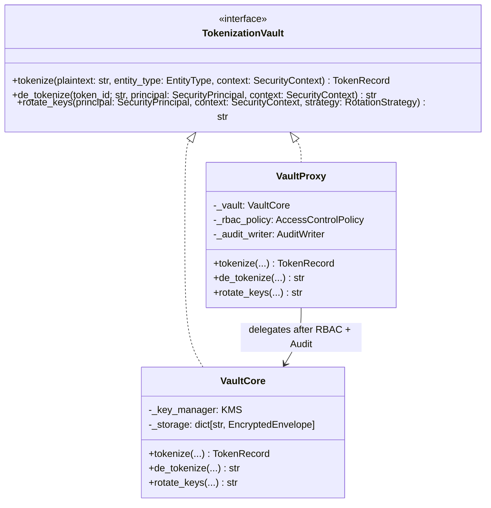

# ADR-004: Access-Controlled Cryptographic Token Vault via Protection Proxy

- **Status:** Accepted
- **Date:** 2026-11-10
- **Component:** `src/vault/` (`VaultProxy`, `VaultCore`, `KMS`)

---

## 1. Context & Problem

When `TokenizationStrategy` replaces sensitive PII (e.g., `Jan Kowalski`) with a pseudonym token (`<PERSON_1>`), the original plaintext must be encrypted and stored so it can be restored in the LLM's response for authorized callers (Scenario 1). However, this introduces three critical security requirements:
1. **Strict RBAC & Tenant Isolation (Scenario 2):** Unauthorized callers (e.g., an analytics role lacking `DETOKENIZE` permission or a principal from another tenant) must be blocked from detokenizing placeholders.
2. **Non-Repudiation & Mandatory Audit Trail (Scenario 2):** Every detokenization or key rotation request—especially **denied/unauthorized attempts**—must be recorded in an immutable audit log without exposing raw PII.
3. **Cryptographic Confidentiality, Integrity & Key Rotation (Scenario 5):** Stored tokens must use authenticated encryption (**AES-256-GCM**) tied to versioned keys (`key_id`) with strict TTL expiration so rotated keys and expired tokens are enforced transparently.

If RBAC checks and audit logging are scattered across pipeline filters, FastAPI endpoints, or mixed directly into low-level AES-256-GCM encryption code, a developer or AI agent could accidentally invoke the vault without performing an access check or writing an audit record.

---

## 2. Decision

We implement the **Protection Proxy Pattern** (`VaultProxy` in `src/vault/proxy.py`) wrapping the internal `VaultCore` (`src/vault/vault.py`).

### Architectural Rules Enforced
1. **Single Access Boundary:** `VaultCore` is package-private to `src/vault/`. All pipeline components (`TokenizationStrategy`, `ResponseRestorer`) depend exclusively on `TokenizationVault` and receive `VaultProxy`.
2. **Pre-Execution RBAC Gate & Post-Execution Audit:**
   - On `de_tokenize(token_id, principal, context)`:
     1. `VaultProxy` evaluates `principal` permissions (`Permission.DETOKENIZE`) and verifies `principal.tenant_id == context.tenant_id`.
     2. If unauthorized, `VaultProxy` emits an immutable `AuditEvent(action="DETOKENIZE", outcome="DENIED", principal_id=..., token_id=...)` and raises `UnauthorizedVaultAccessError` **before** touching `VaultCore`.
     3. If authorized, it delegates to `VaultCore.de_tokenize()`, which verifies token TTL (`expires_at`), fetches the versioned AES-256-GCM key via `KMS.get_key(envelope.key_id)`, verifies Associated Authenticated Data (`AAD = tenant_id || request_id || entity_type`), decrypts the ciphertext, and logs `outcome="GRANTED"`.
3. **Key Versioning & Lifecycle (`KMS`):**
   - Keys have explicit states: `ACTIVE` (used for new `tokenize` operations), `DEPRECATED` (rotated out for encryption, still valid for detokenizing unexpired tokens), and `EXPIRED` / `REVOKED` (rejected with `KeyExpiredError`).

---

## 3. Rejected Alternatives

### Alternative A: Inline RBAC & Audit Checks Inside `VaultCore`
Putting permission verification, audit logging, and AES-256-GCM encryption inside a single `VaultCore` class.
- **Why Rejected:** Violates Single Responsibility Principle (SRP). Mixing authorization policy and audit I/O with cryptographic primitives makes both harder to test and audit independently, and prevents swapping RBAC policies without modifying cryptographic storage code.

### Alternative B: Python Function Decorators (`@require_permission("DETOKENIZE")`) on FastAPI Endpoints
Checking permissions only at the HTTP controller layer.
- **Why Rejected:** Violates Defense-in-Depth / Zero Trust. Internal pipeline components, background workers, or agentic tool calls (Scenario 5.7 in `ARCHITECTURE.md`) could invoke detokenization without passing through the HTTP layer, bypassing both RBAC and audit logging.

---

## 4. Trade-offs & Consequences

### Positive
- **Impossible to Bypass Audit or RBAC:** Because all callers hold a reference to `VaultProxy`, every allowed and denied operation is guaranteed to be authorized and audited.
- **Clean Separation of Cryptography and Policy:** `VaultCore` focuses strictly on AES-256-GCM envelope encryption, nonce uniqueness, AAD binding, and key version lookup, while `VaultProxy` focuses on RBAC evaluation and audit emission.

### Negative / Mitigations
- **Indirection Layer:** Every vault call traverses the proxy wrapper. *Mitigation:* In-memory RBAC set check and structured audit event creation add <5 microseconds per call.

---

## 5. Compliance with Scenarios

- **Scenario 1 (Authorized Pseudonymization Restoration):** `VaultProxy` verifies the caller's `DETOKENIZE` claim, records a `GRANTED` audit event, and returns decrypted PII via `VaultCore`.
- **Scenario 2 (Unauthorized Detokenization Block + Audit):** An unauthorized caller is blocked at `VaultProxy`, receives `UnauthorizedVaultAccessError` with zero plaintext leakage, and triggers an immutable `DENIED` audit log entry.
- **Scenario 5 (Key Rotation & Token Expiration):** `VaultProxy` gates `rotate_keys()` to `KEY_ADMIN` principals, while `VaultCore` + `KMS` seamlessly decrypt legacy tokens under `DEPRECATED` keys and reject expired tokens or `REVOKED` keys.
