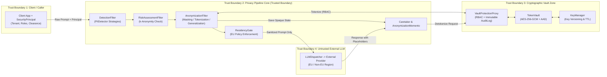

# STRIDE Threat Model & Scenario Verification Matrix (`docs/security/STRIDE.md`)

> **Project:** LLM Anonymization & Pseudonymization Pipeline  
> **Scope:** Inbound/Outbound Sanitization Pipeline (`DetectionFilter`, `RiskAssessmentFilter`, `AnonymizationFilter`, `ResidencyGate`), Cryptographic Storage (`VaultProtectionProxy`, `TokenVault`, `KeyManager`), State Restoration (`AnonymizationMemento`, `Caretaker`), and External Dispatch (`LLMDispatcher`).

---

## 1. Trust Boundaries & Data Classification

### Protected Assets
1. **Raw PII / PHI Payloads:** Names, Polish PESEL numbers, IBANs, medical diagnoses, contact details, and quasi-identifiers.
2. **Cryptographic Key Material (`KeyManager`):** 256-bit AES-GCM keys (`ACTIVE`, `DECRYPT_ONLY`, `REVOKED`).
3. **Token Mappings (`TokenVault` & `AnonymizationMemento`):** Encrypted envelopes (`ciphertext`, `nonce`, `AAD`, `key_id`, `expires_at`) and request-scoped placeholder bindings.
4. **Immutable Audit Trail (`AuditLogger`):** Tamper-evident records of all allowed and denied vault operations, residency blocks, and key lifecycle events.

---

## 2. STRIDE Threat Matrix by Component

| STRIDE Category | Target Component | Concrete Threat Description | Architectural Mitigation |
| :--- | :--- | :--- | :--- |
| **S — Spoofing** | `VaultProtectionProxy`, `LLMDispatcher` | 1. An attacker or compromised service spoofs a `SecurityPrincipal` or `tenant_id` to detokenize another tenant's PII. 2. A non-EU LLM endpoint spoofs its region metadata to bypass `ResidencyGate`. | • `VaultProtectionProxy` validates immutable `SecurityPrincipal` claims (`tenant_id`, role permissions) against both the Memento and AES-256-GCM Associated Authenticated Data (`AAD`). • `LLMDispatcher` endpoint metadata is statically signed/configured in `PipelineBuilder`, never accepted from untrusted request headers. |
| **T — Tampering** | `TokenVault`, `AnonymizationMemento`, `PipelineContext` | 1. Modifying ciphertext or swapping `token_id` envelopes between tenants in `TokenVault`. 2. Mutating `PipelineContext` or `AnonymizationMemento` in-flight to redirect `<PERSON_1>` to another token. | • **AES-256-GCM Authenticated Encryption:** Binds `tenant_id \| request_id \| entity_type` into GCM `AAD`. Any bit-flip or cross-tenant swap raises `VaultIntegrityError` (`InvalidTag`). • `PipelineContext` and `AnonymizationMemento` are frozen (`ConfigDict(frozen=True)`) and encapsulate internal mappings. |
| **R — Repudiation** | `VaultProtectionProxy`, `ResidencyGate`, `KeyManager` | A malicious insider or compromised service attempts unauthorized detokenization or key rotation and denies the action, or suppresses logs on failed attempts. | • `VaultProtectionProxy` writes an immutable, timestamped `AuditEvent` (containing `principal_id`, `tenant_id`, `action`, `token_id`, `outcome="GRANTED"\|"DENIED"`, and previous event SHA-256 chain hash) **before** raising `UnauthorizedVaultAccessError`. |
| **I — Information Disclosure** | `DetectionFilter`, `ResidencyGate`, `LLMDispatcher`, Exception/Log handlers | 1. Raw PHI/PII is dispatched to a US/non-EU LLM endpoint. 2. Quasi-identifiers (`age=34`, `city="Sępólno Krajeńskie"`, `gender="M"`) allow re-identifying a patient despite direct PII removal. 3. Raw PII leaks into stack traces, logs, or error messages. | • `ResidencyGate` enforces fail-closed EU residency blocking for PHI prior to `LLMDispatcher`. • `RiskAssessmentFilter` + `KAnonymityGeneralizationStrategy` enforce $k \ge k_{\text{target}}$. • Custom exceptions and Pydantic models scrub raw PII from `__repr__`, `__str__`, and `AuditEvent` records. |
| **D — Denial of Service** | `DetectionFilter` (`RegexPIIDetector`), `Caretaker`, `TokenVault` | 1. Catastrophic backtracking (ReDoS) via crafted regex input. 2. Memory exhaustion in `Caretaker` or `TokenVault` via uncollected mementos/tokens. | • Bounded, linear-time regex patterns with strict input length caps and checksum pre-filters. • Mandatory TTL (`expires_at`) and capacity eviction on both `AnonymizationMemento` in `Caretaker` and `EncryptedEnvelope` in `TokenVault`. |
| **E — Elevation of Privilege** | `VaultProtectionProxy`, `AnonymizationFilter`, `KeyManager` | 1. A standard caller with `TOKENIZE` access attempts `detokenize()` or `rotate_keys()`. 2. Developer/agent bypasses `VaultProtectionProxy` by calling `TokenVault` directly. 3. Prompt injection tricks the LLM into emitting `<PERSON_2>` tokens belonging to another session. | • Fine-grained `Permission` enum (`TOKENIZE`, `DETOKENIZE`, `ROTATE_KEYS`) enforced inside `VaultProtectionProxy`. • Direct `TokenVault` usage outside `src/vault/proxy.py` is forbidden by `AGENTS.md` and architectural tests. • Outbound restoration only resolves placeholders present in the caller's request-scoped `AnonymizationMemento`. |

---

## 3. Scenario-to-Mitigation & Abuse Test Mapping (Scenarios 1–6)

### Scenario 1: Pseudonymization & Authorized Response Restoration
- **Primary Threats:** Information Disclosure (I), Tampering (T), Elevation of Privilege (E).
- **Mitigations:**
  - Inbound `DetectionFilter` + `ReversibleTokenizationStrategy` replaces PII with `<PERSON_1>` and encrypts plaintext in `TokenVault` via `VaultProtectionProxy` using AES-256-GCM + `AAD`.
  - `SessionOriginator` captures `<PERSON_1> -> token_id` inside an immutable `AnonymizationMemento` managed by `Caretaker`.
  - Outbound restoration verifies caller authorization via `VaultProtectionProxy.detokenize()` and only restores placeholders bound to that specific request's `AnonymizationMemento`.
- **Planned Positive & Abuse Tests (`tests/security/test_scenario1_pseudonymization.py`):**
  - *Positive:* Authorized caller sends prompt with Polish name and PESEL; LLM sees only `<PERSON_1>` and `***********`; caller receives restored name in final response and `GRANTED` audit event is recorded.
  - *Abuse (Cross-Session Token Injection):* LLM response maliciously includes `<PERSON_99>` from another tenant/session; restoration filter ignores/blocks `<PERSON_99>` because it is absent from the request's `AnonymizationMemento` and AAD tenant check fails.
  - *Abuse (Ciphertext/AAD Tampering):* Flipping 1 bit in AES-256-GCM ciphertext or querying with mismatched `tenant_id` raises `VaultIntegrityError` and yields zero plaintext.

### Scenario 2: Unauthorized Detokenization Block & Audit Logging
- **Primary Threats:** Elevation of Privilege (E), Repudiation (R), Spoofing (S).
- **Mitigations:**
  - `VaultProtectionProxy` intercepts every `detokenize()` call, verifies `Permission.DETOKENIZE` on `SecurityPrincipal` and matches `principal.tenant_id == envelope.tenant_id`.
  - On failure, writes an immutable `AuditEvent(outcome="DENIED", reason="MISSING_PERMISSION" | "TENANT_MISMATCH")` and raises `UnauthorizedVaultAccessError`.
- **Planned Negative / Abuse Tests (`tests/security/test_scenario2_unauthorized_detokenization.py`):**
  - *Abuse (Missing Role Permission):* Principal with `ROLE_ANALYST` (only `Permission.TOKENIZE`) calls `detokenize()`; assert `UnauthorizedVaultAccessError` is raised, response contains zero plaintext, and `AuditLogger` contains a `DENIED` record with the caller's `principal_id`.
  - *Abuse (Cross-Tenant Principal Spoofing):* Principal from `tenant_B` attempts to detokenize a `token_id` created by `tenant_A` despite having `Permission.DETOKENIZE`; assert `UnauthorizedVaultAccessError` and `DENIED` audit event.
  - *Abuse (Zero PII in Error/Audit Logs):* Inspect `caplog`, audit records, and exception string to prove the underlying plaintext (`"Jan Kowalski"`) never appears anywhere.

### Scenario 3: EU Data Residency Gate for PHI
- **Primary Threats:** Information Disclosure (I), Tampering (T), Repudiation (R).
- **Mitigations:**
  - `ResidencyGate` filter inspects `PipelineContext.data_classification` and detected `EntityCategory.PHI` entities against `context.target_endpoint.region` using an injected `ResidencyPolicy`.
  - If `PHI` or EU-restricted data targets a non-EU endpoint (e.g., `us-east-1`), `ResidencyGate` records a `RESIDENCY_VIOLATION` audit event and raises `ResidencyViolationError` before `LLMDispatcher` is ever called.
- **Planned Negative / Abuse Tests (`tests/security/test_scenario3_data_residency.py`):**
  - *Abuse (PHI to Non-EU Endpoint):* Dispatch medical prompt containing `PHI` diagnosis to a mock `LLMDispatcher(region="us-east-1")`; assert `ResidencyViolationError` is raised, `dispatcher.call_count == 0`, and a `RESIDENCY_VIOLATION` audit event is logged.
  - *Positive (PHI to Approved EU Endpoint):* Same sanitized medical payload routed to `LLMDispatcher(region="eu-central-1")` succeeds after anonymization.

### Scenario 4: Re-Identification Risk & $k$-Anonymity Generalization
- **Primary Threats:** Information Disclosure via Linkage Attack (I).
- **Mitigations:**
  - `RiskAssessmentFilter` evaluates quasi-identifier combinations (e.g., exact age, small town, rare occupation/diagnosis) against the configured $k$-anonymity threshold.
  - `KAnonymityGeneralizationStrategy` iteratively generalizes quasi-identifiers up a `GeneralizationHierarchy` (`34` -> `30-39`, `"Sępólno Krajeńskie"` -> `"Kujawsko-Pomorskie"` -> `"Polska"`) until equivalence class size $k \ge k_{\text{target}}$. If $k$ still cannot be met at the root hierarchy, the pipeline fails closed with `ReIdentificationRiskError`.
- **Planned Positive & Abuse Tests (`tests/security/test_scenario4_k_anonymity.py`):**
  - *Positive (Generalization to satisfy $k$):* Input with high-risk quasi-identifiers (`age=34, city="Sępólno Krajeńskie"`) with $k_{\text{target}}=5$ is automatically generalized to age band and voivodeship/country before reaching the LLM.
  - *Abuse (Unmitigable Linkage Risk Fail-Closed):* Input with unique quasi-identifier combination where configured hierarchy cannot achieve $k_{\text{target}}=10$ raises `ReIdentificationRiskError` and blocks LLM dispatch.

### Scenario 5: Cryptographic Key Rotation & Token TTL Expiration
- **Primary Threats:** Information Disclosure via Key Compromise (I), Replay of Expired Tokens (T, E).
- **Mitigations:**
  - `KeyManager` assigns a unique `key_id` to every 256-bit AES-GCM key and tracks states (`ACTIVE`, `DECRYPT_ONLY`, `REVOKED`/`EXPIRED`).
  - `rotate_keys()` (gated by `VaultProtectionProxy` requiring `Permission.ROTATE_KEYS`) transitions the current `ACTIVE` key to `DECRYPT_ONLY` and generates a fresh `ACTIVE` key for all subsequent encryptions.
  - Every `EncryptedEnvelope` carries `key_id` and `expires_at` (TTL). Detokenizing an expired token raises `TokenExpiredError`; detokenizing a token whose `key_id` is `REVOKED`/`EXPIRED` raises `KeyExpiredError`.
- **Planned Positive & Abuse Tests (`tests/security/test_scenario5_key_rotation.py`):**
  - *Positive (Graceful Rotation Window):* Tokenize `T1` under `key_v1`; rotate keys to `key_v2` (`key_v1` becomes `DECRYPT_ONLY`); tokenize `T2` under `key_v2`; verify both `T1` and `T2` detokenize cleanly before TTL expiry.
  - *Abuse (Expired Token TTL):* Advance clock past `expires_at` and call `detokenize(T1)`; assert `TokenExpiredError` is raised and `DENIED` audit event is logged.
  - *Abuse (Revoked Key Access):* Mark `key_v1` as `REVOKED` and attempt `detokenize(T1)`; assert `KeyExpiredError` is raised.
  - *Abuse (Unauthorized Key Rotation):* Caller without `Permission.ROTATE_KEYS` calls `vault_proxy.rotate_keys()`; assert `UnauthorizedVaultAccessError` and `DENIED` audit event.

### Scenario 6 & Week 6 Change Request: Extensibility Without Core Modification (Polish IBAN)
- **Primary Threats:** Architectural Regression / Security Bypass during Extension (T, I).
- **Mitigations:**
  - New `PolishIBANDetector` (implementing ISO 13616 Modulo-97 checksum validation) and `IBANMaskingStrategy` implement `PIIDetector` and `AnonymizationStrategy` protocols and are registered via `PipelineBuilder` with zero edits to `src/pipeline/`.
- **Planned Verification Tests (`tests/security/test_scenario6_extensibility.py`):**
  - *Positive:* Register `PolishIBANDetector` via `PipelineBuilder` and verify valid `PL` 28-character IBANs are detected and anonymized while invalid Modulo-97 numbers are ignored.
  - *Abuse (Obfuscated IBAN Spacing):* Verify detector catches IBANs formatted with inconsistent whitespace or non-breaking spaces and never logs the raw IBAN string on error.
